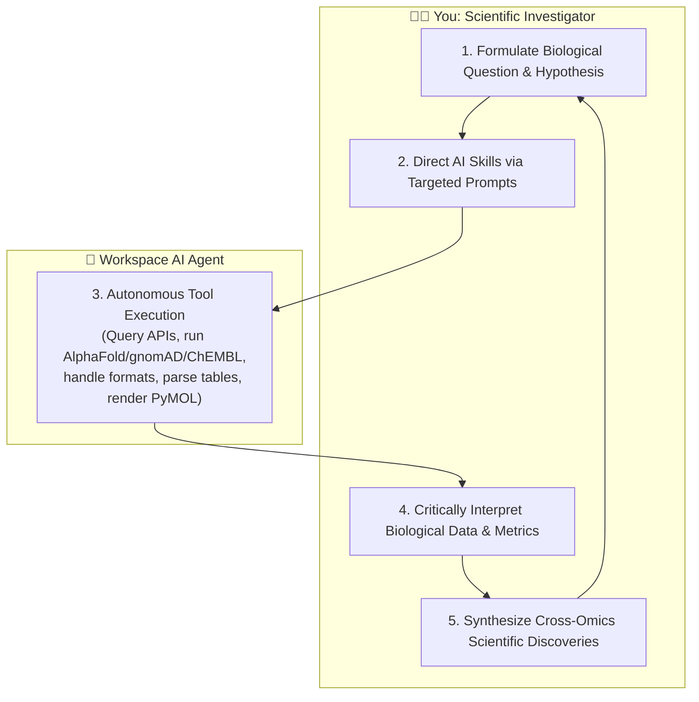

# Advanced Post-Master's Bioinformatics Curriculum
## 12-Week Interactive Syllabus: Mastering Scientific AI Skills Through Biological Investigation

Welcome to your advanced computational biology and bioinformatics study program.

This curriculum is designed specifically for a **Bioinformatics Master's graduate** with strong quantitative, analytical, and data science training who wants to:
1. **Develop Deep Biological Intuition**: Master the physical, biochemical, molecular, and physiological mechanisms behind genomics, structural biology, and pharmacology.
2. **Master the 40 Scientific AI Skills**: Learn how to orchestrate, interrogate, and critically evaluate state-of-the-art computational biology databases and AI models—**acting as a Principal Investigator without writing, debugging, or maintaining script code**.

---

## The Scientific Investigator Paradigm

In classical bioinformatics training, 80% of a researcher's time is spent wrestling with API keys, format conversions (BAM, VCF, GFF, PDB), rate limits, and bash scripting. 

In this curriculum, **the AI agent handles 100% of the software engineering, API mechanics, and script execution**. Your role is elevated to that of the **Lead Scientific Investigator**:

---

## 12-Week Curriculum Overview

| Phase | Weeks | Focus Area | Core Biological Mechanisms | Skills Mastered |
| :--- | :--- | :--- | :--- | :--- |
| **Phase 1** | **Weeks 1–2** | **Structural Biology & Protein Biophysics** | Hydrophobic collapse, Ramachandran steric angles, intrinsic disorder (IDRs), domain modularity, evolutionary fold conservation, catalytic pockets. | `alphafold-database-fetch-and-analyze`, `foldseek-structural-search`, `pdb-database`, `pymol`, `uniprot-database`, `interpro-database`, `protein-sequence-msa` |
| **Phase 2** | **Weeks 3–4** | **Regulatory Genomics & In Silico Mutagenesis** | Nucleosome packing, histone code (H3K4me3, H3K27ac), CTCF insulation, TF binding thermodynamics (PWMs), splicing machinery, cryptic splice sites, deep sequence-to-function models. | `encode-ccres-database`, `jaspar-database`, `unibind-database`, `ucsc-conservation-and-tfbs`, `alphagenome-single-variant-analysis`, `alphagenome-variant-impact-score`, `alphagenome-atlas-website-links` |
| **Phase 3** | **Weeks 5–6** | **Population Genetics & Clinical Variant Curation** | Purifying selection, neutral drift, allele frequency spectrum, haploinsufficiency, ACMG/AMP clinical variant interpretation framework (PVS1/PS/PM/PP/BA1). | `gnomad-database`, `clinvar-database`, `dbsnp-database`, `ensembl-database` |
| **Phase 4** | **Weeks 7–8** | **Multi-Omics & Systems Biology** | Central dogma dynamics (RNA $\ne$ protein abundance), cis/trans-eQTLs, subcellular spatial targeting, signaling cascades, scale-free interactome topology. | `gtex-database`, `human-protein-atlas-database`, `reactome-database`, `string-database`, `quickgo-database`, `embl-ebi-ols` |
| **Phase 5** | **Weeks 9–10** | **AI Target Discovery & Translational Pharmacology** | GWAS fine-mapping, linkage disequilibrium, Locus-to-Gene (L2G) machine learning, target tractability, binding kinetics (IC50, Ki, EC50), Lipinski rules, clinical trial phases. | `opentargets-database`, `chembl-database`, `pubchem-database`, `openfda-database`, `clinical-trials-database` |
| **Phase 6** | **Weeks 11–12** | **Automated Literature Mining & Agentic Workflows** | Evidence hierarchies, tracking resistance mutations, packaging multi-tool protocols into reusable AI agent skills, capstone projects. | `pubmed-database`, `literature-search-europepmc`, `literature-search-biorxiv`, `literature-search-openalex`, `workflow-skill-creator` |

---

## Detailed Weekly Modules & Investigation Guides

---

### Phase 1: Structural Biology & Protein Biophysics

#### Week 1: Protein Folding Thermodynamics, AlphaFold & Confidence Metrics
- **🔬 The Biological Phenomenon & Mechanism**:
  - *The Thermodynamic Driving Force*: A polypeptide collapses in water driven by the **hydrophobic effect**. Non-polar side chains (Leu, Ile, Val, Phe, Trp) disrupt the hydrogen-bonding network of water molecules; burying them inside an anhydrous core releases caged water molecules, maximizing system entropy ($\Delta S > 0$). Polar and charged residues remain on the surface to interact with solvent.
  - *Intrinsically Disordered Regions (IDRs)*: Segments depleted of bulky hydrophobic residues cannot drive hydrophobic collapse. They remain flexible, dynamic ensembles in solution. These IDRs act as flexible molecular linkers, signaling hubs, and post-translational modification sites.
  - *AlphaFold Metric Interpretation*:
    - **pLDDT (0–100)**: Local backbone accuracy. $>90$ indicates atomic-level accuracy suitable for drug design; $70-90$ is reliable backbone fold; $<50$ is the direct physical fingerprint of an **intrinsically disordered region (IDR)**, *not* an algorithmic failure.
    - **PAE (Predicted Aligned Error)**: Measures relative distance error between pairs of residues. When residue $x$ is in Domain 1 and residue $y$ is in Domain 2, low PAE proves that the two domains form a rigid, locked multi-domain assembly. High PAE indicates that each domain folds independently, connected by a flexible linker.
- **🎯 Skill Selection Matrix**:
  - Use `alphafold-database-fetch-and-analyze` when you have a UniProt ID and need pLDDT confidence, domain boundaries, or disorder assessment.
  - Use `pdb-database` when you need experimentally validated X-ray crystallographic, Cryo-EM, or NMR coordinates with co-crystallized small-molecule ligands.
  - Use `uniprot-database` to map sequence feature annotations (catalytic triads, zinc fingers, signal peptides).
- **🗣️ Ready-to-Use Investigation Prompts**:
  - *Primary Inquiry*:
    > *"Using the AlphaFold skill, retrieve the 3D predicted structure and PAE matrix for human Tumor Suppressor p53 (UniProt: P04637). Break down the pLDDT confidence across its functional domains (N-terminal transactivation domain, central DNA-binding domain, C-terminal tetramerization domain), and determine from the PAE matrix which regions are rigid versus disordered."*
  - *Deeper Follow-Up*:
    > *"Cross-reference this with the PDB database to find experimental structures of the p53 DNA-binding domain bound to DNA. How does the experimental structure compare to AlphaFold's high-confidence region?"*
- **📊 Interpreting the Output as a Scientist**:
  - Notice that residues 1–61 and 363–393 have pLDDT $<50$ and high PAE ($>25\text{ \AA}$). This indicates true conformational plasticity (IDR), which allows p53 to bind multiple regulatory proteins (MDM2, CBP/p300).
  - Notice that residues 102–292 have pLDDT $>90$ and low PAE ($<5\text{ \AA}$). This is the rigid, globular DNA-binding core where 80% of human cancer mutations reside.
- **🧠 Biological Synthesis Questions**:
  1. Why do oncogenic hotspot mutations in p53 (e.g., R175H, R248Q, R273H) cluster in the high-pLDDT DNA-binding domain rather than in the disordered termini?
  2. If a cancer patient has a missense mutation in a loop with pLDDT 35, is it likely to destabilize protein tertiary structure, or disrupt a linear interaction motif?

---

#### Week 2: 3D Structural Homology, Pocket Architecture & Molecular Rendering
- **🔬 The Biological Phenomenon & Mechanism**:
  - *Evolution Conserves Folds, Not Sequences*: Tertiary 3D structure is preserved 3 to 10 times longer across evolutionary time than linear amino acid sequence. Two proteins sharing $<20\%$ sequence identity (the classical "twilight zone" where BLAST fails) often share identical active site geometries and catalytic mechanisms.
  - *Foldseek 3Di Geometry*: Instead of comparing 3D atomic coordinates directly (which is computationally slow), Foldseek translates 3D backbone conformations into a 20-character structural alphabet ("3Di"), enabling instantaneous search of a query structure against the entire 200-million-structure AlphaFold database.
  - *Active Site Pocket Chemistry*: Enzymes position catalytic residues in deep, concave hydrophobic clefts shielded from bulk water. Excluding water increases the effective electrostatic field strength, lowering the activation energy barrier for chemical catalysis.
- **🎯 Skill Selection Matrix**:
  - Use `foldseek-structural-search` when you have a 3D coordinate file (`.cif` or `.pdb`) and want to find structural homologs or infer function for uncharacterized proteins.
  - Use `pymol` to produce headless, publication-quality 3D renders, highlight binding pockets, and export interactive `.pse` session files.
  - Use `interpro-database` to identify conserved protein families, domains, and Pfam architectures.
- **🗣️ Ready-to-Use Investigation Prompts**:
  - *Primary Inquiry*:
    > *"Fetch the AlphaFold structure for human BRAF kinase (UniProt: P15056). Then, use Foldseek to search its kinase domain against the PDB100 database to identify experimentally solved kinase structures with high 3D structural alignment. What are the top hits and their alignment metrics?"*
  - *PyMOL Visualization*:
    > *"Use PyMOL to generate a high-resolution cartoon rendering of the BRAF kinase domain. Color the overall structure in cyan, highlight the catalytic loop and ATP-binding cleft in yellow, and render the cancer hotspot residue Val600 as red sticks. Save both a PNG image and a PyMOL .pse session."*
- **📊 Interpreting the Output as a Scientist**:
  - Look for the Foldseek `TM-score` ($>0.5$ indicates the same global fold; $>0.8$ indicates identical fold family).
  - Observe how the kinase active site cleft in the PyMOL render forms an enclosed hydrophobic pocket lined with conserved residues (Lys483, Glu501, Asp594).
- **🧠 Biological Synthesis Questions**:
  1. Why does mutating Valine 600 to Glutamic acid (V600E) cause constitutive kinase activation without requiring upstream RAS activation? (Hint: Glutamic acid introduces a negative charge that mimics the phosphate group of regulatory phosphorylation, flipping the activation loop into the active conformation).

---

### Phase 2: Regulatory Genomics & In Silico Mutagenesis

#### Week 3: The Cis-Regulatory Code, Chromatin Accessibility & TF Motifs
- **🔬 The Biological Phenomenon & Mechanism**:
  - *Chromatin Compaction & Accessibility*: 2 meters of human DNA are packaged around histone octamers ($H2A, H2B, H3, H4$). Dense heterochromatin physically occludes transcription factors; open euchromatin permits regulatory access.
  - *The Histone Post-Translational Code*:
    - **H3K4me3**: Strongly marks active transcription start sites (Promoters).
    - **H3K27ac**: Hallmarks active Enhancers (acetylation neutralizes basic lysine positive charges, loosening electrostatic attraction to negatively charged DNA).
    - **H3K27me3**: Polycomb-mediated repressive mark.
  - *CTCF Insulators & TADs*: Chromatin is folded into Topologically Associating Domains (TADs) anchored by CTCF homodimers and cohesin rings. These boundaries prevent enhancers in one domain from aberrantly activating proto-oncogenes in an adjacent domain.
  - *Transcription Factor Binding Dynamics*: TFs recognize short, degenerate 6–15 bp motifs. Position Weight Matrices (PWMs) quantify binding preference, but $<1\%$ of matching motifs in naked DNA are bound in vivo because binding requires open chromatin and cooperative pioneer factors.
- **🎯 Skill Selection Matrix**:
  - Use `encode-ccres-database` to query the SCREEN registry for candidate Promoters (PLS), Proximal Enhancers (pELS), Distal Enhancers (dELS), and CTCF boundaries.
  - Use `jaspar-database` to retrieve transcription factor PWM models and consensus sequence logos.
  - Use `unibind-database` to obtain direct, experimentally validated ChIP-seq binding intervals.
  - Use `ucsc-conservation-and-tfbs` to assess evolutionary base-pair conservation (phyloP) across vertebrates.
- **🗣️ Ready-to-Use Investigation Prompts**:
  - *Primary Inquiry*:
    > *"Query ENCODE for candidate cis-regulatory elements (cCREs) around the MYC oncogene locus on chromosome 8 (chr8:127,730,000-127,750,000). Classify the elements into promoters, proximal enhancers, and distal enhancers."*
  - *TF Motif Cross-Validation*:
    > *"Fetch the JASPAR binding matrix for the architectural factor CTCF (Matrix ID: MA0139.1). Then, query UniBind to verify whether experimental ChIP-seq binding peaks for CTCF coincide with the insulated boundaries of the MYC locus."*
- **📊 Interpreting the Output as a Scientist**:
  - In ENCODE results, check the "Type A" high-confidence biosample designations (experiments having all four core epigenetic marks: DNase, H3K4me3, H3K27ac, CTCF).
  - High phyloP scores ($>2.0$) within non-coding cCREs confirm that natural selection has preserved the regulatory sequence across tens of millions of years.
- **🧠 Biological Synthesis Questions**:
  1. Why can an enhancer located 200 kb away regulate a promoter just as strongly as one located 200 bp away? (Mechanism: 3D chromatin looping brings the distal enhancer into physical contact with the promoter at the transcription factory).
  2. What happens if a somatic microdeletion eliminates a CTCF insulator boundary between a super-enhancer and an oncogene? (Phenomenon: "Enhancer hijacking", leading to oncogene over-expression).

---

#### Week 4: Deep Learning Splicing & In Silico Saturation Mutagenesis (AlphaGenome)
- **🔬 The Biological Phenomenon & Mechanism**:
  - *The Splicing Machinery*: Pre-mRNA is spliced by the spliceosome to excise non-coding introns. The spliceosome recognizes four critical sequence elements:
    1. **5' Splice Donor**: Invariant `GU` dinucleotide.
    2. **3' Splice Acceptor**: Invariant `AG` dinucleotide.
    3. **Branch Point**: Conserved Adenosine that initiates nucleophilic attack, forming the lariat.
    4. **Polypyrimidine Tract**: Pyrimidine-rich (U/C) tract preceding the 3' AG.
  - *Cryptic Splice Sites & Intron Retention*: A single base substitution can create a de novo `GU` or `AG` motif or abolish an Exonic Splicing Enhancer (ESE). The spliceosome recognizes the cryptic site, resulting in exon skipping or frame-shifted transcripts degraded by Nonsense-Mediated Decay (NMD).
  - *In Silico Saturation Mutagenesis (ISM)*: Modern deep sequence-to-function models (AlphaGenome) learn regulatory grammar directly from raw DNA sequences, enabling in silico perturbation of every base pair in a window to predict chromatin accessibility, histone mark, and expression changes without wet-lab experiments.
- **🎯 Skill Selection Matrix**:
  - Use `alphagenome-single-variant-analysis` to predict the impact of a variant on chromatin accessibility (DNASE), transcription factor binding, and gene expression (RNA-seq).
  - Use `alphagenome-variant-impact-score` to compute AlphaGenome Variant Impact (AVI) scores.
  - Use `alphagenome-atlas-website-links` to construct deep links for interactive visual exploration on the AlphaGenome Atlas.
- **🗣️ Ready-to-Use Investigation Prompts**:
  - *Primary Inquiry*:
    > *"Analyze the canonical non-coding TERT promoter mutation (chr5:1,295,228 C>T). Use AlphaGenome single variant analysis to evaluate its predicted impact on chromatin accessibility, transcription factor binding, and gene expression. Generate the AlphaGenome Atlas interactive links."*
  - *Splicing Disruption Inquiry*:
    > *"Check if any known pathogenic variants near the exon-intron junctions of CFTR or BRCA1 are predicted to disrupt canonical splicing or activate cryptic splice donors using AlphaGenome splicing interpretation."*
- **📊 Interpreting the Output as a Scientist**:
  - Examine the $\Delta$ chromatin accessibility and $\Delta$ expression values. A positive $\Delta$ expression score indicates transcriptional activation.
  - Check whether the mutation creates a de novo binding site for ETS/GABP transcription factors (`CCCGGAAGGGG`), explaining how a non-coding mutation drives immortalization in glioblastomas and bladder cancers.
- **🧠 Biological Synthesis Questions**:
  1. Why does the TERT C228T promoter mutation cause cancer without changing a single amino acid in the TERT protein?
  2. How can an exonic synonymous ("silent") mutation cause loss of protein function? (Mechanism: disrupting an exonic splicing enhancer, leading to whole-exon skipping).

---

### Phase 3: Population Genetics & Clinical Variant Interpretation

#### Week 5: Natural Selection, Allele Frequencies & Gene Constraint (gnomAD)
- **🔬 The Biological Phenomenon & Mechanism**:
  - *The Allele Frequency Spectrum*:
    - **Common variants ($MAF > 5\%$)**: Generally ancient, neutral or very weakly selected; contribute to common polygenic traits via small additive effect sizes.
    - **Rare variants ($MAF < 0.1\%$)**: Fresh mutations subject to **purifying (negative) selection** if deleterious. Severe, early-onset Mendelian diseases are almost exclusively caused by rare variants.
  - *Gene Constraint Metrics (Intolerance to Functional Variation)*:
    - **pLI (Probability of Loss-of-function Intolerance)**: $\ge 0.90$ indicates extreme **haploinsufficiency**—losing one copy of the gene causes disease or lethality.
    - **LOEUF (Loss-of-function Observed/Expected Upper Bound Fraction)**: Ranks all ~20,000 human genes on a continuous scale. Low LOEUF (e.g., $<0.35$) means the gene cannot tolerate loss-of-function mutations; high LOEUF ($>1.0$) means LoF mutations are well-tolerated.
    - **Missense Z-score**: Positive scores indicate fewer missense mutations than expected by neutral mutation models.
- **🎯 Skill Selection Matrix**:
  - Use `gnomad-database` to retrieve ancestral population allele frequencies and gene constraint metrics (pLI, LOEUF).
  - Use `dbsnp-database` to resolve rsIDs, check GRCh38 genomic coordinates, and convert between VCF and HGVS nomenclature.
  - Use `ensembl-database` to inspect transcript structures, exon numbers, and cross-species orthology.
- **🗣️ Ready-to-Use Investigation Prompts**:
  - *Primary Inquiry*:
    > *"Compare the evolutionary constraint metrics in gnomAD between SCN1A (voltage-gated sodium channel linked to Dravet syndrome) and OR2T1 (olfactory receptor). Retrieve pLI, LOEUF, and missense constraint scores. Explain what these numbers reveal about the biological essentiality of each gene."*
  - *Population Allele Frequency Inquiry*:
    > *"Look up the sickle cell anemia variant in HBB (rs334, p.Glu6Val) in dbSNP and gnomAD. What are its allele frequencies across African, European, East Asian, and Latino populations? How does this reflect the evolutionary concept of balancing selection (malaria resistance)?"*
- **📊 Interpreting the Output as a Scientist**:
  - In gnomAD constraint output, check `oe_lof` (observed over expected loss-of-function variants). For *SCN1A*, observing 5 LoF variants when 60 were expected yields a LOEUF $<0.2$, proving intense purifying selection.
  - For olfactory receptors, `oe_lof` is often near $1.0$, proving that losing copies is evolutionary neutral in humans.
- **🧠 Biological Synthesis Questions**:
  1. Why do neurodevelopmental and cardiac transcription factor genes typically have LOEUF $<0.25$, while immune receptor genes often have LOEUF $>1.0$?
  2. If a variant is reported as "pathogenic" in an old literature case report, but you find its allele frequency is $3\%$ in healthy gnomAD European adults, what should you conclude? (Answer: Almost certainly benign; high population frequency refutes high-penetrance severe disease).

---

#### Week 6: Clinical Pathogenicity Classification (ACMG/AMP Framework)
- **🔬 The Biological Phenomenon & Mechanism**:
  - *Mendelian Disease Architecture*: Autosomal dominant vs. recessive, penetrance (probability of phenotype given genotype), and variable expressivity.
  - *The ACMG/AMP 5-Tier Classification*:
    - **Pathogenic / Likely Pathogenic / VUS / Likely Benign / Benign**.
  - *Key Evidence Categories*:
    - **PVS1 (Very Strong)**: Null variant (nonsense, frameshift, canonical $\pm 1, 2$ splice) in a gene where loss-of-function is an established disease mechanism.
    - **PS1–4 (Strong)**: Same amino acid change as known pathogenic variant; de novo occurrence; functional assays demonstrate loss of function; case-control enrichment.
    - **PM1–6 (Moderate)**: Located in a mutational hotspot or critical functional domain; extremely rare in population databases (gnomAD); novel missense at a residue where another pathogenic change is known.
    - **PP1–5 (Supporting)**: Co-segregation with disease; computational in silico predictions agree on deleterious effect; phenotype matches specific syndrome.
    - **BA1 (Stand-alone Benign)**: Allele frequency $>5\%$ in gnomAD.
- **🎯 Skill Selection Matrix**:
  - Use `clinvar-database` to query clinical submissions, review status (0 to 4 stars), and conflicting interpretations.
  - Use `ensembl-database` to run Ensembl VEP (Variant Effect Predictor) to obtain consequence types and SIFT/PolyPhen scores.
- **🗣️ Ready-to-Use Investigation Prompts**:
  - *Primary Inquiry*:
    > *"Search ClinVar for variants in the LDLR gene (Familial Hypercholesterolemia). Identify a Variant of Uncertain Significance (VUS), inspect its submitted evidence, and check its population allele frequency in gnomAD. Run Ensembl VEP to evaluate its molecular consequence. Does the cumulative evidence favor pathogenic, benign, or remaining VUS?"*
  - *Resolving Conflicting Submissions*:
    > *"Look up BRCA1 c.5095C>T (p.Arg1699Trp, rs55770732) in ClinVar. Review the submitter assertions. How do expert panel reviews (ENIGMA) resolve historical conflicts between benign and pathogenic calls for this variant?"*
- **📊 Interpreting the Output as a Scientist**:
  - Review the ClinVar "Review Status" stars (3 stars = expert panel reviewed; 4 stars = practice guideline). Expert panel assertions override individual commercial lab submissions.
- **🧠 Biological Synthesis Questions**:
  1. Why does a nonsense mutation located in the last 50 nucleotides of the penultimate exon or in the terminal exon fail to trigger Nonsense-Mediated Decay (NMD)? (Mechanism: Spliceosome deposits Exon Junction Complexes / EJCs; NMD is only triggered when a ribosome encounters a stop codon $>50$ nt upstream of the final EJC).

---

### Phase 4: Multi-Omics, Spatial Proteomics & Systems Biology

#### Week 7: Transcriptomics, eQTLs & Spatial Protein Localization
- **🔬 The Biological Phenomenon & Mechanism**:
  - *The Central Dogma Disconnect (RNA $\ne$ Protein)*: Transcription does not equal protein abundance. Cellular protein levels depend on mRNA secondary structure, translation initiation rates, ribosomal elongation, and protein degradation via the ubiquitin-proteasome system. Across human tissues, the correlation between mRNA TPM and protein abundance is only $0.40 - 0.60$.
  - *eQTL Mechanics (GTEx)*:
    - **cis-eQTL**: A genetic variant within 1 Mb of a gene that alters promoter/enhancer binding affinity, directly modulating steady-state mRNA levels in specific tissues.
    - **Tissue Specificity**: Most eQTLs operate only in tissues where the necessary cell-lineage transcription factors are expressed.
  - *Spatial Proteomics & Subcellular Targeting (Human Protein Atlas)*: Knowing that a protein is translated is insufficient; it must reach its designated cellular compartment (nucleus, mitochondria, lysosome, plasma membrane, or secreted into circulation) to function.
- **🎯 Skill Selection Matrix**:
  - Use `gtex-database` to obtain baseline median TPM across 54 human tissues and extract significant cis-eQTLs with Normalized Effect Sizes (NES).
  - Use `human-protein-atlas-database` to retrieve immunohistochemistry (IHC) tissue protein abundance and confocal immunofluorescence subcellular localization.
- **🗣️ Ready-to-Use Investigation Prompts**:
  - *Primary Inquiry*:
    > *"Examine PCSK9 using GTEx and the Human Protein Atlas. Retrieve its median TPM expression across all 54 GTEx tissues. In which tissue is it predominantly expressed? Then, query HPA to determine its IHC protein staining and subcellular localization. Does PCSK9 follow the ER-to-Golgi secretory pathway?"*
  - *eQTL Association Inquiry*:
    > *"Query GTEx for significant cis-eQTLs associated with PCSK9 in liver tissue. What is the top variant, its normalized effect size (NES), and p-value?"*
- **📊 Interpreting the Output as a Scientist**:
  - Notice that *PCSK9* expression in GTEx is overwhelmingly concentrated in the liver ($>95\%$ of transcripts), with trace expression in small intestine and kidney.
  - In HPA, observe its localization to the endoplasmic reticulum and Golgi apparatus, consistent with a secreted protease that enters systemic blood circulation.
- **🧠 Biological Synthesis Questions**:
  1. How does hepatic secretion of PCSK9 into blood plasma enable it to regulate LDL receptors on distant cells, and why does inhibiting extracellular PCSK9 with antibodies lower blood cholesterol?
  2. If an eQTL variant in the liver increases PCSK9 mRNA expression by 40%, what physiological effect do you expect on circulating LDL particles and cardiovascular risk?

---

#### Week 8: Biochemical Pathways, Reaction Mechanisms & Interactomes
- **🔬 The Biological Phenomenon & Mechanism**:
  - *Enzymatic Cascades & Signal Amplification*: Intracellular signaling is organized into enzymatic cascades (e.g., MAPK/ERK: Ras $\to$ Raf $\to$ MEK $\to$ ERK). Kinase phosphorylation acts as a molecular switch, amplifying weak extracellular receptor binding into massive transcriptional programs.
  - *Biochemical Reactions vs. Abstract Pathways*: In Reactome, a pathway is not just an arbitrary gene list—it is an ordered directed graph of concrete biochemical reactions with stoichiometrically defined inputs, outputs, enzyme catalysts, and allosteric regulators.
  - *Interactome Networks (STRING)*:
    - **Scale-Free Topology**: Biological networks follow a power-law degree distribution. Most proteins have few interaction partners, while a small number of "hub proteins" have hundreds of connections.
    - **Hub Vulnerability**: Disrupting a network hub (e.g., TP53, UBC, EGFR) often causes cellular lethality or pleiotropic phenotypes, whereas peripheral nodes tolerate perturbations.
- **🎯 Skill Selection Matrix**:
  - Use `reactome-database` to perform pathway over-representation analysis, inspect reaction mechanics, and export pathway diagrams.
  - Use `string-database` to construct protein-protein interaction (PPI) networks, extract interaction confidence scores, and analyze topological clustering.
  - Use `quickgo-database` and `embl-ebi-ols` to traverse the Gene Ontology Directed Acyclic Graph (DAG) across Biological Process, Molecular Function, and Cellular Component.
- **🗣️ Ready-to-Use Investigation Prompts**:
  - *Primary Inquiry*:
    > *"Build a protein-protein interaction network in STRING for the core cholesterol clearance machinery: PCSK9, LDLR, APOB, LDLRAP1, and HMGCR (species: human, Taxon 9606). Check interaction confidence scores and clustering. Which protein acts as the central hub of this network?"*
  - *Reaction Mechanism Tracing*:
    > *"Query Reactome for the pathway 'Receptor-mediated endocytosis of LDLR'. Extract the specific chemical reactions detailing how PCSK9 binds the EGF-A domain of LDLR, preventing the conformational change required for receptor recycling, and directing LDLR to lysosomal destruction."*
- **📊 Interpreting the Output as a Scientist**:
  - In STRING output, distinguish between "physical interaction" scores (co-immunoprecipitation, crystallographic complexes) and "functional association" scores (co-expression, text-mining co-occurrence).
  - In Reactome, identify the catalytic role of enzymes and the subcellular compartment of each reaction.
- **🧠 Biological Synthesis Questions**:
  1. Why are drugs that target "hub proteins" in a PPI network more prone to severe adverse side effects than drugs targeting peripheral pathway nodes?

---

### Phase 5: Translational Bioinformatics & AI Drug Discovery

#### Week 9: Target Validation, L2G & Druggability Assessment
- **🔬 The Biological Phenomenon & Mechanism**:
  - *The GWAS Locus-to-Gene Dilemma*: GWAS identifies statistical genomic intervals (credible sets of SNPs in Linkage Disequilibrium, LD). In ~50% of loci, the nearest gene is **not** the true causal gene! Enhancers loop through 3D nuclear space to activate distant genes while skipping proximal promoters.
  - *Open Targets Locus-to-Gene (L2G)*: Uses machine learning to integrate distance, molecular QTL colocalization (eQTL, pQTL, sQTL), chromatin interactions (Promoter Capture Hi-C), and functional annotations (VEP, CADD) to score causal gene probability ($0.0 - 1.0$).
  - *Target Tractability Modalities*:
    - **Small Molecules**: Target must have an accessible, concave hydrophobic binding pocket ($>300\text{ \AA}^3$).
    - **Monoclonal Antibodies**: Target must be exposed on the outer surface of the plasma membrane or secreted into the bloodstream.
    - **PROTACs (Proteolysis Targeting Chimeras)**: Bifunctional molecules recruiting E3 ligases to degrade undruggable proteins lacking catalytic pockets.
- **🎯 Skill Selection Matrix**:
  - Use `opentargets-database` to query target-disease associations, retrieve L2G prioritization scores, inspect GWAS credible sets, and assess target tractability.
- **🗣️ Ready-to-Use Investigation Prompts**:
  - *Primary Inquiry*:
    > *"Query the Open Targets Platform for Rheumatoid Arthritis (MONDO_0008383). Retrieve the top genetically associated drug targets. For the top kinase target (e.g., JAK1), extract its tractability profile across small molecules and antibodies, and inspect its clinical safety and trial precedents."*
  - *L2G Causal Gene Prioritization*:
    > *"Query Open Targets for a known Crohn's disease or Type 2 Diabetes GWAS locus. Extract the credible set variants and the Locus-to-Gene (L2G) scores. Which gene is predicted as the true causal target, and what evidence drives the score?"*
- **📊 Interpreting the Output as a Scientist**:
  - Check the Open Targets overall association score ($0.0 - 1.0$), which aggregates evidence from genetics, somatic mutations, pathways, and animal models. Targets with strong human genetic evidence have a $2\times$ higher approval rate in clinical trials.
- **🧠 Biological Synthesis Questions**:
  1. Why can TNF be targeted effectively with a monoclonal antibody (Adalimumab) while JAK1 requires an orally bioavailable small molecule (Tofacitinib)? (Mechanism: TNF is an extracellular secreted cytokine accessible to antibodies; JAK1 is an intracellular kinase shielded behind the plasma membrane).

---

#### Week 10: Cheminformatics, Pharmacodynamics & Clinical Translation
- **🔬 The Biological Phenomenon & Mechanism**:
  - *Pharmacodynamics & Binding Kinetics*:
    - **IC50**: Drug concentration inhibiting enzyme activity by 50%.
    - **Ki (Inhibition Constant)**: True thermodynamic equilibrium dissociation constant of the enzyme-inhibitor complex ($K_i = [E][I]/[EI]$); independent of substrate concentration.
    - **EC50**: Effective concentration producing 50% maximal cellular response.
  - *Lipinski's Rule of 5 for Oral Bioavailability*:
    - Molecular Weight $<500\text{ Da}$, $\log P < 5$, H-bond donors $\le 5$, H-bond acceptors $\le 10$.
  - *Off-Target Liability & Clinical Trials*:
    - Kinase inhibitors often cross-react with other kinases due to ATP pocket homology, causing toxicities (e.g., hERG channel block causing cardiac arrhythmia / QT prolongation).
    - **Phase 1** (Safety/PK in healthy volunteers or refractory cancer) $\to$ **Phase 2** (Efficacy proof-of-concept in target patients) $\to$ **Phase 3** (Large randomized pivotal trials) $\to$ **Phase 4** (Post-marketing surveillance in openFDA).
- **🎯 Skill Selection Matrix**:
  - Use `chembl-database` to query approved drugs, target bioactivities, IC50/Ki values, and assay types.
  - Use `pubchem-database` to retrieve 2D/3D chemical structures, canonical SMILES, InChIKeys, and molecular properties.
  - Use `openfda-database` to inspect FDA adverse event reports (FAERS), recalls, and drug labels.
  - Use `clinical-trials-database` to search clinical trials via APIv2 (NCT ID, phase, recruitment status, primary completion date).
- **🗣️ Ready-to-Use Investigation Prompts**:
  - *Primary Inquiry*:
    > *"Search ChEMBL for bioactivity values (IC50) of small molecules targeting EGFR (CHEMBL203). Find Osimertinib (CHEMBL3353410), retrieve its chemical structure and SMILES in PubChem, check openFDA for reported adverse events, and query ClinicalTrials.gov for active Phase 3 clinical trials."*
  - *Comparing Drug Generations*:
    > *"Query ChEMBL to compare the IC50 of 1st-generation Gefitinib versus 3rd-generation Osimertinib against the EGFR T790M resistance mutant. Explain the structural reason for the difference."*
- **📊 Interpreting the Output as a Scientist**:
  - Check whether the IC50 is in the nanomolar ($nM$) range. Sub-10 $nM$ potency is typical for clinical-stage kinase inhibitors.
  - Notice the covalent acrylamide warhead in Osimertinib's SMILES (`C=CC(=O)N...`) that forms an irreversible covalent bond with Cys797 in EGFR.
- **🧠 Biological Synthesis Questions**:
  1. Why did 1st-generation EGFR inhibitors (Gefitinib) fail after 10–14 months of therapy in lung cancer patients, and how does the T790M "gatekeeper" mutation physically block Gefitinib binding? (Mechanism: Methionine is bulkier than Threonine, sterically clashing with Gefitinib's aniline ring while increasing affinity for ATP).

---

### Phase 6: Automated Literature Mining & Agentic Workflows

#### Week 11: Scientific Literature Mining & Knowledge Graphs
- **🔬 The Biological Phenomenon & Mechanism**:
  - *Evidence Synthesis & Conflicting Literature*: With $>1.5$ million papers published annually, experimental reports frequently contradict one another due to cell-line-specific artifacts or differing assay conditions. Systematic literature mining extracts consensus and establishes evidence hierarchies.
  - *Preprint Surveillance*: Groundbreaking discoveries (such as newly emerged oncogenic resistance mutations or single-cell foundation models) appear on **bioRxiv** and **arXiv** months before formal journal peer review.
- **🎯 Skill Selection Matrix**:
  - Use `pubmed-database` for structured medical literature search and linking PubMed IDs to genes/compounds.
  - Use `literature-search-europepmc` to query Europe PMC and retrieve full-text open-access XML articles.
  - Use `literature-search-biorxiv` to monitor preprints by date range and subject categories.
  - Use `literature-search-openalex` to query scholarly knowledge graphs, citation impact, and concept hierarchies.
- **🗣️ Ready-to-Use Investigation Prompts**:
  - *Primary Inquiry*:
    > *"Search Europe PMC and bioRxiv for papers published in the last 12 months regarding resistance mutations to KRAS G12C inhibitors (such as Sotorasib or Adagrasib). Download the key abstracts and summarize the reported secondary mutations (e.g., Y96D, R68S)."*
  - *Citation Graph Exploration*:
    > *"Query OpenAlex for the seminal AlphaFold 2 paper published in Nature (2021). Retrieve its citation count, top citing concepts, and identify 3 highly cited follow-up papers focusing on structural drug discovery."*
- **📊 Interpreting the Output as a Scientist**:
  - Synthesize biological themes from abstracts: What biochemical mechanism mediates resistance? (e.g., secondary switch-II pocket mutations preventing covalent drug engagement).
- **🧠 Biological Synthesis Questions**:
  1. When monitoring emerging drug resistance in oncology, why are preprints on bioRxiv critical compared to waiting for 12-month journal review cycles?

---

#### Week 12: Building Autonomous Bioinformatics Agent Skills & Capstones
- **🔬 The Biological Phenomenon & Mechanism**:
  - *Standardizing Multi-Tool Protocols*: Real-world biomedical discovery requires orchestrating dozens of databases across multiple omics layers. Distilling validated investigative workflows into structured agent skills ensures reproducibility and rate-limited execution.
- **🎯 Skill Selection Matrix**:
  - Use `workflow-skill-creator` to package completed multi-step investigations into reusable skills.
  - Execute Capstone 1 & Capstone 2.
- **🗣️ Ready-to-Use Investigation Prompts**:
  - *Skill Packaging*:
    > *"I want to package the multi-step variant evaluation workflow we just performed into a reusable agent skill using workflow-skill-creator. Guide me through Phase 1 (Brainstorming) to define the skill's inputs, dependencies, and outputs."*

---

## Capstone Projects

### Capstone 1: End-to-End GWAS-to-Target Precision Medicine Investigation
- **Scenario**: A newly published GWAS identifies a genome-wide significant risk locus for **Coronary Artery Disease (CAD)** at 1p32.3.
- **Your Mission as the Lead Investigator**: Direct the agent through the complete multi-omics workflow:
  1. **Genomic Mapping**: Map lead SNP `rs11591147` to GRCh38 (`dbsnp-database`).
  2. **Regulatory Overlap**: Query ENCODE for candidate enhancers and chromatin accessibility (`encode-ccres-database`, `ucsc-conservation-and-tfbs`).
  3. **AI Sequence Effect**: Predict regulatory and splicing consequences with AlphaGenome (`alphagenome-single-variant-analysis`).
  4. **Target Prioritization**: Colocalize with GTEx liver eQTLs and Open Targets L2G scores (`gtex-database`, `opentargets-database`).
  5. **Protein Biophysics**: Download the prioritized target's 3D AlphaFold model, evaluate pLDDT/PAE domains, and inspect binding surfaces in PyMOL (`alphafold-database-fetch-and-analyze`, `pymol`).
  6. **Pharmacological Landscape**: Query ChEMBL for bioactivity profiles, assess small-molecule tractability, and inspect ongoing clinical trials (`chembl-database`, `clinical-trials-database`).
- **Guide**: [labs/capstones/capstone1_gwas_to_drug.md](file:///home/sergiobermudez/local_projects/study-bio/labs/capstones/capstone1_gwas_to_drug.md).

---

### Capstone 2: Autonomous ACMG/AMP Clinical Variant Curation Agent
- **Scenario**: Construct and test an automated clinical variant evaluation pipeline.
- **Your Mission as the Lead Investigator**: Direct the agent to execute a multi-database evidence synthesis for an unclassified missense mutation (e.g., in *BRCA1* or *LDLR*) across:
  1. gnomAD population frequencies (BA1/PM2 criteria).
  2. ClinVar historical assertions and submitter reviews.
  3. Gene constraint metrics (LOEUF / pLI).
  4. In silico functional predictions (AlphaGenome & Ensembl VEP).
  5. AlphaFold 3D structural context (rigid catalytic pocket vs. flexible IDR loop).
  6. PubMed literature citations.
  7. Package the protocol into a reusable skill via `workflow-skill-creator`.
- **Guide**: [labs/capstones/capstone2_variant_curation.md](file:///home/sergiobermudez/local_projects/study-bio/labs/capstones/capstone2_variant_curation.md).

---

## Cross-Skill Investigative Recipes

When investigating biological problems, use these three proven multi-skill workflows:

```mermaid
flowchart TD
    subgraph RecipeA["Recipe A: Non-Coding Variant Dissection"]
        A1["1. dbsnp-database<br/>(Resolve coordinates)"] --> A2["2. encode-ccres-database<br/>(Check promoter/enhancer)"]
        A2 --> A3["3. jaspar-database / unibind<br/>(TF motif disruption)"]
        A3 --> A4["4. alphagenome<br/>(In silico mutagenesis)"]
        A4 --> A5["5. gtex-database<br/>(Tissue cis-eQTL validation)"]
    end

    subgraph RecipeB["Recipe B: Clinical Missense VUS Triage"]
        B1["1. gnomad-database<br/>(Allele frequency & LOEUF)"] --> B2["2. clinvar-database<br/>(Clinical assertions)"]
        B2 --> B3["3. ensembl-database<br/>(VEP consequence)"]
        B3 --> B4["4. alphafold-database<br/>(pLDDT: rigid core vs IDR)"]
        B4 --> B5["5. pymol<br/>(Pocket / active site context)"]
    end

    subgraph RecipeC["Recipe C: Target-to-Lead Pharmacological Validation"]
        C1["1. opentargets-database<br/>(L2G causal target & tractability)"] --> C2["2. human-protein-atlas<br/>(Tissue & subcellular expression)"]
        C2 --> C3["3. chembl-database<br/>(Potency IC50 / Ki values)"]
        C3 --> C4["4. pubchem-database<br/>(SMILES & Lipinski rule of 5)"]
        C4 --> C5["5. clinical-trials-database<br/>(Phase 1-3 trials & openFDA ADRs)"]
    end
```

---

## How to Begin Your Study Sessions

Whenever you are ready to study:
1. Open this workspace in chat.
2. Direct the agent:
   > *"Let's begin Week 1 of the study plan. Explain the biophysics of protein folding and let's run Exercise 1.1 on TP53 using AlphaFold."*
3. The agent will fetch the biological data, present the analysis, and discuss the biological implications with you.
