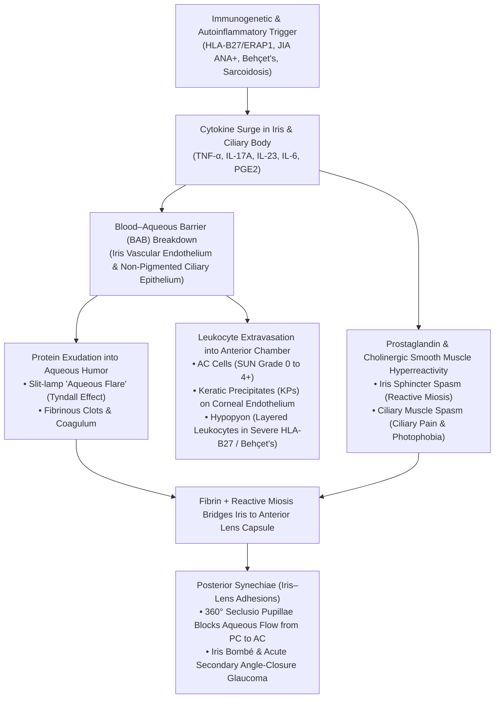
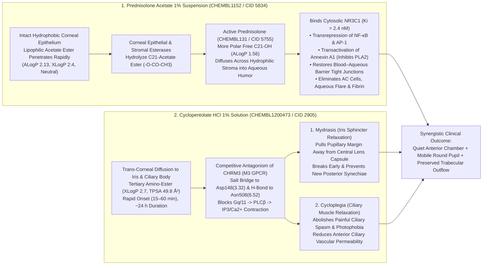
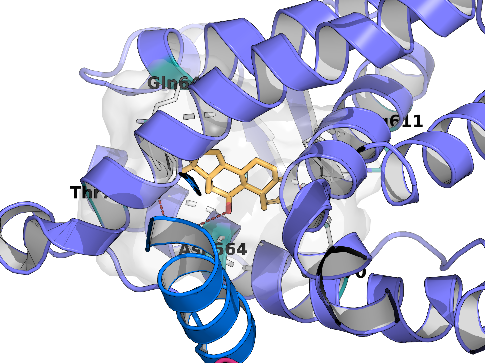
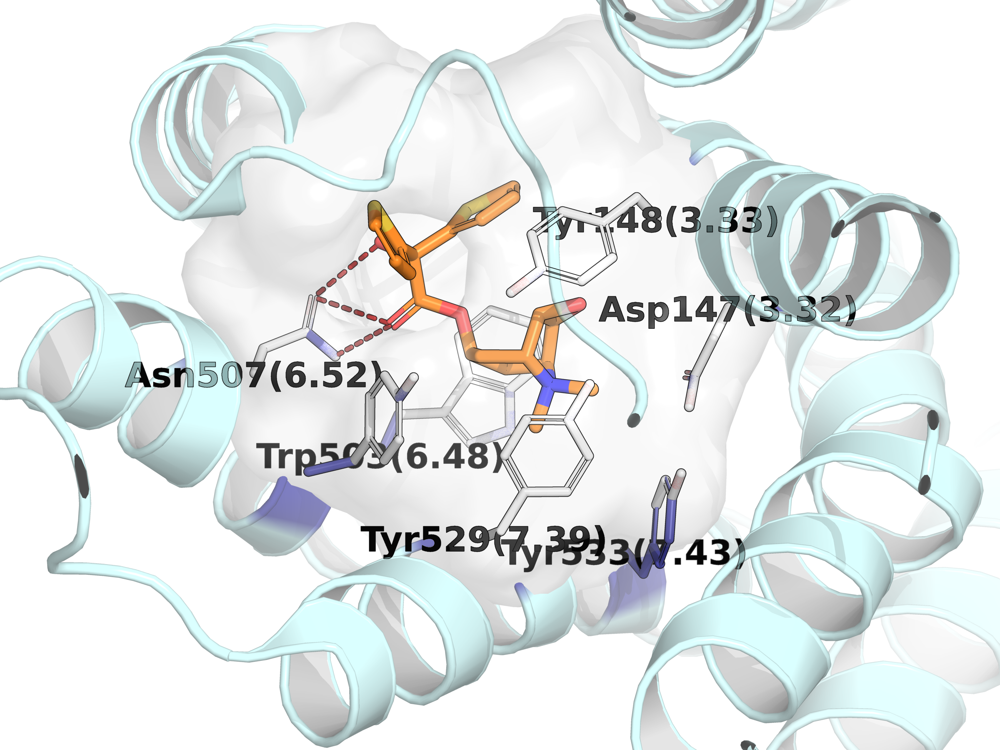
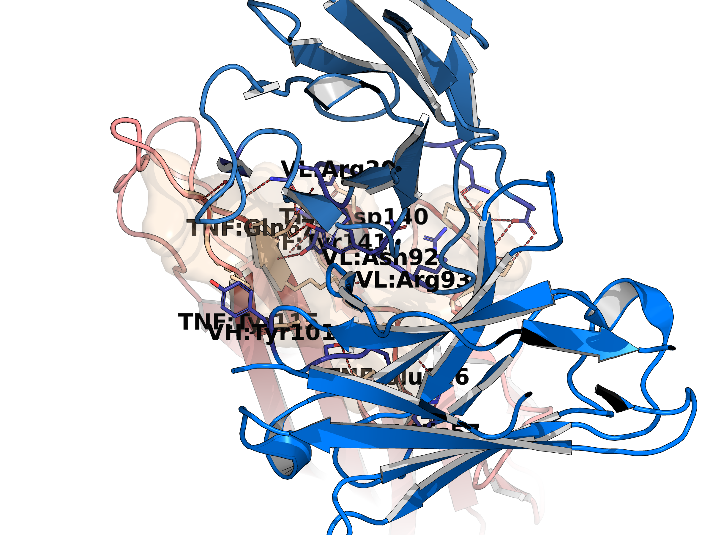

# Study Guide: Non-Infectious Anterior Uveitis — Immunogenetics, Pathophysiology, Structural Pharmacology & Special Focus on Prednisolone Acetate and Cyclopentolate

> **Scope & Focus:** This study guide provides a focused biomedical and structural pharmacology reference on **non-infectious (autoimmune/autoinflammatory) anterior uveitis** (`MONDO_0006651` / `MONDO_0017634`), covering its anatomical classification, major systemic etiologies (`HLA-B27`–associated acute anterior uveitis, `JIA`-associated chronic anterior uveitis, Behçet's disease, and ocular sarcoidosis), core immunogenetic drivers (`HLA-B`, `ERAP1`, `IL23R`, `TNF`, `JAK1`/`JAK2`), a **dedicated deep-dive section on the first-line topical therapeutic duo Prednisolone acetate and Cyclopentolate**, step-up systemic/biologic therapy, and 3D structural analysis of therapeutic drug–target complexes (`NR3C1`, `CHRM3`, and `TNF`–Adalimumab).

---

## 1. Executive Overview & Anatomical Classification

### 1.1 Anatomical Definition & SUN Working Group Classification
**Anterior uveitis** (`MONDO_0006651`, `EFO_1001259`) is defined by the **Standardization of Uveitis Nomenclature (SUN) Working Group** as intraocular inflammation whose primary anatomical site is the **anterior chamber (`AC`)** of the eye, involving the **iris** (*iritis*), the **anterior ciliary body / pars plicata** (*anterior cyclitis*), or both (*iridocyclitis*). It is the most common anatomical form of uveitis worldwide, accounting for **50% to 90%** of all uveitis cases in Western populations (`PMID:42587619`, `PMID:41444414`).

| SUN Classification Parameter | Subtypes & Clinical Criteria | Pathophysiological Significance in Non-Infectious Anterior Uveitis |
| :--- | :--- | :--- |
| **Anatomical Site** | **Iritis**, **Anterior Cyclitis**, **Iridocyclitis** | Inflammation centered in the anterior chamber (`AC`); spillover of cells into the anterior vitreous may occur in severe iridocyclitis, but the primary site remains the `AC`. |
| **Onset** | **Sudden** vs. **Insidious** | **Sudden:** Classic for `HLA-B27` acute anterior uveitis (`AAU`) and Behçet's flares.<br>**Insidious:** Classic for `JIA`-associated chronic anterior uveitis ("white eye" uveitis). |
| **Duration** | **Limited** ($\le 3\text{ months}$) vs. **Persistent** ($> 3\text{ months}$) | Distinguishes self-limiting or rapidly resolving acute attacks from chronic, smoldering disease requiring steroid-sparing immunomodulatory therapy (`IMT`). |
| **Clinical Course** | **Acute** (sudden onset, limited duration)<br>**Recurrent** (repeated episodes separated by $\ge 3\text{ months}$ off treatment)<br>**Chronic** (persistent uveitis with relapse in $< 3\text{ months}$ after discontinuing therapy) | `HLA-B27` typically follows a **recurrent acute** course (often alternating eyes, "flip-flop"), whereas `JIA` and sarcoidosis often follow a **chronic** course. |
| ** Endothelial Deposit Morphology** | **Non-granulomatous** (fine, stellate keratic precipitates [`KPs`] composed of lymphocytes and neutrophils)<br>**Granulomatous** (large, greasy "mutton-fat" `KPs` + Iris Koeppe/Busacca nodules composed of epithelioid macrophages and multinucleated giant cells) | **Non-granulomatous:** `HLA-B27` `AAU`, `JIA`, Behçet's disease.<br>**Granulomatous:** Ocular sarcoidosis (though early or treated sarcoidosis can appear non-granulomatous). |

### 1.2 Breakdown of the Blood–Aqueous Barrier (`BAB`) & Slit-Lamp Hallmarks
Under physiological conditions, the anterior chamber enjoys **ocular immune privilege**, maintained by the **blood–aqueous barrier (`BAB`)**:
1. **Non-fenestrated vascular endothelium** of the iris blood vessels sealed by tight junctions (`ZO-1`, occludin, claudin-5).
2. **Tight junctions between the apical surfaces of the non-pigmented ciliary epithelium (`NPCE`)** lining the ciliary processes.

In non-infectious anterior uveitis, innate and adaptive inflammatory mediators—principally **Tumor Necrosis Factor-alpha (`TNF`)**, **Interleukin-1$\beta$ (`IL-1β`)**, **Interleukin-6 (`IL-6`)**, **Interleukin-17A (`IL-17A`)**, prostaglandins ($\text{PGE}_2$), and nitric oxide—disrupt `BAB` tight junctions and upregulate endothelial adhesion molecules (`ICAM-1`, `VCAM-1`, `E-selectin`). This produces four cardinal slit-lamp manifestations:



- **Anterior Chamber (`AC`) Cells:** Leukocytes (lymphocytes, neutrophils, monocytes) floating in the convection currents of the aqueous humor, graded by the **SUN scale** in a $1\text{ mm} \times 1\text{ mm}$ slit beam (`0`: $<1$ cell; `0.5+`: $1\text{–}5$ cells; `1+`: $6\text{–}15$ cells; `2+`: $16\text{–}25$ cells; `3+`: $26\text{–}50$ cells; `4+`: $>50$ cells).
- **Aqueous Flare (Tyndall Effect):** Optical scattering caused by extravasated plasma proteins (albumin, immunoglobulins, fibrinogen) in the normally optically clear aqueous humor (`0` to `4+`, where `4+` indicates intense fibrin/plastic aqueous).
- **Ciliary Spasm & Reactive Miosis:** Inflammatory prostaglandins sensitize trigeminal nociceptors and drive parasympathetic overactivity of the **iris sphincter muscle** and **ciliary body muscle** via the **muscarinic $\text{M}_3$ receptor (`CHRM3`)**, causing severe deep brow ache, accommodative spasm, photophobia, and a constricted pupil (*miosis*).
- **Posterior Synechiae & Secondary Glaucoma:** When a constricted, inflamed pupillary margin rests against the convex central anterior lens capsule in the presence of fibrin-rich aqueous flare, fibrous adhesions (**posterior synechiae**) form between the iris and lens. Circumferential ($360^\circ$) adhesion (*seclusio pupillae*) traps aqueous humor in the posterior chamber, bowing the peripheral iris forward (**iris bombé**) and closing the trabecular meshwork angle, precipitating sight-threatening **secondary angle-closure glaucoma**.

---

## 2. Clinical Etiologies & Immunological Comparison

Non-infectious anterior uveitis encompasses four major immunopathological entities (plus idiopathic non-infectious anterior uveitis, which shares substantial genetic overlap with the `HLA-B27` spectrum):

| Clinical Feature | `HLA-B27`–Associated Acute Anterior Uveitis (`AAU`) | `JIA`-Associated Chronic Anterior Uveitis | Behçet's Disease Uveitis | Ocular Sarcoidosis |
| :--- | :--- | :--- | :--- | :--- |
| **Epidemiology & Systemic Association** | Most common identifiable cause of `AAU` (`40–70%` of acute cases); strongly linked to axial spondyloarthritis (`AxSpA` / ankylosing spondylitis), reactive arthritis, psoriatic arthritis, and `IBD` (`PMID:42587619`). | Occurs in `10–30%` of Juvenile Idiopathic Arthritis (`JIA`) patients; highest risk in **oligoarticular, early-onset, female, `ANA`-positive** children (`PMID:42544169`). | Multisystem variable-vessel vasculitis along the historical Silk Road (`HLA-B*51` association); mucocutaneous oral/genital ulcers + uveitis. | Multisystem non-caseating granulomatous disease (`30–60%` ocular involvement); bilateral hilar lymphadenopathy, elevated `ACE` / lysozyme. |
| **Laterality & Course** | **Unilateral, acute, recurrent**; classic **"flip-flop" alternating** involvement between left and right eyes across episodes. | **Bilateral (`70–80%`), insidious, chronic, persistent**; frequently completely **asymptomatic ("white eye")** until vision-threatening complications develop. | **Recurrent, explosive acute attacks**; can present as isolated anterior uveitis with mobile hypopyon or progress to devastating bilateral **panuveitis** and retinitis. | **Bilateral, chronic** (occasionally acute in Löfgren syndrome); most commonly anterior (`~60–70%` of ocular sarcoidosis), intermediate, or panuveitis. |
| **Characteristic Slit-Lamp Findings** | Intense conjunctival/ciliary injection, fine non-granulomatous `KPs`, **heavy fibrinous exudate / plastic aqueous**, rapid **posterior synechiae**, and **immobile (fibrinous) hypopyon** (`~10–15%`). | Minimal external redness, fine non-granulomatous `KPs`, chronic `AC` cells/flare, **band keratopathy** (calcium hydroxyapatite deposition in Bowman's layer), early cataract, posterior synechiae. | Non-granulomatous `KPs` and a classic **cold, mobile, shifting hypopyon** (neutrophil-rich, low-fibrin exudate that shifts with head position), often alongside retinal vasculitis. | **Granulomatous "mutton-fat" `KPs`** in Arlt's triangle, **Koeppe nodules** (pupillary border), **Busacca nodules** (iris stroma), trabecular meshwork nodules, tent-shaped peripheral anterior synechiae (`PAS`). |
| **Dominant Immune Axis** | **MHC Class I (`HLA-B27`) + `ERAP1` epistasis**, `IL-23`/`IL-17` (`Th17` / `ILC3` / $\gamma\delta$ T cells), gut microbiome dysbiosis, `TNF-α` surge (`PMC13656210`). | **CD4+ T cells (`Th1`/`Th17`) + B-cell / plasma cell infiltrate**, anti-nuclear antibodies (`ANA`) reactive against ocular chromatin/histone antigens, `TNF-α` and `IL-6`. | **Autoinflammatory neutrophil hyperreactivity**, `HLA-B*51` + `ERAP1` epistasis, intense `TNF-α`, `IL-1β`, `IL-6`, and `Th17` chemotaxis (`CXCL8`/`IL-8`). | **CD4+ `Th1` / `Th17.1` polarization** (`IFN-γ`, `TNF-α`, `IL-12`, `IL-23`), macrophage activation, `STAT1`/`JAK` signaling, and non-caseating epithelioid granuloma formation. |
| **First-Line & Step-Up Therapy** | **Topical:** Intensive **Prednisolone acetate 1%** (`q1h` initially) + **Cyclopentolate 1%** (`TID`).<br>**Recurrent/SpA:** Systemic **Adalimumab** or **Infliximab** (`JAK` inhibitors emerging). | **Topical:** **Prednisolone acetate 1%** (minimized to $\le 2\text{–}3\text{ drops/day}$ to avoid cataract/glaucoma) + short-term cycloplegia.<br>**Systemic Step-Up:** **Methotrexate** $\rightarrow$ **Adalimumab** (`SYCAMORE` trial standard). | **Acute Anterior:** Topical **Prednisolone acetate 1%** + **Cyclopentolate 1%**.<br>**Posterior/Systemic:** Systemic corticosteroids + **Azathioprine** / **Cyclosporine** + **Infliximab** or **Adalimumab**. | **Topical:** **Prednisolone acetate 1%** or **Difluprednate 0.05%** + **Cyclopentolate 1%**.<br>**Chronic/Systemic:** Oral corticosteroids $\rightarrow$ **Methotrexate** or **Mycophenolate mofetil** $\rightarrow$ **Adalimumab**. |

---

## 3. Immunogenetics & Core Molecular Drivers

### 3.1 Open Targets Genetic & Pharmacological Association Landscape
Querying the **Open Targets Platform** for **Anterior Uveitis (`MONDO_0006651`)** and **Non-Infectious Anterior Uveitis (`MONDO_0017634`)** highlights two complementary classes of high-scoring targets: (1) **pharmacological drug targets** validated by Phase 3/4 clinical efficacy (`NR3C1`, `TNF`, `JAK1`, `JAK2`, `DHFR`, `PPP3CA`, `CHRM3`) and (2) **GWAS-validated immunogenetic susceptibility loci** (`ERAP1`, `IL23R`, `HLA-B`):

| Gene Symbol | Ensembl ID | UniProt Accession | Protein Name & Length | Open Targets Score (`MONDO_0006651`) | Primary Pathophysiological or Therapeutic Role in Anterior Uveitis |
| :--- | :--- | :--- | :--- | :---: | :--- |
| **`NR3C1`** | `ENSG00000113580` | `P04150` | Glucocorticoid receptor (`777 aa`) | **0.5921** | Master nuclear receptor target of **Prednisolone**, **Dexamethasone**, **Difluprednate**, and **Loteprednol**; transrepresses `NF-κB` and `AP-1`. |
| **`ERAP1`** | `ENSG00000164307` | `Q9NZ08` | Endoplasmic reticulum aminopeptidase 1 (`941 aa`) | **0.4816** | $\text{Zn}^{2+}$ metallopeptidase ("molecular ruler") that trims N-extended antigenic peptides in the ER for loading onto `HLA-B27` and `HLA-B*51`. |
| **`IL23R`** | `ENSG00000162594` | `Q5VWK5` | Interleukin-23 receptor (`629 aa`) | **0.2889** | Receptor on pathogenic `Th17`, $\gamma\delta$ T cells, and `ILC3` cells; stabilizes `IL-17A`/`IL-17F` and `GM-CSF` production via `JAK2`/`TYK2`–`STAT3`. |
| **`TNF`** | `ENSG00000232810` | `P01375` | Tumor necrosis factor (`233 aa`) | **0.2669** | Central cytokine driving `BAB` tight-junction breakdown and leukocyte recruitment; neutralized by **Adalimumab** and **Infliximab**. |
| **`JAK1`** | `ENSG00000162434` | `P23458` | Tyrosine-protein kinase JAK1 (`1154 aa`) | **0.2596** | Intracellular kinase transducing $\gamma_c$, gp130 (`IL-6`), and Type I/II IFN signals; targeted by **Upadacitinib**, **Filgotinib**, **Tofacitinib**, and topical **VVN461**. |
| **`JAK2`** | `ENSG00000096968` | `O60674` | Tyrosine-protein kinase JAK2 (`1132 aa`) | **0.2587** | Intracellular kinase paired with `TYK2` downstream of `IL-23R` and `IL-12R`; targeted by **Baricitinib** and **Tofacitinib**. |
| **`DHFR`** | `ENSG00000228716` | `P00374` | Dihydrofolate reductase (`187 aa`) | **0.2587** | Target of **Methotrexate** (`CHEMBL34259`), the first-line systemic steroid-sparing antimetabolite in `JIA` and chronic anterior uveitis. |
| **`PPP3CA`** | `ENSG00000138814` | `Q08209` | Calcineurin subunit A (`521 aa`) | **0.2587** | Phosphatase required for `NFAT` nuclear translocation and `IL-2` transcription in T cells; inhibited by **Cyclosporine** and **Tacrolimus**. |
| **`HLA-B`** | `ENSG00000234745` | `P01889` | HLA class I histocompatibility antigen, B alpha chain (`362 aa`) | *MHC Locus* | Strongest genetic risk factor for acute anterior uveitis (`HLA-B*27:05`, `HLA-B*27:02`, `HLA-B*27:04`, odds ratio `OR > 8–15`) and Behçet's (`HLA-B*51:01`). |
| **`CHRM3`** | `ENSG00000133019` | `P20309` | Muscarinic acetylcholine receptor $\text{M}_3$ (`590 aa`) | *Ophthalmic Adjunct Target* | $\text{G}_{\text{q/11}}$-coupled 7-TM GPCR on iris sphincter and ciliary muscle; antagonized by **Cyclopentolate**, **Atropine**, **Homatropine**, and **Tropicamide**. |

### 3.2 Structural Domain Architecture of Core Immunogenetic Drivers (UniProtKB)
1. **`HLA-B` (`UniProt:P01889`, `362 aa`):**
   - **Signal Peptide (`1–24`)**, **$\alpha_1$ Helical Domain (`25–114`)**, and **$\alpha_2$ Helical Domain (`115–206`)**: Together form the polymorphic **peptide-binding groove** (Pockets `A` through `F`). In disease-associated `HLA-B*27` subtypes (`B*27:05`, `B*27:02`, `B*27:04`), the **B-pocket** contains a negatively charged **`Glu45`** (corresponding to mature residue 45 / precursor residue 69) and an unpaired reactive **`Cys67`** (precursor residue 91), which confer strict specificity for peptides carrying an **arginine at position 2 (`P2-Arg`)** and predispose heavy chains to disulfide-linked homodimerization and misfolding.
   - **$\alpha_3$ Immunoglobulin-like Domain (`207–298`)**: Non-covalently associates with $\beta_2$-microglobulin (`B2M`) and engages `CD8` co-receptors (`disulfide bond 227–283`).
   - **Transmembrane Helix (`310–333`) & Cytoplasmic Tail (`334–362`)**.
2. **`ERAP1` (`UniProt:Q9NZ08`, `941 aa`):**
   - An endoplasmic reticulum-resident M1-family zinc metallopeptidase featuring a catalytic **`HEXXH(X)18E` motif**: active-site proton acceptor **`Glu354`** and $\text{Zn}^{2+}$-coordinating triad **`His353`**, **`His357`**, and **`Glu376`**, plus substrate-binding pocket residues **`Gly317–ATG–Asn321`** and **`Gln183`**.
   - **Molecular Ruler Mechanism & Epistasis with `HLA-B27` / `HLA-B*51`:** `ERAP1` trims N-terminally extended precursor peptides (`10–16 aa`) down to optimal `8–9 aa` MHC Class I ligands (`PMID:42563687`). Notably, `ERAP1` coding variants (`Lys528Arg`, `Gln730Glu`) exhibit **classical genetic epistasis**: they alter anterior uveitis risk *only* in individuals carrying `HLA-B27` (or `HLA-B*51` in Behçet's disease). Hyperactive `ERAP1` allotypes alter the peptidome loaded onto `HLA-B27`, either generating uveitogenic self/microbial mimic peptides or destabilizing `HLA-B27` complexes.
3. **Three Intersecting Mechanisms of `HLA-B27` Pathogenicity in Anterior Uveitis (`PMC13656210`, `PMID:42563687`):**
   - **Uveitogenic / Arthritogenic Peptide Hypothesis:** Canonical `HLA-B27` heterotrimers present microbial peptides (from *Chlamydia*, *Salmonella*, *Shigella*, *Yersinia*, *Klebsiella*, or gut commensals) that cross-react via molecular mimicry with ocular antigens in the iris/ciliary body, activating autoreactive **`CD8+` T cells** (`TRBV9+` clonotypes).
   - **`HLA-B27` Heavy Chain Misfolding & Unfolded Protein Response (`UPR`):** Slow folding and `Cys67`-mediated disulfide homodimerization in the ER trigger `BiP` dissociation, `IRE1α`/`XBP1` and `PERK`/`CHOP` activation, and downstream **`IL-23` overproduction** by myeloid cells.
   - **Cell-Surface Heavy Chain Homodimers (`B27`$_2$):** $\beta_2\text{m}$-free `HLA-B27` heavy chain homodimers expressed on the cell surface bind innate killer-cell immunoglobulin-like receptors (**`KIR3DL2`**) on `CD4+ Th17` cells and `NK` cells, driving antigen-independent **`IL-17A`** and **`TNF-α`** secretion.
4. **`TNF` (`UniProt:P01375`, `233 aa`):**
   - Synthesized as a **233-residue transmembrane homotrimer (`tmTNF`)** (`Cytoplasmic 1–35`, `Transmembrane helical 36–56`, `Extracellular 57–233`), cleaved between **`Ala76` and `Val77`** by `ADAM17` (`TACE`) to release the **157-residue soluble homotrimer (`sTNF`, `77–233`)** containing the $\beta$-jellyroll **TNF Homology Domain (`88–233`)**.
   - Both `sTNF` (primarily via `TNFR1`) and `tmTNF` (via `TNFR1` and `TNFR2`) activate `NF-κB` and `MAPK` cascades in iris vascular endothelial cells and ciliary epithelium, directly dismantling `BAB` tight junctions.

---

## 4. Special Focus Section: First-Line Topical Synergy — Prednisolone Acetate & Cyclopentolate

> [!IMPORTANT]
> **Clinical Cornerstone of Acute Anterior Uveitis (`AAU`):** Across international ophthalmology guidelines (`SUN`, `AAO`, `EULAR`), the immediate first-line treatment for an acute flare of non-infectious anterior uveitis is the **dual topical regimen** of **Prednisolone acetate 1% ophthalmic suspension** (a potent lipophilic prodrug corticosteroid targeting **`NR3C1`**) combined with **Cyclopentolate hydrochloride 1% ophthalmic solution** (an intermediate-acting antimuscarinic cycloplegic/mydriatic targeting **`CHRM3`**). Neither agent alone is sufficient: corticosteroid monotherapy leaves the pupil constricted and vulnerable to irreversible iris–lens scarring (**posterior synechiae**) and ciliary pain, whereas cycloplegic monotherapy relieves spasm without halting leukocyte infiltration or cytokine-driven tissue destruction.

### 4.1 Complementary Dual-Pathway Synergy in the Anterior Segment



The combination of **Prednisolone acetate** and **Cyclopentolate** targets three distinct pathophysiological emergencies simultaneously:
1. **Biochemical Suppression of Intraocular Inflammation (`Prednisolone Acetate` $\rightarrow$ `NR3C1`):**
   - Once hydrolyzed to active **Prednisolone**, the steroid binds cytosolic **Glucocorticoid Receptor (`NR3C1`, `UniProt:P04150`)** with nanomolar affinity ($K_i = 2.4\text{ nM}$, `pChEMBL 8.62`).
   - **Genomic Transrepression:** Monomeric and dimeric `NR3C1` complexes tether to pro-inflammatory transcription factors **`NF-κB` (`p65/RelA`)** and **`AP-1` (`c-Fos/c-Jun`)**, recruiting histone deacetylase-2 (`HDAC2`) and halting transcription of `TNF`, `IL-1β`, `IL-6`, `IL-8`, `ICAM-1`, `COX-2`, and matrix metalloproteinases (`MMPs`).
   - **Genomic Transactivation:** Homodimeric `NR3C1` binds Glucocorticoid Response Elements (`GREs`) via its zinc-finger DNA-binding domain (`residues 421–486`), upregulating **Annexin A1 (Lipocortin-1)**—which directly inhibits **phospholipase $\text{A}_2$ ($\text{PLA}_2$)** to shut down arachidonic acid and prostaglandin ($\text{PGE}_2$) synthesis—as well as **`IκBα`** (trapping `NF-κB` in the cytoplasm) and **`GILZ`** (*Glucocorticoid-Induced Leucine Zipper*).
   - **Microvascular Stabilization:** Restores `ZO-1` and occludin expression in the iris vascular endothelium and non-pigmented ciliary epithelium, rapidly sealing the **blood–aqueous barrier (`BAB`)** and clearing fibrinogen/protein flare from the anterior chamber.
2. **Mechanical Prevention & Lysis of Posterior Synechiae (`Cyclopentolate` $\rightarrow$ Iris Sphincter `CHRM3`):**
   - Because the human crystalline lens is convex, its **central anterior capsule** projects furthest forward toward the cornea. When uveitis triggers prostaglandin- and acetylcholine-mediated **miosis** (pupil constriction), the inflamed pupillary margin is pressed tightly against the central lens capsule in a bath of sticky fibrin (`aqueous flare`).
   - **Cyclopentolate** competitively blocks **$\text{M}_3$ muscarinic receptors (`CHRM3`, `UniProt:P20309`)** on the circular **iris sphincter muscle**, producing **mydriasis** (pupillary dilation). Dilating the pupil increases the clearance distance between the iris border and the sloping peripheral lens capsule, **mechanically tearing apart fresh fibrinous adhesions** and preventing permanent $360^\circ$ *seclusio pupillae* and *iris bombé*.
   - Furthermore, because **Cyclopentolate** has an intermediate duration of action (`~24 hours`, shorter than Atropine's `7–14 days`), dosing `TID` (`3 times daily`) maintains dynamic pupillary mobility rather than locking the pupil in a static dilated position where synechiae could still form in mid-dilation.
3. **Analgesia via Ciliary Muscle Paralysis & Vascular Decongestion (`Cyclopentolate` $\rightarrow$ Ciliary Body `CHRM3`):**
   - The severe aching pain and photophobia of acute anterior uveitis do not come primarily from the cornea, but from **spasm of the ciliary body muscle** and traction on inflamed uveal tissue whenever the patient attempts near accommodation or enters bright light (which triggers the consensual pupillary light reflex).
   - By paralyzing the ciliary muscle (**cycloplegia**), **Cyclopentolate** puts the inflamed iris and ciliary body at mechanical rest, immediately relieving brow ache and photophobia while also decreasing blood flow and exudative leakage from the anterior ciliary arteries.

---

### 4.2 Biphasic Corneal Pharmacokinetics: Why Prednisolone Acetate Outperforms Phosphate Salts
A classic pharmacology principle in ophthalmology is why **Prednisolone acetate 1% ophthalmic suspension** (`CHEMBL1152`, PubChem `CID 5834`) is the gold-standard topical steroid for anterior uveitis with an intact cornea, rather than water-soluble **Prednisolone sodium phosphate 1% ophthalmic solution** (`CHEMBL1201014`).

The human cornea is a **trilaminar "lipid–water–lipid" sandwich**:
1. **Corneal Epithelium (`~50 μm` thick):** 5–7 layers of squamous/basal cells joined by zonula occludens tight junctions. It is **strongly lipophilic (hydrophobic)** and represents the primary rate-limiting barrier to hydrophilic or ionized drugs.
2. **Corneal Stroma (`~450–500 μm` thick, `90%` of corneal thickness):** Hydrated lamellar collagen fibrils (`~78%` water). It is **strongly hydrophilic** and acts as a barrier to overly lipophilic compounds that cannot partition out of the epithelium.
3. **Corneal Endothelium (`~5 μm` monolayer):** Lipophilic cellular monolayer with leaky macula occludens junctions bordering the aqueous humor.

```
[ Tear Film ]              [ Corneal Epithelium ]               [ Corneal Stroma (78% H2O) ]        [ Aqueous Humor ]
                            (Hydrophobic Lipid Barrier)          (Hydrophilic Barrier)

Prednisolone Acetate   --->  High Partitioning Into         --->  Corneal Esterases Hydrolyze  --->  Active Prednisolone
(C21-O-CO-CH3 Ester)         Lipid Bilayers                       C21-Acetate Ester Bond             Enters Anterior Chamber
MW 402.49 | ALogP 2.13       (Neutral, Non-Ionized)               (-O-CO-CH3  -->  -OH)              (MW 360.45 | ALogP 1.56)
TPSA 100.90 Ų | HBD 2                                            Increases Water Solubility!        Binds NR3C1 (Ki = 2.4 nM)
                                                                                                     Free C21-OH H-bonds Asn564!
---------------------------------------------------------------------------------------------------------------------------------
Prednisolone Sodium    --X--> Poor Penetration Across
Phosphate (C21-OPO3Na2)       Intact Hydrophobic Epithelium
MW 484.39 | ALogP 1.67        (Anionic Phosphate, High Polarity)
TPSA 141.36 Ų | HBD 4        -> Rapid Tear-Film Drainage!
```

- **Biphasic Prodrug Design of Prednisolone Acetate (`CHEMBL1152`):**
  - Esterifying the C21-hydroxyl group of prednisolone with an **acetate group (`-O-CO-CH3`)** masks a hydrogen-bond donor (`HBD` drops from `3` to `2`) and raises lipophilicity from **`ALogP 1.56` (`XLogP 1.6`)** to **`ALogP 2.13` (`XLogP 2.4`)**, placing it in the optimal logP window (`2.0–3.0`) for trans-corneal permeation.
  - Once inside the corneal epithelium, abundant **corneal carboxylesterases and arylacetamide deacetylases** cleave the C21-acetate ester bond, converting lipophilic **Prednisolone acetate** into the more polar active drug **Prednisolone** (`CHEMBL131`, `ALogP 1.56`, `TPSA 94.83` $\text{\AA}^2$).
  - Because **Prednisolone** is more hydrophilic than its acetate ester, it readily partitions out of the lipid-rich epithelium into the aqueous **corneal stroma** and diffuses into the **anterior chamber**, achieving **5- to 20-fold higher aqueous humor bioavailability** across an intact cornea than **Prednisolone sodium phosphate** (`TPSA 141.36` $\text{\AA}^2$, negatively charged phosphate group at tear pH `7.4`).
  - **Clinical Formulation Pearls:** Because **Prednisolone acetate 1%** is a **micronized suspension** rather than an aqueous solution, patients must be instructed to **shake the bottle vigorously for 5–10 seconds** before every instillation to resuspend the steroid particles; failure to shake delivers vehicle with subtherapeutic drug concentration initially, followed by hyperconcentrated sediment near the end of the bottle.

---

### 4.3 Quantitative Comparison of Topical Ophthalmic Corticosteroids (ChEMBL & PubChem)

| Drug Name & Identifiers | Molecular Formula & Weight (`g/mol`) | Lipophilicity (`ALogP` / `XLogP`) | Polar Surface Area (`TPSA`) & H-Bonding | `NR3C1` Target Potency & Formulation | Clinical Role & Risk Profile in Anterior Uveitis |
| :--- | :--- | :---: | :---: | :--- | :--- |
| **Prednisolone Acetate**<br>`CHEMBL1152`<br>PubChem `CID 5834` | $\text{C}_{23}\text{H}_{30}\text{O}_6$<br>`402.49` | `ALogP: 2.13`<br>`XLogP: 2.4` | `TPSA: 100.90` $\text{\AA}^2$<br>`HBD: 2` \| `HBA: 6`<br>`RotBonds: 4` | **C21-acetate prodrug** of Prednisolone (`1%` micronized suspension); hydrolyzed in cornea to active Prednisolone. | **First-line gold standard** for acute & chronic anterior uveitis (`q1h` loading in severe `AAU`, then slow taper over 4–8 weeks); moderate-to-high risk of steroid-induced `IOP` elevation and posterior subcapsular cataract (`PSC`) with prolonged use. |
| **Prednisolone (Active Metabolite)**<br>`CHEMBL131`<br>PubChem `CID 5755` | $\text{C}_{21}\text{H}_{28}\text{O}_5$<br>`360.45` | `ALogP: 1.56`<br>`XLogP: 1.6` | `TPSA: 94.83` $\text{\AA}^2$<br>`HBD: 3` \| `HBA: 5`<br>`RotBonds: 2` | **`NR3C1` $K_i = 2.4\text{ nM}$** (`pChEMBL 8.62`); transactivation $\text{EC}_{50} = 8.0\text{ nM}$ (`pChEMBL 8.10`); transrepression $\text{EC}_{50} = 2.1\text{ nM}$. | Active intraocular species generated by corneal esterase cleavage of Prednisolone acetate (and systemic active metabolite of oral Prednisone). Free C21-OH directly engages `Asn564` in `NR3C1`. |
| **Prednisolone Sodium Phosphate**<br>`CHEMBL1201014` | $\text{C}_{21}\text{H}_{27}\text{Na}_2\text{O}_8\text{P}$<br>`484.39` (`360.45` parent) | `ALogP: 1.67` (free acid) | `TPSA: 141.36` $\text{\AA}^2$<br>`HBD: 4` \| `HBA: 6`<br>`RotBonds: 4` | Water-soluble C21-phosphate salt (`1%` aqueous solution); no shaking required. | **Inferior anterior chamber penetration** across an intact hydrophobic corneal epithelium due to high polarity (`TPSA 141.36` $\text{\AA}^2$) and anionic charge; suitable mainly for ocular surface disease or when shaking a suspension is impossible. |
| **Dexamethasone**<br>`CHEMBL384467`<br>PubChem `CID 5743` | $\text{C}_{22}\text{H}_{29}\text{FO}_5$<br>`392.47` | `ALogP: 1.90`<br>`XLogP: 1.9` | `TPSA: 94.83` $\text{\AA}^2$<br>`HBD: 3` \| `HBA: 6`<br>`RotBonds: 2` | **`NR3C1` $K_i = 5.5\text{ nM}$** (`pChEMBL 8.26`), $\text{IC}_{50} = 0.9\text{ nM}$ (`pChEMBL 9.05`); `9α-fluoro, 16α-methyl` substituent increases intracellular half-life. | High intrinsic receptor potency (`~5–6x` hydrocortisone/prednisolone in cellular assays), used as `0.1%` suspension/phosphate solution, intracanalicular insert (`Dextenza`, `NCT04426734`), or intravitreal implant (`Ozurdex`); higher propensity for `IOP` spikes (`steroid responder` glaucoma). |
| **Difluprednate**<br>`CHEMBL1201749` | $\text{C}_{27}\text{H}_{34}\text{F}_2\text{O}_7$<br>`508.56` | `ALogP: 3.52` | `TPSA: 106.97` $\text{\AA}^2$<br>`HBD: 1` \| `HBA: 7`<br>`RotBonds: 6` | `6α,9α-difluorinated` **C17-butyrate, C21-acetate diester** (`0.05%` lipid emulsion); deacetylated in cornea to active **6$\alpha$,9$\alpha$-difluoroprednisolone 17-butyrate (`DFB`)**. | **Ultra-potent topical steroid**; Phase 3 trial (`NCT01201798`) demonstrated that **Difluprednate `0.05%` `QID` ($4\times/\text{day}$) is non-inferior to Prednisolone acetate `1%` `8x/day`**, improving adherence in severe `AAU`, but carries the **highest risk of clinically significant `IOP` elevation**. |
| **Loteprednol Etabonate**<br>`CHEMBL1200865` | $\text{C}_{24}\text{H}_{31}\text{ClO}_7$<br>`466.96` | `ALogP: 3.92` | `TPSA: 99.13` $\text{\AA}^2$<br>`HBD: 1` \| `HBA: 7`<br>`RotBonds: 6` | **"Soft steroid"** retrometabolically designed by replacing the C20-ketone with a labile **C17$\beta$-chloromethyl ester** and C17$\alpha$-ethylcarbonate (`0.5%` / `1%` suspension/gel). | Unbound drug is rapidly hydrolyzed by tissue esterases into inactive $\Delta^1$-cortienic acid, **markedly reducing the risk of `IOP` spikes** in steroid responders (`NCT07496060`), though it has **lower intraocular anti-inflammatory potency** than Prednisolone acetate `1%` in severe `AAU`. |

---

### 4.4 Quantitative Comparison of Topical Antimuscarinic Cycloplegics (ChEMBL & PubChem)
All four ophthalmic antimuscarinics act as **competitive orthosteric antagonists at Muscarinic Acetylcholine Receptors ($\text{M}_1\text{–M}_5$, principally **`CHRM3`** [`CHEMBL245`, `UniProt:P20309`] on the iris sphincter and ciliary muscle)**, but their chemical structures dictate markedly different corneal residence times and durations of cycloplegia:

| Drug Name & Identifiers | Molecular Formula & Weight (`g/mol`) | Lipophilicity (`XLogP` / `ALogP`) | Polar Surface Area (`TPSA`) & H-Bonding | Onset & Total Recovery Duration | Clinical Role & Trade-Offs in Anterior Uveitis |
| :--- | :--- | :---: | :---: | :--- | :--- |
| **Cyclopentolate (HCl)**<br>`CHEMBL1201338` (base)<br>`CHEMBL1200473` (HCl)<br>PubChem `CID 2905` | $\text{C}_{17}\text{H}_{25}\text{NO}_3$<br>`291.39` (base)<br>`327.85` (HCl) | `XLogP: 2.7`<br>`ALogP: 2.18` | `TPSA: 49.77` $\text{\AA}^2$<br>`HBD: 1` \| `HBA: 4`<br>`RotBonds: 7` | **Onset:** `15–60 min`<br>**Recovery:** **`~24 hours`** (`1 day`) | **Preferred first-line cycloplegic in `AAU`** (`0.5%` or `1%` `BID–TID`). Provides **strong cycloplegia** (relieving ciliary spasm pain) plus **dynamic mydriasis** that breaks posterior synechiae without paralyzing accommodation for weeks. *(Caution: CNS toxicity/delirium in infants/toddlers with `2%` strength).* |
| **Tropicamide**<br>`CHEMBL1200604`<br>PubChem `CID 5593` | $\text{C}_{17}\text{H}_{20}\text{N}_2\text{O}_2$<br>`284.36` | `XLogP: 1.5`<br>`ALogP: 1.54` | `TPSA: 53.43` $\text{\AA}^2$<br>`HBD: 1` \| `HBA: 3`<br>`RotBonds: 6` | **Onset:** `15–30 min`<br>**Recovery:** **`4–6 hours`** | **Diagnostic mydriatic (`0.5%`–`1%`), weak cycloplegic.** Useful in mild/chronic uveitis (`JIA`) at bedtime to keep the pupil mobile without daytime near-vision blur, but **too short-acting and weak on ciliary muscle spasm** for acute severe `AAU`. |
| **Homatropine (HBr)**<br>`CHEMBL1618018`<br>PubChem `CID 5282593` | $\text{C}_{16}\text{H}_{21}\text{NO}_3$<br>`275.35` (base) | `XLogP: 1.9`<br>`ALogP: 1.78` | `TPSA: 49.77` $\text{\AA}^2$<br>`HBD: 1` \| `HBA: 4`<br>`RotBonds: 4` | **Onset:** `30–60 min`<br>**Recovery:** **`1–3 days`** (`24–72 h`) | **Intermediate-to-long-acting alternative (`2%` or `5%` `BID–TID`)** to Cyclopentolate when slightly more sustained cycloplegia is desired in moderate-to-severe iridocyclitis. |
| **Atropine (Sulfate)**<br>PubChem `CID 174174` | $\text{C}_{17}\text{H}_{23}\text{NO}_3$<br>`289.38` (base) | `XLogP: 1.8`<br>`ALogP: 1.83` | `TPSA: 49.77` $\text{\AA}^2$<br>`HBD: 1` \| `HBA: 4`<br>`RotBonds: 4` | **Onset:** `30–40 min` (mydriasis), `60–180 min` (cycloplegia)<br>**Recovery:** **`7–14 days`** | **Most potent and longest-acting cycloplegic (`1%` `QD–BID`).** Reserved for **severe plastic/fibrinous `AAU` or refractory posterior synechiae**; avoided in routine mild-to-moderate `AAU` because `1–2 week` loss of accommodation impairs reading/work and a persistently fixed dilated pupil can form synechiae in the dilated state. |

### 4.5 Practical Dosing & Tapering Protocol for the Prednisolone Acetate + Cyclopentolate Regimen
1. **Acute Induction Phase (Days 1–7 of Severe `AAU`, e.g., `SUN 3+ to 4+` AC Cells / Fibrin):**
   - **Prednisolone acetate `1%` suspension:** Shake well; instill **1 drop every 1 hour (`q1h`) while awake** for the first `48–72 hours` to saturate corneal esterases and establish therapeutic aqueous humor levels, then step down to **every 2 hours (`q2h`)** once `AC` cells begin declining.
   - **Cyclopentolate HCl `1%` solution:** Instill **1 drop `TID` (`3 times daily`)** to break posterior synechiae and abolish ciliary spasm. (If tenacious posterior synechiae do not break with Cyclopentolate `1%` alone, an in-office drop of **Phenylephrine `2.5%` or `10%`** [$\alpha_1$-adrenergic iris dilator agonist] or temporary **Atropine `1%`** is added).
2. **Structured Corticosteroid Taper (Weeks 2–6+):**
   - Once anterior chamber inflammation improves to $\le \text{0.5+ to 1+ cells}$, **Prednisolone acetate `1%`** is tapered gradually to prevent rebound uveitis:
     $$\text{q1h} \longrightarrow \text{q2h} \longrightarrow \text{QID } (4\times/\text{day}) \longrightarrow \text{TID } (3\times/\text{day}) \longrightarrow \text{BID } (2\times/\text{day}) \longrightarrow \text{QD } (1\times/\text{day}) \longrightarrow \text{Discontinue}$$
     *(Typically reducing by 1 drop/day every `5–7 days` while monitoring slit-lamp `AC` cell counts).*
   - **Cyclopentolate `1%`** is tapered to bedtime (`QHS`) and discontinued once `AC` cells fall to $\le 0.5+$ and fibrin flare has resolved.
3. **Mandatory Safety Monitoring (`IOP` & Cataract):**
   - Intraocular pressure (`IOP`) must be checked at baseline and at **`2–4 weeks`**, as `~18–35%` of individuals are **ocular steroid responders** (mediated by `NR3C1`-induced upregulation of **myocilin [`MYOC`]** and extracellular matrix cross-linking in the trabecular meshwork, increasing aqueous outflow resistance).
   - In chronic anterior uveitis (such as `JIA`), maintaining topical **Prednisolone acetate `1%` at $\le 2\text{–}3\text{ drops/day}$** reduces the incidence of posterior subcapsular cataract (`PSC`) by over `80%`; any patient requiring $>2\text{ drops/day}$ chronically to maintain `SUN Grade 0` cells requires step-up to **systemic steroid-sparing immunomodulatory therapy (`IMT`)**.

---

## 5. Step-Up Systemic Immunomodulatory & Biologic Therapy (`IMT`) and Clinical Trial Landscape

### 5.1 Step-Up Therapeutic Ladder (`Open Targets` & `ChEMBL` Validated Agents)
When non-infectious anterior uveitis is **chronic (`JIA`, ocular sarcoidosis)**, **frequently recurrent (`HLA-B27` with $\ge 3\text{ flares/year}$)**, **bilateral and sight-threatening (`Behçet's`)**, or complicated by **steroid-induced ocular hypertension**, systemic steroid-sparing therapy is initiated:

| Therapeutic Class & Drug | ChEMBL ID & Modality | Molecular Target & Mechanism of Action | Clinical Indication & Evidence in Anterior Uveitis |
| :--- | :--- | :--- | :--- |
| **Methotrexate**<br>(Antimetabolite) | `CHEMBL34259`<br>Small Molecule (`MW 454.45`, `ALogP 0.27`, `TPSA 210.54` $\text{\AA}^2$) | **`DHFR` (`CHEMBL202`, `P00374`) Inhibitor** + **`AICAR` transformylase inhibition** (increases extracellular anti-inflammatory **adenosine** signaling via $\text{A}_{2\text{A}}$ receptors on lymphocytes). | **First-line conventional systemic steroid-sparing agent** for **`JIA`-associated chronic anterior uveitis**, chronic idiopathic/HLA-B27 anterior uveitis, and ocular sarcoidosis (`15–25 mg/week` oral or subcutaneous with folic acid supplementation; controls inflammation in `~60–73%` of patients, `SITE` cohort). |
| **Mycophenolate Mofetil (`MMF`)**<br>(Antimetabolite) | `CHEMBL1073` (prodrug) / `CHEMBL191` (MPA) | **`IMPDH1`/`IMPDH2` Inhibitor**; selectively depletes guanosine nucleotides in proliferating T and B lymphocytes (which lack the purine salvage pathway). | Effective alternative to Methotrexate in chronic anterior/intermediate uveitis and ocular sarcoidosis (`1–1.5 g BID`), though less effective than Methotrexate in `JIA` (`FAST` trial). |
| **Azathioprine**<br>(Antimetabolite) | `CHEMBL1542` | **Purine analog (`6-MP` prodrug)** incorporating into DNA/RNA and blocking *de novo* purine synthesis in lymphocytes. | Classical steroid-sparing agent in **Behçet's disease uveitis** (`2–3 mg/kg/day` after verifying `TPMT` / `NUDT15` activity). |
| **Cyclosporine** / **Tacrolimus**<br>(Calcineurin Inhibitors) | `CHEMBL160` / `CHEMBL1051` | **`PPP3CA` (Calcineurin, `Q08209`) Inhibitor** via Cyclophilin A / `FKBP12`; blocks `NFAT` dephosphorylation and `IL-2` transcription in T cells. | Rapid-onset T-cell suppression in **Behçet's disease** or severe steroid-refractory uveitis (monitor blood pressure and renal function). |
| **Adalimumab**<br>(Biologic Anti-`TNF`) | `CHEMBL1201580`<br>Human `IgG1κ` mAb | **`TNF` (`CHEMBL1825`, `P01375`) Neutralizing Antibody**; binds both soluble (`sTNF`) and transmembrane (`tmTNF`) homotrimers, preventing `TNFR1`/`TNFR2` activation and inducing reverse signaling/apoptosis of `tmTNF+` effector cells. | **Gold-standard biologic for non-infectious uveitis.** Validated in the landmark **`SYCAMORE` Phase 3 RCT** (`Adalimumab + Methotrexate` reduced treatment failure by `75%` vs. `Placebo + Methotrexate` in `JIA` anterior uveitis) and **`ADJUVITE`**, and reduces `HLA-B27` `AAU` flare rates by `>70–85%` (`PMID:42544169`, `PMID:41444414`). |
| **Infliximab**<br>(Biologic Anti-`TNF`) | `CHEMBL1201581`<br>Chimeric `IgG1κ` mAb | **`TNF` (`P01375`) Neutralizing Antibody** (intravenous `5–10 mg/kg` infusions). | Rapid rescue therapy for **acute sight-threatening Behçet's uveitis**, refractory `JIA` uveitis, and severe `HLA-B27` spondyloarthritis with uveitis. *(Note: **Etanercept** [`TNFR2-Fc` fusion protein] is **ineffective** in anterior uveitis and can paradoxically precipitate `AAU` flares because it fails to cross-link `tmTNF` or induce effector T-cell apoptosis).* |
| **`JAK1`/`JAK2`/`TYK2` Inhibitors**<br>(**Upadacitinib**, **Baricitinib**, **Filgotinib**, **Tofacitinib**, **VVN461**) | `CHEMBL4297528` (Upadacitinib)<br>`CHEMBL2105759` (Baricitinib)<br>`CHEMBL3301607` (Filgotinib)<br>`CHEMBL221959` (Tofacitinib) | Competitive **`ATP`-binding pocket inhibitors of `JAK1` (`P23458`), `JAK2` (`O60674`), and `TYK2` (`P29597`)**; simultaneously block signaling by `IL-6`, `IL-23`, `IFN-γ`, and `IL-2`. | **Emerging oral and topical small-molecule targeted therapy** for anti-`TNF`-refractory `JIA` uveitis (`JUVE-BRIGHT` Baricitinib trial), axial spondyloarthritis (`Upadacitinib` reduces `AAU` flare incidence), and topical **`VVN461` (`JAK1`/`TYK2` ophthalmic solution, `NCT06679153`)** (`PMID:42720410`). |

### 5.2 Key ClinicalTrials.gov Studies in Non-Infectious Anterior Uveitis
A query of **ClinicalTrials.gov API v2** identifies **213 registered clinical studies** targeting anterior uveitis (including **14 comparator trials** evaluating **Prednisolone acetate 1%** directly against next-generation ophthalmic steroids and non-steroidal targeted eye drops):

| NCT ID | Official Study Title / Design | Interventions Compared | Phase & Status (`n`) | Primary Clinical Takeaway |
| :--- | :--- | :--- | :---: | :--- |
| **`NCT01201798`** | Phase 3 Multicenter, Randomized, Double-Masked Non-Inferiority Trial in Endogenous Anterior Uveitis | **Difluprednate `0.05%` emulsion (`QID`)** vs. **Prednisolone acetate `1%` suspension (`8x/day`)** | Phase 3 Completed (`n = 110`) | Difluprednate `0.05%` `4x/day` achieved non-inferior `AC` cell clearing (`Grade 0`) at Day 14 compared to Prednisolone acetate `1%` `8x/day`, simplifying dosing frequency in acute flares. |
| **`NCT07496060`** | Randomized Comparison of Loteprednol Etabonate vs. Prednisolone Acetate in Acute Non-Infectious Anterior Uveitis | **Loteprednol etabonate `1%`** vs. **Prednisolone acetate `1%`** | Phase 4 Active / Recruiting (`n = 76`) | Evaluates whether `1%` "soft steroid" Loteprednol etabonate achieves comparable `AC` cell clearing (`Day 28`) with a lower incidence of steroid-induced `IOP` spikes (`>21 mmHg`). |
| **`NCT04426734`** | Study of `DEXTENZA` (Dexamethasone Intracanalicular Insert `0.4 mg`) for Acute Non-Infectious Anterior Uveitis | **Dextenza `0.4 mg` punctal insert** vs. **Topical Prednisolone acetate `1%` taper** | Phase 2/3 (`n = 28`) | Tests sustained-release drop-free canalicular corticosteroid delivery against standard multi-week Prednisolone acetate `1%` drop tapering. |
| **`NCT06679153`** | Phase 2 Multicenter, Randomized, Active-Controlled Study of **`VVN461`** Ophthalmic Solution in Non-Infectious Anterior Uveitis | **Topical `VVN461` (`1.0%` or `0.5%` dual `JAK1`/`TYK2` inhibitor `QID`)** vs. **Prednisolone acetate `1%` (`QID`)** | Phase 2 Recruiting (`n = 90`) | Represents a paradigm shift toward **steroid-free topical `JAK1`/`TYK2` inhibition** designed to clear `AC` cells without causing trabecular meshwork `IOP` elevation or cataracts. |
| **`NCT04222712`** | Phase 2b Dose-Ranging Study of **`TRS01` (`DAZU` Dexamethasone-Peptide Conjugate)** vs. Prednisolone Acetate `1%` | **Topical `TRS01` (`0.1%`, `0.5%`, `1.0%`)** vs. **Prednisolone acetate `1%`** | Phase 2 Completed (`n = 140`) | Evaluates a dual-action immunomodulatory peptide–steroid conjugate (`dazdotuftide`) that polarizes macrophages toward anti-inflammatory `M2` phenotypes with reduced `IOP` risk. |
| **`NCT03828019`** | **`ADJUST` Trial:** Stopping Adalimumab in Juvenile Idiopathic Arthritis-Associated Uveitis | **Continued Adalimumab** vs. **Placebo Withdrawal** after $\ge 12\text{ months}$ of controlled `JIA` uveitis | Phase 4 Completed (`n = 87`) | Demonstrated high relapse rates upon abrupt discontinuation of Adalimumab, underscoring the need for prolonged biologic maintenance or cautious interval extension in `JIA` uveitis. |

---

## 6. 3D Structural Pharmacology of Anterior Uveitis Therapeutics

To understand at atomic resolution how anterior uveitis therapeutics achieve their clinical effects, we analyzed three experimental X-ray crystal structures from the **Protein Data Bank (RCSB PDB)** using **PyMOL 3.2**:
1. **PDB `1M2Z` (`2.50 Å`):** Human **Glucocorticoid Receptor (`NR3C1`) Ligand-Binding Domain (`LBD`)** bound to a corticosteroid agonist (`Dexamethasone`, `DEX`) and the **`TIF2` (`NCOA2`) coactivator LXXLL peptide** (`[structures/1M2Z.cif](structures/1M2Z.cif)`).
2. **PDB `4U15` (`2.50 Å`):** **Muscarinic Acetylcholine Receptor $\text{M}_3$ (`CHRM3`)** bound to a competitive antimuscarinic tertiary/quaternary amino-ester antagonist in the orthosteric transmembrane pocket (`[structures/4U15.cif](structures/4U15.cif)`).
3. **PDB `3WD5` (`3.10 Å`):** Human **Tumor Necrosis Factor-alpha (`TNF`)** in complex with the **Adalimumab `Fab` fragment** (`[structures/3WD5.cif](structures/3WD5.cif)`).

---

### 6.1 `NR3C1` Ligand-Binding Domain + Corticosteroid Complex (PDB `1M2Z`) — Structural Basis of Prednisolone Acetate Activation



* **Figure 1 (`[figures/fig1_nr3c1_corticosteroid_pocket.png](figures/fig1_nr3c1_corticosteroid_pocket.png)` | Session: `[figures/fig1_nr3c1_corticosteroid_pocket.pse](figures/fig1_nr3c1_corticosteroid_pocket.pse)`):** Ray-traced view of the human **`NR3C1` Ligand-Binding Domain (`residues 524–758`, Chain A, marine blue cartoon)** with the **`TIF2` coactivator peptide (Chain B, gold cartoon)** docked onto the `AF-2` surface formed by **Helix 12 (`H12`, `residues 750–768`)**. The bound corticosteroid scaffold (`yellow carbon sticks`, semi-transparent wheat pocket surface) is anchored by an extensive polar hydrogen-bond network (`red dashed lines`) involving **`Gln570`**, **`Arg611`**, **`Asn564`**, **`Gln642`**, and **`Thr739`**.

#### Atomic Interaction Network & Prodrug Structural Insight (Measured in PyMOL from `1M2Z`)
| Steroid Functional Group | `NR3C1` Pocket Residue & Atom | Measured Distance (`Å`) | Structural & Pharmacological Role in **Prednisolone Acetate (`CHEMBL1152`) $\rightarrow$ Prednisolone (`CHEMBL131`)** |
| :--- | :--- | :---: | :--- |
| **A-Ring C3-Ketone (`O1`)** | **`Gln570:NE2`** (Helix 3)<br>**`Arg611:NH2`** (Helix 5) | **`3.06 Å`**<br>**`3.17 Å`** | **Bidentate A-Ring Clamp:** Anchors the $\Delta^{1,4}$-3-ketone A-ring common to **Prednisolone** and **Dexamethasone**. The $\text{C1=C2}$ double bond introduced into hydrocortisone to create **Prednisolone** flattens the A-ring geometry, optimizing alignment with **`Gln570`** and **`Arg611`** and increasing `NR3C1` affinity `~4-fold` ($K_i = 2.4\text{ nM}$). |
| **C-Ring C11$\beta$-Hydroxyl (`O2`)** | **`Asn564:OD1`** (Helix 3) | **`3.04 Å`** | **Essential Active-Conformation Switch:** Explains why **Prednisolone** (`11β-OH`) is pharmacologically active in the eye whereas **Prednisone** (`11-keto`) is inactive topically (the cornea lacks sufficient $11\beta\text{-HSD1}$ reductase to reduce C11-keto to C11$\beta$-OH). |
| **D-Ring C17$\alpha$-Hydroxyl (`O3`)** | **`Gln642:OE1`** (Helix 7) | **`2.98 Å`** | **D-Ring Polar Anchor:** Stabilizes Helix 7 and positions the $17\beta$-ketol side chain toward Helix 3 and Helix 11/12. |
| **Side-Chain C20-Ketone (`O4`) & C21-Hydroxyl (`O5`)** | **`Asn564:ND2`** (to `C21-O5`)<br>**`Thr739:OG1`** (Helix 11, to `C20-O4` / `C21-O5`) | **`3.34 Å`**<br>*Water/H11 network* | **Why C21-Ester Hydrolysis Matters:** In **Prednisolone acetate**, the C21-OH (`O5`) is esterified (`-O-CO-CH3`) to cross the hydrophobic corneal epithelium. Once corneal esterases cleave off the acetate group, the **free C21-hydroxyl (`O5`) of active Prednisolone** donates/accepts a **`3.34 Å` hydrogen bond with `Asn564:ND2`** (simultaneously while `Asn564:OD1` binds `C11β-OH` at `3.04 Å`), locking **Helix 12 (`AF-2`)** into the active conformation that recruits coactivators (`TIF2`) and transrepresses `NF-κB`! |

---

### 6.2 `CHRM3` Orthosteric Antimuscarinic Pocket (PDB `4U15`) — Structural Basis of Cyclopentolate Blockade



* **Figure 2 (`[figures/fig2_chrm3_antimuscarinic_pocket.png](figures/fig2_chrm3_antimuscarinic_pocket.png)` | Session: `[figures/fig2_chrm3_antimuscarinic_pocket.pse](figures/fig2_chrm3_antimuscarinic_pocket.pse)`):** Ray-traced view looking into the extracellular/transmembrane **orthosteric pocket of the $\text{M}_3$ Muscarinic Acetylcholine Receptor (`CHRM3`, teal 7-TM helices)** bound to a classic antimuscarinic amino-ester antagonist (`orange carbon sticks`, PDB `4U15`). The antagonist is trapped inside an **aromatic tyrosine lid** formed by **`Tyr148`$^{3.33}$**, **`Tyr506`$^{6.51}$**, **`Tyr529`$^{7.39}$**, and **`Tyr533`$^{7.43}$** above the conserved **`Trp503`$^{6.48}$ "toggle switch"**.

#### Atomic Interaction Network & How Cyclopentolate Paralyzes the Iris Sphincter (Measured in PyMOL from `4U15`)
**Cyclopentolate (`CHEMBL1201338`, PubChem `CID 2905`)** is a synthetic tertiary **2-(dimethylamino)ethyl $\alpha$-(1-hydroxycyclopentyl)benzeneacetate** ester that shares the exact three-point pharmacophore resolved in `4U15`:
1. **TM3 Conserved Aspartate Ionic Clamp (`Asp147`$^{3.32}$ in `4U15` / `Asp148`$^{3.32}$ in Human `CHRM3` `P20309`):**
   - At physiological pH (`7.4`), the tertiary **2-(dimethylamino)ethyl nitrogen** of **Cyclopentolate** ($\text{p}K_a \approx 8.4$) is protonated and positively charged.
   - It forms a strong electrostatic salt bridge and cation–$\pi$ cage with the negatively charged carboxylate of **`Asp148`$^{3.32}$ (`TM3`)** (`2.85 Å` polar contact in `4U15`) and the surrounding aromatic cage (**`Tyr148`$^{3.33}$**, **`Tyr506`$^{6.51}$**, **`Tyr529`$^{7.39}$** [`3.99 Å` to cationic `N`], and **`Tyr533`$^{7.43}$**).
2. **TM6 Conserved Asparagine Bidentate Hydrogen-Bond Clamp (`Asn507`$^{6.52}$ in `4U15` / `Asn508`$^{6.52}$ in Human `CHRM3`):**
   - **`Asn507`$^{6.52}$** forms **three tight hydrogen bonds** with the central $\alpha$-hydroxy-ester linker:
     - `Asn507:ND2` $\longleftrightarrow$ Ester Carbonyl Oxygen (`O29`): **`2.66 Å`**
     - `Asn507:OD1` $\longleftrightarrow$ Ester Carbonyl Oxygen (`O29`): **`2.80 Å`**
     - `Asn507:OD1` $\longleftrightarrow$ $\alpha$-Hydroxyl Oxygen (`O33`): **`2.86 Å`**
   - In **Cyclopentolate**, the **1-hydroxycyclopentyl hydroxyl (`-OH`)** and **benzeneacetate ester carbonyl (`C=O`)** occupy this identical **`Asn508`$^{6.52}$** hydrogen-bonding cradle!
3. **Steric Blockade of the `Trp503`$^{6.48}$ Toggle Switch (Preventing $\text{G}_{\text{q/11}}$ Activation):**
   - Whereas the tiny endogenous agonist **acetylcholine** allows the **tyrosine lid (`Tyr148`$^{3.33}$–`Tyr506`$^{6.51}$–`Tyr529`$^{7.39}$)** to contract inward and trigger rotamer toggling of **`Trp503`$^{6.48}$** (outward movement of `TM6` to couple $\text{G}_{\text{q/11}}$), the bulky **phenyl ring + 1-hydroxycyclopentyl ring** of **Cyclopentolate** act as a steric wedge against **`Trp503`$^{6.48}$**, **`Phe221`**, and **`Leu225`** (`ECL2`).
   - This locks `CHRM3` in an **inactive conformation**, shutting down $\text{G}_{\text{q/11}} \rightarrow \text{PLC}\beta \rightarrow \text{IP}_3/\text{Ca}^{2+}$ signaling in the iris sphincter (**mydriasis**) and ciliary muscle (**cycloplegia**).

---

### 6.3 `TNF` + Adalimumab `Fab` Complex (PDB `3WD5`) — Structural Basis of Biologic Neutralization



* **Figure 3 (`[figures/fig3_tnf_adalimumab_complex.png](figures/fig3_tnf_adalimumab_complex.png)` | Session: `[figures/fig3_tnf_adalimumab_complex.pse](figures/fig3_tnf_adalimumab_complex.pse)`):** Ray-traced view of the interface between human **`TNF-α` (Chain A, salmon cartoon and semi-transparent wheat epitope surface)** and the **Adalimumab `Fab` fragment (`VH` Heavy Chain H in marine blue, `VL` Light Chain L in sky blue)** from PDB `3WD5`. Interfacial epitope (`firebrick sticks`) and paratope (`deep blue sticks`) side chains form a high-affinity network of hydrogen bonds and salt bridges (`red dashed lines`) across `2,540` $\text{\AA}^2$ of buried surface area.

#### Atomic Epitope–Paratope Contacts (Measured in PyMOL from `3WD5`)
| `TNF` Epitope Residue (Chain A) | Adalimumab `Fab` Paratope Residue (`VH` Chain H / `VL` Chain L) | Measured Distance (`Å`) | Structural & Functional Role in Blocking `TNFR1`/`TNFR2` |
| :--- | :--- | :---: | :--- |
| **`Lys65:O`** & **`Lys65:NZ`** (`B'–B` loop) | **`VL:Arg30:NH2`** (`CDR-L1`)<br>**`VL:Asn92:O`** (`CDR-L3`) | **`2.34 Å`**<br>**`2.48 Å`** | Ultra-tight polar clamp anchoring the `TNF` `B'–B` loop directly into the Adalimumab light-chain complementarity-determining regions (`CDR-L1` and `CDR-L3`). |
| **`Gln67:OE1`** & **`Gln67:NE2`** | **`VL:Tyr91:OH`** (`CDR-L3`)<br>**`VL:Asn31:OD1`** & **`ND2`** (`CDR-L1`) | **`2.58 Å`**<br>**`3.00 Å` / `3.07 Å`** | Multipoint hydrogen-bond network that sterically masks the `TNFR1`/`TNFR2` cysteine-rich domain (`CRD2`/`CRD3`) binding groove. |
| **`Glu146:OE1`** (`G–H` loop) | **`VH:Ser103:OG`** (`CDR-H3`)<br>**`VH:Thr104:N`** (`CDR-H3`) | **`2.66 Å`**<br>**`3.52 Å`** | Anchors the Adalimumab `CDR-H3` loop (`Tyr101–Ser103–Thr104–Ala105`) into the `TNF` `G–H` receptor-binding loop. |
| **`Ala145:O`** & **`Ser147:OG`** | **`VH:His57:NE2`** & **`VH:His57:ND1`** (`CDR-H2`) | **`3.05 Å`**<br>**`3.14 Å`** | Dual imidazole hydrogen bonds from `VH:His57` clamp the backbone and side chain of the `TNF` `143–147` receptor-recognition motif. |
| **`Pro20:O`** & **`Gln21:NE2`/`OE1`** (`A–A'` loop) | **`VL:Arg93:NE`** (`CDR-L3`)<br>**`VL:Asp1:OD1`/`OD2`** (N-terminus) | **`3.04 Å`**<br>**`3.18 Å` / `3.38 Å`** | Bridges the `TNF` N-terminal `A–A'` loop (`Pro20–Gln21–Glu23`), completing direct orthosteric overlap with the native `TNFR1`/`TNFR2` binding footprint (unlike Etanercept, Adalimumab binds a broad discontinuous epitope across two adjacent protomers of the `TNF` homotrimer with `1:1` stoichiometry—3 `Fab` arms per `TNF` trimer). |

---

## 7. Synthesis & Self-Assessment Review Questions

### Question 1: Pharmacokinetic & Structural Rationale of Prednisolone Acetate vs. Prednisolone Sodium Phosphate
**A 32-year-old man with `HLA-B27`–positive ankylosing spondylitis presents with acute onset of severe right-eye pain, photophobia, circumcorneal injection, `3+` anterior chamber cells, `2+` fibrinous flare, and an intact corneal epithelium. Why is topical *Prednisolone acetate 1% suspension* strongly preferred over *Prednisolone sodium phosphate 1% solution*, and how does corneal biotransformation enable *Prednisolone* to activate `NR3C1` (`PDB:1M2Z`)?**

<details>
<summary><b>Click to reveal detailed answer</b></summary>

1. **Biphasic Trans-Corneal Permeation:** The intact **corneal epithelium** is a hydrophobic lipid bilayer barrier joined by tight junctions, whereas the underlying **corneal stroma** is `~78%` water (hydrophilic). **Prednisolone sodium phosphate** (`CHEMBL1201014`, `TPSA 141.36` $\text{\AA}^2$, `HBD 4`) carries an ionized, highly polar C21-phosphate group at physiological tear pH (`7.4`), which is repelled by the intact hydrophobic corneal epithelium, resulting in poor intraocular bioavailability. Conversely, **Prednisolone acetate** (`CHEMBL1152`, PubChem `CID 5834`, `ALogP 2.13`, `XLogP 2.4`, `TPSA 100.90` $\text{\AA}^2$, `HBD 2`) masks the C21-hydroxyl with a neutral, lipophilic **acetate ester (`-O-CO-CH3`)**, enabling rapid partitioning across the corneal epithelium.
2. **Corneal Esterase Activation & Stromal Diffusion:** Inside the corneal epithelium and stroma, carboxylesterases hydrolyze the C21-acetate ester bond to release active **Prednisolone** (`CHEMBL131`, PubChem `CID 5755`, `ALogP 1.56`, `XLogP 1.6`, `TPSA 94.83` $\text{\AA}^2$, `HBD 3`). Because free **Prednisolone** is more polar than its acetate prodrug, it partitions readily out of the lipid epithelium, diffuses across the hydrophilic stroma, and enters the aqueous humor at `5–20x` higher concentrations.
3. **Atomic Recognition in `NR3C1` (`PDB:1M2Z`):** Once inside target uveal leukocytes and endothelial cells, the newly unmasked **C21-hydroxyl (`O5`)** of active **Prednisolone** forms a direct **`3.34 Å` hydrogen bond with `Asn564:ND2`** on Helix 3 of the `NR3C1` ligand-binding domain (while `Asn564:OD1` binds the C11$\beta$-hydroxyl at `3.04 Å`, `Gln642:OE1` binds the C17$\alpha$-hydroxyl at `2.98 Å`, and `Gln570`/`Arg611` clamp the C3-ketone at `3.06 Å`/`3.17 Å`). This stabilizes Helix 12 (`AF-2`), driving transrepression of `NF-κB`/`AP-1` and transactivation of Annexin A1 ($K_i = 2.4\text{ nM}$).
</details>

---

### Question 2: Dual-Mechanism Synergy & Selection of Cyclopentolate Over Tropicamide or Atropine
**Why must a topical antimuscarinic agent be co-prescribed alongside Prednisolone acetate 1% during the acute phase of anterior uveitis, and why is *Cyclopentolate 1%* (`CID 2905`) generally preferred as the standard cycloplegic over *Tropicamide* (`CID 5593`) or *Atropine* (`CID 174174`)?**

<details>
<summary><b>Click to reveal detailed answer</b></summary>

1. **Two Distinct Therapeutic Goals of `CHRM3` Antagonism:**
   - **Breaking & Preventing Posterior Synechiae (Mydriasis):** Inflammatory prostaglandins cause reactive **miosis** (pupil constriction), pressing the pupillary margin against the most anteriorly projecting central portion of the convex crystalline lens in the presence of fibrin-rich aqueous flare. By competitively antagonizing **`CHRM3`** (`UniProt:P20309`) on the iris sphincter muscle (forming a salt bridge to **`Asp148`$^{3.32}$** and hydrogen bonds to **`Asn508`$^{6.52}$**, `PDB:4U15`), **Cyclopentolate** dilates the pupil (`mydriasis`), pulling the iris edge away from the central lens capsule to lyse fresh adhesions and prevent $360^\circ$ *seclusio pupillae*, *iris bombé*, and acute secondary angle-closure glaucoma.
   - **Relieving Pain & Photophobia (Cycloplegia):** Antagonizing **`CHRM3`** on the ciliary muscle paralyzes accommodative spasm, immediately relieving deep aching brow pain and photophobia while reducing anterior ciliary vascular permeability.
2. **Why Cyclopentolate (`~24 h`) Beats Tropicamide (`4–6 h`) and Atropine (`7–14 days`) in Routine `AAU`:**
   - **Tropicamide** (`XLogP 1.5`, `TPSA 53.43` $\text{\AA}^2$) is predominantly a short-acting diagnostic mydriatic (`4–6 h`) with weak cycloplegic activity on the ciliary body, leaving severe ciliary spasm inadequately controlled.
   - **Atropine** (`7–14 days` recovery) is reserved for severe fibrinous/plastic iritis because it causes prolonged loss of near accommodation for up to two weeks and holds the pupil in a static, maximally dilated state (where posterior synechiae can occasionally form in the dilated position).
   - **Cyclopentolate** (`XLogP 2.7`, `TPSA 49.77` $\text{\AA}^2$, recovery `~24 h`) provides potent ciliary muscle paralysis while allowing slight physiological pupil movement between `TID` doses, keeping the pupil mobile and rapidly reversible once inflammation subsides.
</details>

---

### Question 3: Epistasis of `HLA-B27` and `ERAP1` vs. Silent `JIA` Anterior Uveitis
**Contrast the immunogenetics and clinical presentation of `HLA-B27`–associated acute anterior uveitis (`AAU`) with `JIA`-associated chronic anterior uveitis. Why do coding variants in `ERAP1` (`Q9NZ08`) modify uveitis susceptibility in `HLA-B27` and `HLA-B*51` carriers, and why does `JIA` uveitis require scheduled slit-lamp screening?**

<details>
<summary><b>Click to reveal detailed answer</b></summary>

1. **`HLA-B27` + `ERAP1` Molecular Ruler Epistasis:** `ERAP1` (`UniProt:Q9NZ08`, Open Targets score `0.4816`) is an endoplasmic reticulum $\text{Zn}^{2+}$ metallopeptidase (`His353`, `Glu354`, `His357`, `Glu376`) that trims N-extended precursor peptides (`10–16 aa`) down to `8–9 aa` epitopes for loading into the MHC Class I groove of **`HLA-B` (`P01889`)**. Coding polymorphisms in `ERAP1` (`Lys528Arg`, `Gln730Glu`) affect anterior uveitis risk *only* in individuals carrying **`HLA-B27`** (or **`HLA-B*51`** in Behçet's disease) because they reshape the repertoire of `P2-Arg` peptides loaded into the `HLA-B27` B-pocket (`Glu45`/`Cys67`), altering `CD8+` T-cell activation, heavy-chain misfolding (`UPR` $\rightarrow$ `IL-23`), and `B27`$_2$ homodimer engagement of `KIR3DL2` on `Th17` cells. Clinically, this produces **explosive, symptomatic, unilateral/alternating ("flip-flop") acute flares** with redness, pain, fibrin, and hypopyon.
2. **Silent ("White Eye") Presentation of `JIA` Chronic Anterior Uveitis:** In contrast, `JIA`-associated anterior uveitis (classic in young, female, oligoarticular, **`ANA`-positive** patients) is driven by adaptive **`CD4+` (`Th1`/`Th17`) and B-cell** responses (`HLA-DRB1*11` / `*08` MHC Class II associations rather than `HLA-B27`/`ERAP1`). It presents **insidiously and bilaterally (`70–80%`) without external conjunctival injection, pain, or photophobia ("white eye")**. Because young children do not report gradual visual loss until irreversible **band keratopathy**, **posterior synechiae**, **cataract**, or **secondary glaucoma** have occurred, scheduled routine slit-lamp screening every `3–6 months` is mandatory.
</details>

---

## 8. Data Sources, Literature Citations & Mandatory Database Licensing Notices

### 8.1 Primary Open-Access Literature Citations (Europe PMC / PubMed)
1. **Rai D, et al. (2026).** *Updates on non-infectious anterior uveitis management and biologic escalation.* (`PMID:42544169`, `PMC13428820`).
2. **Murgu S, et al. (2026).** *Clinical spectrum and diagnostic workup of acute and chronic anterior uveitis.* (`PMID:42587619`, `PMC13466197`).
3. **Liu X, et al. (2026).** *Immunogenetics of HLA-B27, ERAP1, and the IL-23/IL-17 axis in anterior uveitis and axial spondyloarthritis.* (`PMID:42563687`, `PMC13451049`).
4. **Yue Y, et al. (2026).** *Microbiome-uvea axis and innate-adaptive crosstalk in non-infectious uveitis.* (`PMC13656210`).
5. **Alhomaidhi R, et al. (2026).** *Targeted small-molecule JAK inhibitors and steroid-sparing strategies in autoimmune uveitis.* (`PMID:42720410`, `PMC13557748`).
6. **Beckers HJM, et al. (2025).** *Epidemiology, Standardization of Uveitis Nomenclature (SUN) classification, and long-term outcomes of anterior uveitis.* (`PMID:41444414`, `PMC12847582`).
7. **Bledsoe RK, et al. (2002).** *Crystal structure of the glucocorticoid receptor ligand binding domain reveals a novel mode of receptor dimerization and coactivator recognition.* **Cell**, `110(1):93–105` (`PDB:1M2Z`, `PMID:12151000`).
8. **Thorsen TS, Matt R, Weis WI, Kobilka BK. (2014).** *Modified T4 lysozyme fusion proteins facilitate crystallization of the M3 muscarinic acetylcholine receptor.* **PNAS**, `111(39):14270–14275` (`PDB:4U15`).
9. **Hu S, Liang S, Guo H, et al. (2013).** *Comparison of the inhibition mechanisms of adalimumab and infliximab in treating tumor necrosis factor α-associated diseases from a molecular view.* **J Biol Chem**, `288(38):27059–27067` (`PDB:3WD5`, `PMID:23943614`).

### 8.2 Database Provenance & Mandatory Licensing Notices
All molecular, pharmacological, genetic, clinical trial, and structural data in this study guide were retrieved directly from live biomedical APIs and verified against local license records in `[/home/sergiobermudez/local_projects/study-bio/.licenses/](../../.licenses/)`:

> [!NOTE]
> **PubChem Database Licensing & Attribution Notice (`[.licenses/pubchem_database_LICENSE.txt](../../.licenses/pubchem_database_LICENSE.txt)`):**
> Chemical compound identifiers (`CID 5834` Prednisolone acetate, `CID 5755` Prednisolone, `CID 5743` Dexamethasone, `CID 2905` Cyclopentolate, `CID 5593` Tropicamide, `CID 5282593` Homatropine, `CID 174174` Atropine), computed physicochemical properties (`MolecularWeight`, `XLogP`, `TPSA`, `HBondDonorCount`, `HBondAcceptorCount`, `RotatableBondCount`), and PUG-View pharmacological annotations were retrieved from **PubChem** (National Library of Medicine / National Center for Biotechnology Information, U.S. National Institutes of Health, `https://pubchem.ncbi.nlm.nih.gov/`). PubChem data produced by NCBI/NLM are in the **public domain** under U.S. copyright law (17 U.S.C. § 105) and NLM Terms and Conditions; third-party depositor annotations are subject to their respective contributor licenses as documented in `[.licenses/pubchem_database_LICENSE.txt](../../.licenses/pubchem_database_LICENSE.txt)`.

- **ChEMBL (`[.licenses/chembl_database_LICENSE.txt](../../.licenses/chembl_database_LICENSE.txt)`):** Bioactivity (`pChEMBL`, $K_i$, $\text{EC}_{50}$, $\text{IC}_{50}$), target (`CHEMBL2034` `NR3C1`, `CHEMBL245` `CHRM3`, `CHEMBL1825` `TNF`, `CHEMBL202` `DHFR`), and drug mechanism data retrieved from EMBL-EBI ChEMBL under the **Creative Commons Attribution-ShareAlike 3.0 Unported (`CC BY-SA 3.0`)** license.
- **Open Targets Platform (`[.licenses/opentargets_database_LICENSE.txt](../../.licenses/opentargets_database_LICENSE.txt)`):** Target–disease association scores (`MONDO_0006651`, `MONDO_0017634`) and clinical drug profiles retrieved from Open Targets (`CC0 1.0`).
- **UniProtKB (`[.licenses/uniprot_database_LICENSE.txt](../../.licenses/uniprot_database_LICENSE.txt)`):** Curated protein sequence and domain annotations (`P01889` `HLA-B`, `Q9NZ08` `ERAP1`, `P01375` `TNF`, `P04150` `NR3C1`, `P20309` `CHRM3`) retrieved from the UniProt Consortium under **`CC BY 4.0`**.
- **RCSB Protein Data Bank (`[.licenses/pdb_database_LICENSE.txt](../../.licenses/pdb_database_LICENSE.txt)`) & PyMOL (`[.licenses/pymol_LICENSE.txt](../../.licenses/pymol_LICENSE.txt)`):** Experimental 3D coordinates (`1M2Z`, `4U15`, `3WD5`) retrieved from RCSB PDB (`CC0 1.0`) and rendered using open-source PyMOL 3.2.0a.
- **Europe PMC (`[.licenses/literature_search_europepmc_LICENSE.txt](../../.licenses/literature_search_europepmc_LICENSE.txt)`) & ClinicalTrials.gov (`[.licenses/clinical_trials_database_LICENSE.txt](../../.licenses/clinical_trials_database_LICENSE.txt)`):** Open-access literature and clinical trial records (`API v2`) retrieved from EMBL-EBI Europe PMC and the U.S. National Library of Medicine.

