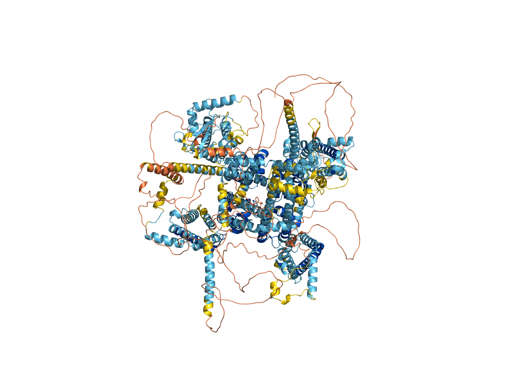
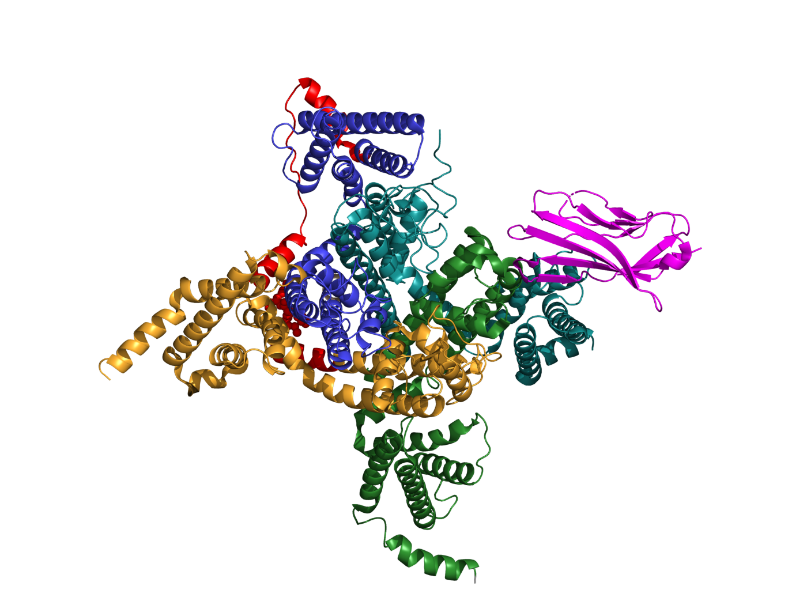
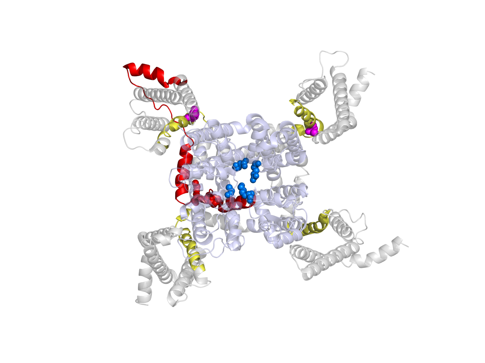
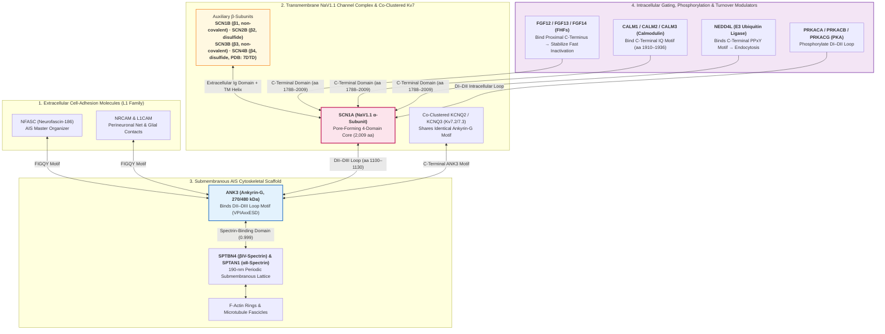

# 🧬 Study Guide: The *SCN1A* Gene ($\text{Na}_\text{V}1.1$)

## 1. Normal Function: What does *SCN1A* do?

### 1.1 Gene & Protein Structure
* **Genomic Location:** Chromosome `2q24.3` (contains 26–27 coding exons, encoding a ~2,009-amino-acid protein of ~229 kDa).
* **The Protein ($\text{Na}_\text{V}1.1$):** *SCN1A* encodes the **$\alpha$ (alpha) subunit** of the voltage-gated sodium channel **$\text{Na}_\text{V}1.1$** (one of nine human voltage-gated sodium channels, $\text{Na}_\text{V}1.1\text{–}\text{Na}_\text{V}1.9$).
* **Architecture:** The $\alpha$ subunit folds into **four homologous domains ($\text{DI–DIV}$)**, each containing **six transmembrane $\alpha$-helical segments ($\text{S1–S6}$)**:
  * **$\text{S1–S4}$ (Voltage Sensor):** Segment **$\text{S4}$** contains positively charged amino acids that move outward when the cell membrane depolarizes, triggering the channel to open.
  * **$\text{S5–S6}$ (Pore Region):** Forms the central $\text{Na}^+$-selective pore through which sodium ions rush into the neuron.
  * **$\text{DIII–DIV}$ Intracellular Loop (Inactivation Gate):** Acts as a "hinged lid" that rapidly folds over the inner mouth of the pore milliseconds after opening, stopping $\text{Na}^+$ influx so the neuron can reset.

### 1.2 Developmental Splicing ("Poison Exon 20N")
* During fetal brain development, *SCN1A* pre-mRNA frequently includes an alternative non-coding "poison exon" (**exon 20N** in intron 20). Including exon 20N introduces a premature stop codon, causing the transcript to be degraded (nonsense-mediated decay) and keeping $\text{Na}_\text{V}1.1$ levels low before birth.
* After birth (around 5–9 months in humans), exon 20N inclusion is downregulated, causing functional $\text{Na}_\text{V}1.1$ protein expression to rise sharply. *(This explains why SCN1A loss-of-function disorders typically don't cause seizures immediately at birth, and it is also the target of modern antisense oligonucleotide therapies!)*

### 1.3 Cellular Role: The "Brakes" of the Brain
* **Where it lives:** While excitatory pyramidal neurons rely mainly on $\text{Na}_\text{V}1.2$ (*SCN2A*) and $\text{Na}_\text{V}1.6$ (*SCN8A*), **$\text{Na}_\text{V}1.1$ is predominantly expressed at the axon initial segment (AIS) and nodes of Ranvier of inhibitory GABAergic interneurons**—especially fast-spiking **parvalbumin-positive ($\text{PV}^+$)** basket cells and **somatostatin-positive ($\text{SST}^+$)** interneurons in the cortex, hippocampus, and cerebellum.
* **Why it matters:** $\text{PV}^+$ interneurons must fire action potentials at very high frequencies to release **GABA** (the brain's main inhibitory neurotransmitter) onto excitatory neurons. $\text{Na}_\text{V}1.1$ enables this rapid, sustained firing, maintaining the brain's **Excitation–Inhibition (E/I) balance** and generating healthy gamma/theta brain oscillations needed for attention, memory, and cognition.

---

## 2. Pathology: Why does breaking a sodium channel cause seizures?

### 2.1 The "Interneuron Hypothesis" Paradox
A classic exam question in neurobiology is: *"If sodium channels excite neurons, why does losing $\text{Na}_\text{V}1.1$ cause hyperexcitability (epilepsy) instead of silencing the brain?"*
* **Answer:** Because $\text{Na}_\text{V}1.1$ is the engine for **inhibitory interneurons** (the brain's brakes). When *SCN1A* has a **Loss-of-Function (LoF)** mutation, inhibitory interneurons cannot sustain high-frequency firing ("stuttering" or failing to propagate action potentials). Without GABAergic inhibition, excitatory pyramidal neurons fire uncontrollably (**disinhibition**), leading to seizures.

### 2.2 The Genotype–Phenotype Spectrum
Depending on whether a mutation causes **Loss-of-Function (LoF)** or **Gain-of-Function (GoF)**—and how severely it impairs the channel—*SCN1A* variants produce a striking spectrum of disorders:

| Condition | Mechanism | Typical Variants | Key Clinical Features |
| :--- | :--- | :--- | :--- |
| **Febrile Seizures (FS) / GEFS+** *(Genetic Epilepsy with Febrile Seizures Plus)* | **Mild LoF** (or mixed biophysical effects) | Missense mutations (often autosomal dominant with variable penetrance) | Mildest end of the spectrum. Fever-induced seizures in childhood that may persist past age 6, or mild generalized/focal afebrile seizures. Normal cognition. |
| **Dravet Syndrome (DS)** *(Severe Myoclonic Epilepsy of Infancy)* | **Severe LoF / Haploinsufficiency** (~50% reduction in functional $\text{Na}_\text{V}1.1$) | >80% *de novo*; >50% are truncating (nonsense, frameshift, splice-site) or pore-region ($\text{S5–S6}$) missense mutations; rare intron 20 "poison exon" variants | Begins at **4–12 months** in previously healthy infants with prolonged, fever-triggered hemiclonic or generalized tonic-clonic seizures (and status epilepticus). Progresses after age 1–2 to multiple drug-resistant seizure types, intellectual disability, ataxia/"crouch gait", autism/ADHD traits, and a high risk of **SUDEP** (Sudden Unexpected Death in Epilepsy). |
| **Early Infantile DEE (EIDEE) / NMDAR-like Movement Disorder & Arthrogryposis** | **Moderate Gain-of-Function (GoF)** (impaired inactivation, faster recovery) | Missense mutations clustering in voltage sensor ($\text{S4}$, e.g., `p.Thr226Met`) and $\text{DIII–DIV}$ inactivation linker | Starts **<3 months of age** (or neonatally in the first 3 days of life with congenital joint contractures/arthrogryposis). Profound developmental impairment, severe hyperkinetic movement disorder, and apneas. |
| **Familial Hemiplegic Migraine Type 3 (FHM3)** | **Strong Gain-of-Function (GoF)** (large persistent $\text{Na}^+$ current) | Missense mutations (e.g., `p.Leu1649Gln`, clustering in $\text{DIII–DIV}$) | Severe migraine with hemiplegic (one-sided weakness) aura. Hyperexcitable interneurons fire excessively, causing extracellular $\text{K}^+$ accumulation and a wave of **Cortical Spreading Depolarization (CSD)**. |

---

## 3. Therapeutics: From Pharmacology to Precision Medicine

### 3.1 Crucial Clinical Rule: Loss-of-Function vs. Gain-of-Function
* **In Dravet Syndrome (LoF):** Standard **Sodium Channel Blockers (SCBs)**—such as *carbamazepine, oxcarbazepine, lamotrigine, and phenytoin*—are **CONTRAINDICATED**. Because the patient already has too little $\text{Na}_\text{V}1.1$ in their inhibitory interneurons, blocking the remaining channels worsens disinhibition, aggravates seizures, and harms cognitive development.
* **In *SCN1A* Gain-of-Function EIDEE:** Conversely, because the channel is overactive, **sodium channel blockers are often effective** (improving seizures in ~81% of GoF patients in clinical cohorts).

### 3.2 Approved Pharmacological Treatments for Dravet Syndrome (LoF)
Because standard sodium channel blockers fail in Dravet syndrome, treatment focuses on boosting GABAergic inhibition or modulating network excitability:
1. **First-Line Baseline Therapy:**
   * **Valproic Acid (VPA):** Broad-spectrum antiseizure medication that increases brain GABA levels.
   * **Clobazam:** A 1,5-benzodiazepine ($\text{GABA}_\text{A}$ receptor positive allosteric modulator) that strengthens inhibitory postsynaptic currents.
2. **Targeted Add-On Therapies (FDA/EMA Approved for Dravet Syndrome):**
   * **Stiripentol (Diacomit):** Allosterically enhances $\text{GABA}_\text{A}$ receptors and inhibits cytochrome P450 enzymes (which boosts active clobazam/norclobazam levels). The combination of *Valproate + Clobazam + Stiripentol* has historically been a classic triad.
   * **Fenfluramine (Fintepla):** Enhances serotonin ($5\text{-HT}$) release, activates multiple $5\text{-HT}$ receptors, and positively modulates Sigma-1 receptors. In randomized trials and network meta-analyses, fenfluramine shows some of the highest responder rates (>60% reduction in monthly convulsive seizures) and reduces status epilepticus/SUDEP risk (requires periodic echocardiogram monitoring).
   * **Cannabidiol / CBD (Epidiolex):** Purified, non-psychoactive cannabinoid approved as adjunctive therapy (~39–49% median reduction in convulsive seizures via GPR55 antagonism, TRPV1 desensitization, and adenosine modulation).
3. **Non-Pharmacological & Investigational Agents:**
   * **Ketogenic Diet:** High-fat, low-carbohydrate diet that significantly reduces seizure frequency and SUDEP mortality in both mouse models and clinical cohorts.
   * **Investigational small molecules:** **Soticlestat** (cholesterol 24-hydroxylase inhibitor modulating NMDA signaling) and **Clemizole / EPX-100** (serotonergic modulator discovered via *scn1a* mutant zebrafish drug screening).

### 3.3 Emerging Precision Medicine & Gene Therapies (Fixing the Root Cause)
Why can't we just pack the full *SCN1A* gene into a standard viral vector (AAV) and replace it? Because the *SCN1A* coding sequence (~6 kb) is **too large** to fit inside a standard Adeno-Associated Virus (AAV packaging limit is ~4.7 kb). Scientists have engineered clever ways around this to boost the patient's single healthy copy of *SCN1A*:

1. **Antisense Oligonucleotides (ASOs) — *STK-001 (Zorevunersen)*:**
   * Uses **TANGO** (*Targeted Augmentation of Nuclear Gene Output*) technology.
   * As mentioned in Section 1, *SCN1A* naturally produces some unproductive mRNA containing "poison exon 20N." **STK-001** is a synthetic RNA snippet injected into the spinal fluid (intrathecally) that binds to pre-mRNA and **blocks exon 20N inclusion**, forcing the cell to produce more full-length, functional $\text{Na}_\text{V}1.1$ protein from the healthy allele.
   * In mouse models, a single dose restored $\text{Na}_\text{V}1.1$ levels and prevented SUDEP; it is currently in human clinical trials (e.g., MONARCH/ADMIRAL studies).
2. **Cell-Selective Gene Regulation Therapy — *ETX101*:**
   * Instead of delivering the huge *SCN1A* gene, **ETX101** uses an AAV9 vector to deliver a small **engineered transcription factor (eTF)** controlled by a **GABAergic-interneuron-specific regulatory promoter**.
   * This ensures that *SCN1A* transcription is turned up **only inside inhibitory interneurons** (avoiding off-target expression in excitatory cells). It rescued seizures and survival in Dravet mice and was well-tolerated in non-human primates, leading to ongoing pediatric clinical trials (ENDEAVOR study).
3. **CRISPR Activation (CRISPRa):**
   * Uses a "dead" Cas9 (dCas9) fused to transcriptional activators targeted to the *SCN1A* promoter to boost transcription of the healthy wild-type allele in preclinical models.

---

## 4. 3D Protein Structure & Structural Biology Analysis ($\text{Na}_\text{V}1.1$ / UniProt `P35498`)

To move from 2D cartoons to the actual 3D molecular machine, we combined four structural biology resources:
* **UniProtKB (`P35498`, `SCN1A_HUMAN`):** Exact sequence annotations, transmembrane topology, and functional motifs (2,009 amino acids).
* **AlphaFold Protein Structure Database ([`structures/AF-P35498-F1-model_v6.cif`](structures/AF-P35498-F1-model_v6.cif)):** Full-length AI-predicted 3D structure (all 2,009 residues), per-residue confidence (**pLDDT**), and **Predicted Aligned Error (PAE)** domain-packing metrics ([`data/AF-P35498-F1-predicted_aligned_error_v6.json`](data/AF-P35498-F1-predicted_aligned_error_v6.json)).
* **RCSB Protein Data Bank (`PDB: 7DTD`, [`structures/7DTD.cif`](structures/7DTD.cif)):** Experimental **Cryo-Electron Microscopy (Cryo-EM)** structure of human $\text{Na}_\text{V}1.1$ in complex with the auxiliary $\beta_4$ subunit (`SCN4B`) at **3.30 Å resolution** (*Pan et al., PNAS 2021*).
* **PyMOL 3D Rendering & Structural Alignment ([`scripts/render_scn1a_structures.py`](scripts/render_scn1a_structures.py)):** Direct 3D superposition, pore-distance measurements, and ray-traced figures (saved alongside interactive `.pse` PyMOL session files in [`figures/`](figures/)).

---

### 4.1 Exact Sequence & Transmembrane Topology (UniProt `P35498`)

Unlike potassium channels (which assemble from four separate protein chains), the $\text{Na}_\text{V}1.1$ $\alpha$-subunit is a **single giant polypeptide chain (2,009 amino acids)** folded into **four homologous repeats ($\text{DI–DIV}$)** that wrap into a pseudotetrameric ring in the cell membrane:

| Structural Region | Residue Range (`P35498`) | Key Sub-Structures & Functional Motifs | Mean AlphaFold pLDDT | Structural State |
| :--- | :---: | :--- | :---: | :--- |
| **N-Terminus** | `1–109` | Cytoplasmic N-terminal domain (disordered `28–60`) | **70.1** | Partially folded |
| **Domain I ($\text{DI}$)** | `110–454` | **VSD-I ($\text{S1–S4}$):** `129–235` ($\text{S4}$ voltage sensor: `214–235`, contains `Thr226`)<br>**Pore-I ($\text{S5–P–S6}$):** `246–423` (P-loop `370–384`, contains **`Asp382`** of DEKA filter) | **80.3** | Rigid transmembrane core |
| **$\text{DI–DII}$ Cytoplasmic Linker** | `455–749` | Large intracellular regulatory loop (phosphorylation sites; disordered `455–529`, `584–627`) | **34.7** | **Intrinsically Disordered** |
| **Domain II ($\text{DII}$)** | `750–1022` | **VSD-II ($\text{S1–S4}$):** `769–874` ($\text{S4}$: `855–874`)<br>**Pore-II ($\text{S5–P–S6}$):** `892–992` (P-loop `939–952`, contains **`Glu951`** of DEKA filter) | **81.0** | Rigid transmembrane core |
| **$\text{DII–DIII}$ Cytoplasmic Linker** | `1023–1199` | Intracellular loop containing the **Ankyrin-G binding motif** that anchors $\text{Na}_\text{V}1.1$ to the **Axon Initial Segment (AIS)** | **39.2** | **Intrinsically Disordered** |
| **Domain III ($\text{DIII}$)** | `1200–1483` | **VSD-III ($\text{S1–S4}$):** `1219–1332` ($\text{S4}$: `1314–1332`)<br>**Pore-III ($\text{S5–P–S6}$):** `1346–1483` (P-loop `1416–1433`, contains **`Lys1432`** of DEKA filter) | **86.7** | Rigid transmembrane core |
| **$\text{DIII–DIV}$ Fast Inactivation Gate** | `1484–1541` | Short intracellular "hinged lid" linker containing the hydrophobic **`IFM` motif (`Ile1498–Phe1499–Met1500`)** | **71.8** | Structured latch / flexible hinge |
| **Domain IV ($\text{DIV}$)** | `1542–1788` | **VSD-IV ($\text{S1–S4}$):** `1542–1655` ($\text{S4}$: `1637–1655`, contains `Leu1649`; spider toxin site `Glu1574`)<br>**Pore-IV ($\text{S5–P–S6}$):** `1666–1788` (P-loop `1712–1726`, contains **`Ala1724`** of DEKA filter) | **83.9** | Rigid transmembrane core |
| **C-Terminal Core & IQ Domain** | `1789–1944` | Globular cytoplasmic EF-hand-like domain + **Calmodulin-binding `IQ` motif (`1915–1944`)** | **73.2** | Folded cytoplasmic domain |
| **C-Terminal Tail** | `1945–2009` | Extreme C-terminal disordered tail (`1986–2009`) | **32.1** | **Intrinsically Disordered** |

---

### 4.2 AlphaFold 2 Confidence (pLDDT) & Domain Flexibility (PAE) Analysis

> **⚠️ Mandatory Structural Interpretation Warnings:**
> 1. **Low pLDDT (< 50) Indicates Intrinsic Disorder, Not Just "Bad Prediction":** In AlphaFold models, long ribbon-like "spaghetti" loops with $\text{pLDDT} < 50$ represent regions that are **intrinsically disordered in solution** and do not adopt a single fixed 3D fold in isolation. You should **never** trust the exact 3D coordinates of residues in these low-confidence loops (`455–749`, `1023–1199`, `1945–2009`).
> 2. **PAE (Predicted Aligned Error) vs. Local pLDDT:** A domain can have high local confidence (high pLDDT) while its *relative position* to another domain is uncertain (high PAE). Here, PAE analysis ([`data/AF-P35498-F1-predicted_aligned_error_v6.json`](data/AF-P35498-F1-predicted_aligned_error_v6.json)) yields a mean global PAE of **19.86 Å** because the large cytoplasmic linkers (`DI–DII` and `DII–DIII`) are flexible joints, whereas the four transmembrane repeats ($\text{DI–DIV}$) pack together as a cohesive intramembrane core.

* **Overall Global pLDDT (`P35498`):** **68.50**
  * **Very High ($\ge 90$):** `16.3%` of residues (core transmembrane $\alpha$-helices and pore selectivity filter)
  * **Confident ($70\text{–}90$):** `45.2%` of residues (most of $\text{DI–DIV}$, the $\text{DIII–DIV}$ inactivation gate, and the C-terminal EF-hand/IQ domain)
  * **Low ($50\text{–}70$):** `13.0%` of residues (extracellular loops and linker transitions)
  * **Very Low ($< 50$):** `25.5%` of residues (almost entirely the $\text{DI–DII}$ and $\text{DII–DIII}$ cytoplasmic loops and extreme C-terminus)


* **Figure 1 ([`figures/fig1_alphafold_plddt.png`](figures/fig1_alphafold_plddt.png) | PyMOL session: [`figures/fig1_alphafold_plddt.pse`](figures/fig1_alphafold_plddt.pse) | Structure: [`structures/AF-P35498-F1-model_v6.cif`](structures/AF-P35498-F1-model_v6.cif)):** Full-length AlphaFold 2 prediction colored by canonical pLDDT thresholds (**Dark Blue** $\ge 90$, **Light Blue** $70\text{–}90$, **Yellow** $50\text{–}70$, **Orange** $< 50$). Notice how the central 24-helix transmembrane bundle ($\text{DI–DIV}$) is tightly folded with high confidence (blue), while the long intracellular $\text{DI–DII}$ and $\text{DII–DIII}$ linkers loop out into the cytoplasm as flexible orange ribbons ($\text{pLDDT} < 50$). In real neurons, these flexible loops are invisible in Cryo-EM maps because they move constantly—acting as "molecular fishing lines" that bind regulatory kinases and **Ankyrin-G** at the Axon Initial Segment!

---

### 4.3 Experimental Cryo-EM Structure (`PDB: 7DTD`) vs. AlphaFold Model

In 2021, structural biologist Nieng Yan and colleagues solved the experimental **Cryo-EM structure of human $\text{Na}_\text{V}1.1$ bound to the auxiliary $\beta_4$ subunit (`PDB: 7DTD`, [`structures/7DTD.cif`](structures/7DTD.cif)) at 3.30 Å resolution** (*Pan et al., PNAS 2021*).

* **How closely does AlphaFold match the experimental Cryo-EM structure?**
  When we superpose the transmembrane core ($\text{DI–DIV}$) of AlphaFold ([`structures/AF-P35498-F1-model_v6.cif`](structures/AF-P35498-F1-model_v6.cif)) onto the experimental Cryo-EM structure ([`structures/7DTD.cif`](structures/7DTD.cif), Chain A) in PyMOL, they align with an **$\text{RMSD} = 1.035\text{ Å}$ across 932 $\text{C}_\alpha$ atoms**—near-atomic agreement!
* **What does `7DTD` show that AlphaFold alone does not?**
  1. **The Auxiliary $\beta_4$ Subunit (Chain B, Magenta):** `7DTD` captures how the extracellular immunoglobulin (Ig) domain of the $\beta_4$ subunit (`SCN4B`) docks onto the extracellular loops of $\text{Na}_\text{V}1.1$ while its single transmembrane helix packs beside $\text{DI}$, helping stabilize the channel in the membrane and modulate gating kinetics.
  2. **Domain-Swapped Architecture:** Looking down at the channel (`Figure 2`), each Voltage-Sensing Domain ($\text{S1–S4}$) does *not* hug its own pore module ($\text{S5–S6}$); instead, it reaches clockwise around the perimeter to hug the **neighboring domain's pore module** (e.g., $\text{VSD-I}$ packs against $\text{Pore-II}$). This **domain-swapped pinwheel** explains why all four domains work together cooperatively to open and close the central pore.


* **Figure 2 ([`figures/fig2_cryoem_7dtd_domains.png`](figures/fig2_cryoem_7dtd_domains.png) | PyMOL session: [`figures/fig2_cryoem_7dtd_domains.pse`](figures/fig2_cryoem_7dtd_domains.pse) | Structure: [`structures/7DTD.cif`](structures/7DTD.cif)):** Experimental Cryo-EM structure (`PDB: 7DTD`, 3.30 Å) showing the pseudotetrameric architecture of $\text{Na}_\text{V}1.1$ (Chain A) and its auxiliary **$\beta_4$ subunit** (Chain B, **Magenta**).
  * **Domain I (`110–454`):** Deep Teal
  * **Domain II (`750–1022`):** Forest Green
  * **Domain III (`1200–1483`):** Bright Orange
  * **Domain IV (`1542–1788`):** Blue
  * **$\text{DIII–DIV}$ Fast Inactivation Gate (`1484–1541`) & `IFM` Latch (`Ile1498–Phe1499–Met1500`):** Bright **Red** (with `IFM` shown as red spheres).

---

### 4.4 Mapping Function & Disease Hotspots in 3D Space (`Figure 3`)

Why does **where** a missense mutation sits in the 3D structure determine whether a patient develops **Loss-of-Function Dravet Syndrome** versus **Gain-of-Function EIDEE / Familial Hemiplegic Migraine (FHM3)**? Looking straight down the central pore of `PDB: 7DTD` (`Figure 3`) makes the biophysics crystal clear:

1. **The Central Pore & `DEKA` Selectivity Filter (Blue Spheres — Loss-of-Function Hotspot):**
   * At the exact center of the channel, one residue from each domain's P-loop comes together to form the asymmetric **$\text{DEKA}$ selectivity filter ring**:
     * **`Asp382` ($\text{D}$)** from Domain I (`370–384`)
     * **`Glu951` ($\text{E}$)** from Domain II (`939–952`)
     * **`Lys1432` ($\text{K}$)** from Domain III (`1416–1433`)
     * **`Ala1724` ($\text{A}$)** from Domain IV (`1712–1726`)
   * In `7DTD`, the $\text{C}_\alpha$ diameter across this filter ring is **10.60 Å** (`Asp382` $\leftrightarrow$ `Lys1432`) by **12.04 Å** (`Glu951` $\leftrightarrow$ `Ala1724`), creating a narrow electrostatic constriction that strips away larger or divalent ions ($\text{K}^+, \text{Ca}^{2+}$) and lets only hydrated $\text{Na}^+$ ions pass.
   * **Clinical Consequence:** Missense mutations in the **light-blue $\text{S5–S6}$ pore-lining helices or the $\text{DEKA}$ selectivity filter** physically collapse or plug the ion-conduction pathway or prevent the protein from folding in the ER $\rightarrow$ **Loss of Function (Dravet Syndrome)**.

2. **The `IFM` Fast Inactivation Gate (`Ile1498–Phe1499–Met1500`, Red Spheres — Allosteric Doorstop):**
   * Rather than plugging the pore directly like a cork, the hydrophobic **`IFM` motif (`Ile1498–Phe1499–Met1500`)** on the red $\text{DIII–DIV}$ linker acts as an **allosteric wedge**: within 1–2 ms of channel opening, it inserts into a hydrophobic receptor pocket on the intracellular side of the $\text{DIII}/\text{DIV}$ $\text{S4–S5}$ linkers and $\text{S6}$ helices, squeezing the bottom of the $\text{S6}$ bundle shut.
   * **Clinical Consequence:** Mutations in or around the **red $\text{DIII–DIV}$ inactivation linker** or its intracellular receptor pocket prevent this latch from staying closed, allowing a persistent "leaky" $\text{Na}^+$ current $\rightarrow$ **Gain of Function (FHM3 / EIDEE)**.

3. **The Voltage-Sensing $\text{S4}$ Helices (Yellow Helices & Magenta Spheres — Gain-of-Function Hotspots):**
   * The four **yellow $\text{S4}$ helices** sit on the outer corners of the channel and carry repeating positively charged arginine/lysine residues (`R/K`) that slide outward when the membrane depolarizes.
   * **Magenta Spheres in `Figure 3`** highlight two famous clinical **Gain-of-Function** mutations right inside the $\text{S4}$ voltage sensors:
     * **`Thr226` in $\text{DI-S4}$ (`p.Thr226Met`):** Destabilizes the resting state of Voltage Sensor I so the channel opens too easily (hyperpolarizing shift in activation) $\rightarrow$ **Early Infantile Developmental and Epileptic Encephalopathy (EIDEE)**.
     * **`Leu1649` in $\text{DIV-S4}$ (`p.Leu1649Gln`):** Because $\text{VSD-IV}$ specifically triggers fast inactivation, mutating `Leu1649` in $\text{DIV-S4}$ impairs fast inactivation and speeds recovery from inactivation $\rightarrow$ **Familial Hemiplegic Migraine Type 3 (FHM3)**.


* **Figure 3 ([`figures/fig3_functional_and_disease_hotspots.png`](figures/fig3_functional_and_disease_hotspots.png) | PyMOL session: [`figures/fig3_functional_and_disease_hotspots.pse`](figures/fig3_functional_and_disease_hotspots.pse) | Structure: [`structures/7DTD.cif`](structures/7DTD.cif)):** Top-down extracellular view looking straight through the central $\text{Na}^+$ pore of human $\text{Na}_\text{V}1.1$ (`PDB: 7DTD`).
  * **Blue Spheres (Center):** The **`DEKA` $\text{Na}^+$ Selectivity Filter** (`Asp382`, `Glu951`, `Lys1432`, `Ala1724`) surrounded by the **Pale Blue $\text{S5–S6}$ Pore Module** (where **Loss-of-Function Dravet** missense mutations cluster).
  * **Yellow Helices (Four Corners):** The positively charged **$\text{S4}$ Voltage-Sensing Helices** of $\text{DI–DIV}$.
  * **Magenta Spheres:** Classic **Gain-of-Function** mutation hotspots **`Thr226`** ($\text{DI-S4}$, EIDEE) and **`Leu1649`** ($\text{DIV-S4}$, FHM3).
  * **Red Ribbon & Spheres:** The **$\text{DIII–DIV}$ Fast Inactivation Gate** (`1484–1541`) and **`IFM` Latch (`Ile1498–Phe1499–Met1500`)** wedged at the $\text{DIII}/\text{DIV}$ interface.

---

## 5. Clinical & Population Genetics (`gnomAD`, `ClinVar`, `dbSNP`)

Now that we understand how $\text{Na}_\text{V}1.1$ works in neural circuits (Sections 1–3) and how its 3D molecular machine is built (Section 4), how do clinical geneticists actually interpret a patient's DNA sequencing report when they find a variant in ***SCN1A*** (`chr2q24.3`, minus strand, Ensembl `ENSG00000144285`, RefSeq `NM_001165963.4` / MANE Select)?

To answer that, we combine **population genetics** (**gnomAD** — what variation exists in ~807,000 generally healthy humans?) with **clinical genetics** (**ClinVar** & **dbSNP** — what variants have been observed in patients with epilepsy or migraine?).

---

### 5.1 Population Constraint in `gnomAD`: Why Losing One Copy of *SCN1A* Is Catastrophic

In population genetics, **natural (purifying) selection** weeds out harmful mutations from the human gene pool. By comparing the **expected** number of mutations in a gene (based on gene length, sequence context, and mutation rates) against the **observed** number of mutations in healthy reference populations (**gnomAD**), we can measure how intolerant a gene is to mutation:

| Variant Class | Expected Count (gnomAD) | Observed Count (gnomAD) | Observed / Expected Ratio (`o/e`) | 90% Confidence Interval (`o/e`) | Key Constraint Metric | Student Interpretation |
| :--- | :---: | :---: | :---: | :---: | :---: | :--- |
| **Predicted Loss-of-Function (`pLoF`)** *(nonsense, frameshift, canonical splice)* | `104.3` | **`7`** | **`0.067`** *(only 6.7% of expected!)* | `0.044 – 0.107` | **`pLI = 1.000`**<br>**`LOEUF = 0.107`** | **Extreme haploinsufficiency intolerance.** `pLI = 1.0` is the maximum possible score, and `LOEUF = 0.107` is far below the `< 0.35` threshold for haploinsufficient genes. Over **93% of expected truncating variants are eliminated by natural selection** (`0` high-confidence pLoF variants pass all clinical filters in gnomAD v4). |
| **Missense** *(single amino acid substitutions)* | `1,158.9` | **`677`** | **`0.584`** *(58.4% of expected)* | `0.559 – 0.610` | **`Z = 5.03`** | **Strong missense constraint.** Over 41% of expected amino acid substitutions are missing from the general population—specifically those in the rigid transmembrane helices ($\text{S4}$, $\text{S5–S6}$, `DEKA` pore, and `IFM` gate), whereas benign missense variants cluster in the flexible, low-pLDDT intracellular loops we saw in **Figure 1**. |
| **Synonymous** *(silent coding changes — neutral control)* | `434.2` | **`434`** | **`1.000`** *(100.0% of expected)* | `0.935 – 1.068` | **`Z = 0.01`** | **Perfect neutral baseline.** Silent DNA changes that do not alter the amino acid sequence occur at 100% of the expected rate (`434` observed vs. `434.2` expected), proving that the depletion of `pLoF` and missense variants is driven by biological purifying selection rather than low sequencing coverage. |

> **🎓 Student Takeaway — Why `LOEUF = 0.107` and `pLI = 1.0` Matter in the Clinic:**
> Because healthy humans almost never carry truncating (*Loss-of-Function*) variants in *SCN1A*, finding a *de novo* nonsense or frameshift variant in an infant with seizures immediately triggers the strongest pathogenic evidence code in clinical genetics (**ACMG/AMP `PVS1` — Very Strong evidence of pathogenicity for a null variant in a gene where Loss-of-Function is a known mechanism of disease**).

---

### 5.2 The Clinical Variant Landscape in `ClinVar`: Pathogenic Spectrum vs. the "VUS Problem"

Querying NCBI **ClinVar** across the entire ***SCN1A*** gene reveals **5,536 total reported clinical variants**, making *SCN1A* one of the most frequently sequenced—and clinically actionable—genes in human neurology:

* **Total Pathogenic / Likely Pathogenic Variants:** **`3,078` variants**
  * **Pathogenic Missense (`1,734` variants, ~56% of pathogenic):** Single amino acid changes that either destroy channel folding/pore conduction (**Loss-of-Function** $\rightarrow$ Dravet Syndrome / GEFS+) or impair inactivation/shift voltage gating (**Gain-of-Function** $\rightarrow$ EIDEE / FHM3).
  * **Pathogenic Truncating — Nonsense & Frameshift (`944` variants, ~31% of pathogenic, including `554` nonsense stop-gained variants):** Premature stop codons or reading-frame shifts that cause **haploinsufficiency** (`50%` functional $\text{Na}_\text{V}1.1$ channels) $\rightarrow$ classic **Dravet Syndrome**.
  * **Splice-Site, Intronic & Structural Variants (~13% of pathogenic):** Canonical splice-site disruptions, whole-exon deletions, and deep intronic variants in **Poison Exon 20N** that cause aberrant nonsense-mediated decay (the exact target of the ASO therapy **zorevunersen / STK-001** from Section 3).
* **Variants of Uncertain Significance (`VUS`):** **`3,403` variants** *(some records carry multiple/conflicting submissions across categories)*
  * **Why are there so many `VUS` in *SCN1A*?** When a child has a **truncating** (`nonsense`/`frameshift`) variant, the diagnosis of Loss-of-Function is straightforward (`PVS1`). However, when a patient has a **novel missense variant** (an amino acid substitution never seen before), a sequencing lab cannot always tell from the DNA sequence alone whether that amino acid change is:
    1. A harmless polymorphism in a flexible loop (**Benign**),
    2. A **Loss-of-Function** folding/pore defect (**Dravet Syndrome** — avoid $\text{Na}^+$ channel blockers!), or
    3. A **Gain-of-Function** gating defect (**EIDEE / FHM3** — treat *with* $\text{Na}^+$ channel blockers!).
  * This is why combining **3D structural mapping (`PDB: 7DTD` / AlphaFold)**, **population frequency (`gnomAD`)**, and **functional patch-clamp or computational impact scoring** is the frontier of modern precision medicine in *SCN1A*.

---

### C. Benchmark Clinical Variants Across the 3D Structural Domains (`ClinVar` + `dbSNP` + `gnomAD`)

Below are **8 real clinical benchmark variants** retrieved from **ClinVar**, resolved to exact 1-based **GRCh38 (`<chrom>:<pos>:<ref>><alt>`)** genomic coordinates via **dbSNP** (note that because *SCN1A* sits on the **minus (`-`) strand** of Chromosome 2, a coding `C>T` change on the mRNA transcript corresponds to a `G>A` change on the GRCh38 reference genome plus strand), and cross-checked in **gnomAD v4**:

| Variant (Protein / cDNA on `NM_001165963.4`) | GRCh38 Coordinate (`<chrom>:<pos>:<ref>><alt>`) | dbSNP rsID & ClinVar ID (Review Stars) | 3D Structural Location (`PDB: 7DTD` / `AF-P35498-F1`) | Clinical Classification & Phenotype | Functional Mechanism | gnomAD v4 Allele Frequency (`AF`) | Clinical & ACMG/AMP Rationale |
| :--- | :--- | :--- | :--- | :--- | :--- | :--- | :--- |
| **`p.Arg222Ter`**<br>(`c.664C>T`) | `chr2:166052882:G>A` | `rs121918624`<br>ClinVar: **`12889`**<br>(`★★☆☆` 2 stars, multiple submitters, no conflicts) | **Domain I ($\text{DI-S4}$)**<br>Early premature stop codon at residue `222` (of `2,009`) | **Pathogenic / Likely Pathogenic**<br>Dravet Syndrome (SMEI), GEFS+ Type 2 | **Complete Loss-of-Function (Haploinsufficiency)** via Nonsense-Mediated mRNA Decay (NMD) | **Absent**<br>(`AF = 0.0`) | Premature stop codon (`CGA>TGA`) in early exon triggers NMD (`PVS1`) and is completely absent from general populations (`PM2_Supporting`). |
| **`p.Arg1645Ter`**<br>(`c.4933C>T`) | `chr2:165992342:G>A` | `rs794726759`<br>ClinVar: **`189921`**<br>(`★★☆☆` 2 stars, 8 submitters incl. Labcorp/Invitae, GeneDx, 3billion) | **Domain IV ($\text{DIV-S4}$)**<br>Premature stop codon at residue `1645` | **Pathogenic**<br>Dravet Syndrome (SMEI), EIDEE, GEFS+ Type 2 | **Loss-of-Function (Truncation)**<br>Deletes the last `365` amino acids ($\text{DIV}$ pore module & C-terminal domain) | **Absent**<br>(`AF = 0.0` in gnomAD v4.1) | Even if late-exon mRNA escapes NMD, truncating the final `365` residues removes the $\text{DIV}$ $\text{S5–S6}$ pore-forming helices and C-terminus, destroying channel assembly (`PVS1`, `PM2`, `PS4`). |
| **`p.Asp382Glu`**<br>(`c.1146C>A`) | `chr2:166047651:G>T` | `rs794726753`<br>ClinVar: **`189913`**<br>(`★★☆☆` 2 stars, multiple submitters, no conflicts) | **`DEKA` $\text{Na}^+$ Selectivity Filter (`Asp382` / `D` in Domain I)**<br>*(Blue sphere in **Fig. 3**)* | **Pathogenic**<br>Dravet Syndrome (SMEI), EIDEE | **Loss-of-Function (Pore Selectivity Filter Disruption)** | **Absent**<br>(`AF = 0.0`) | Even a conservative acidic substitution (`Asp` $\rightarrow$ `Glu`, adding just one $-\text{CH}_2-$ carbon group at `Asp382`) alters the sub-Ångström geometry (`10.60 Å` ring) of the `DEKA` selectivity filter (`PM1`, `PM2`, `PM5`). |
| **`p.Glu951Lys`**<br>(`c.2851G>A`) | `chr2:166037871:C>T` | `rs1553541206`<br>ClinVar: **`2100352`**<br>(`★☆☆☆` 1 star, criteria provided, single submitter) | **`DEKA` $\text{Na}^+$ Selectivity Filter (`Glu951` / `E` in Domain II)**<br>*(Blue sphere in **Fig. 3**)* | **Pathogenic**<br>Early-Infantile DEE / Dravet Spectrum | **Loss-of-Function (Electrostatic Pore Collapse)** | **Absent**<br>(`AF = 0.0`) | Replaces the negatively charged `Glu951` ($-1$) that coordinates $\text{Na}^+$ ions with a positively charged `Lys` ($+1$), electrostatically repelling $\text{Na}^+$ ions from the central pore (`PM1`, `PM2`, `PP3`). |
| **`p.Lys1432Ile`**<br>(`c.4295A>T`) | `chr2:165999766:T>A` | `rs1690583220`<br>ClinVar: **`836631`**<br>(`★☆☆☆` 1 star, criteria provided, single submitter — Invitae/Labcorp) | **`DEKA` $\text{Na}^+$ Selectivity Filter (`Lys1432` / `K` in Domain III)**<br>*(Blue sphere in **Fig. 3**)* | **Pathogenic**<br>Early-Infantile DEE / Dravet Syndrome | **Loss-of-Function (Selectivity Filter Loss)** | **Absent**<br>(`AF = 0.0`) | `Lys1432` is the indispensable positive charge of the `DEKA` ring that excludes divalent $\text{Ca}^{2+}$ ions and enforces $\text{Na}^+$ selectivity; mutating it to hydrophobic `Ile` abolishes normal $\text{Na}^+$ permeation (`PM1`, `PM2`). |
| **`p.Thr226Met`**<br>(`c.677C>T`) | `chr2:166052869:G>A` | `rs121917984`<br>ClinVar: **`68578`**<br>(`★★☆☆` 2 stars, multiple submitters, no conflicts) | **Domain I Voltage Sensor ($\text{DI-S4}$ Helix, residue `226`)**<br>*(Magenta sphere in **Fig. 3**)* | **Pathogenic**<br>Early-Infantile DEE (`DEE6B`), FHM3, Severe Myoclonic Epilepsy | **Gain-of-Function (Hyperpolarizing Shift in Activation)** | **Absent**<br>(`AF = 0.0` in gnomAD v4) | Prototype **Gain-of-Function** epilepsy variant (`Brunklaus et al., 2022`). Causes the $\text{DI-S4}$ voltage sensor to activate at more negative membrane potentials, triggering neuronal hyperexcitability and early neonatal/infantile seizures (`PS2`, `PS3`, `PM1`, `PM2`). |
| **`p.Phe1499Leu`**<br>(`c.4495T>C`) | `chr2:165996099:A>G` | `rs121918632`<br>ClinVar: **`12902`**<br>(`★★☆☆` 2 stars, multiple submitters, no conflicts) | **`IFM` Fast Inactivation Gate (`Ile1498–Phe1499–Met1500` in $\text{DIII–DIV}$ Linker)**<br>*(Red sphere in **Fig. 3**)* | **Pathogenic**<br>Familial Hemiplegic Migraine Type 3 (**FHM3**), EIDEE | **Gain-of-Function (Defective Fast Inactivation & Persistent $\text{Na}^+$ Current)** | **Ultra-Rare**<br>(`1 / 151,492` genomes, `AF = 6.60e-6`; `0` exomes) | Mutates the aromatic `Phe1499` centerpiece of the `IFM` hydrophobic latch (`1498–1500`), preventing the inactivation gate from staying docked in its $\text{DIII}/\text{DIV}$ pocket $\rightarrow$ leaky persistent $\text{Na}^+$ current and cortical spreading depression (`PS1`, `PS3`, `PM1`). |
| **`p.Met1619Val`**<br>(`c.4855A>G`)<br>*(Benign Control)* | `chr2:165992420:T>C` | `rs373967247`<br>ClinVar: **`206851`**<br>(`★★☆☆` 2 stars, multiple submitters, no conflicts) | **Domain IV Extracellular $\text{S3–S4}$ Linker (`1619`)** | **Benign / Likely Benign**<br>*(Healthy Population Polymorphism)* | **Neutral / Tolerated Substitution** | **Common in South Asia**<br>(`401 / 1,461,354` exomes, overall `AF = 2.74e-4`; South Asian `AF = 0.443%` (`382 / 86,256`) with **`7` healthy homozygotes**) | Demonstrates how **gnomAD prevents false-positive diagnoses**: although `p.Met1619Val` is a missense change in *SCN1A*, its high allele frequency in South Asian controls (`FAF95 = 0.406%`) and presence in **7 healthy adult homozygotes** proves it cannot cause a severe dominant infantile epilepsy (`BS1`, `BS2`). |

---

### D. How a Clinical Geneticist Integrates Structure + Population + Clinic (Summary Workflow)

When you look at the table above alongside our 3D PyMOL models (**Figures 1–3**), notice how three independent lines of evidence lock together:
1. **Population Filtering (`gnomAD`):** Any variant present at significant frequency in healthy adults—or seen in healthy homozygotes like `p.Met1619Val` (`chr2:165992420:T>C`, `7` homozygotes)—is ruled out as a cause of Dravet Syndrome or EIDEE (`BS1`/`BS2`). Conversely, true disease-causing *SCN1A* variants (`p.Arg222Ter`, `p.Arg1645Ter`, `p.Asp382Glu`, `p.Thr226Met`) have **`AF = 0.0`** in gnomAD (`PM2`).
2. **Variant Consequence (`ClinVar` + `dbSNP`):** If the variant is a premature stop codon (`p.Arg222Ter`, `p.Arg1645Ter`) or frameshift, `gnomAD`'s `pLI = 1.0` and `LOEUF = 0.107` confirm that *SCN1A* cannot tolerate haploinsufficiency $\rightarrow$ **Loss-of-Function (Dravet Syndrome)**.
3. **3D Structural Hotspot Mapping (`PDB: 7DTD` / `AlphaFold`):** If the variant is a missense change:
   * Sitting in the **`DEKA` selectivity filter** (`p.Asp382Glu`, `p.Glu951Lys`, `p.Lys1432Ile`) or **$\text{S5–S6}$ pore helices** $\rightarrow$ collapses $\text{Na}^+$ conduction $\rightarrow$ **Loss-of-Function (Dravet Syndrome; avoid $\text{Na}^+$ channel blockers)**.
   * Sitting in the **$\text{S4}$ voltage sensor** (`p.Thr226Met`, `p.Leu1649Gln`) or **`IFM` fast inactivation latch** (`p.Phe1499Leu`) $\rightarrow$ hyperactive opening or leaky inactivation $\rightarrow$ **Gain-of-Function (EIDEE / FHM3; responds to $\text{Na}^+$ channel blockers)**.

---

## 6. Tissue, Brain-Region & Subcellular Expression (`GTEx` & `Human Protein Atlas`)

Why does a mutation in ***SCN1A*** cause **epilepsy, cognitive impairment, and cerebellar ataxia**, while leaving skeletal muscle contraction and primary cardiac rhythm largely intact? And why can't doctors simply draw a blood sample (`Whole Blood` RNA-seq) to measure a patient's *SCN1A* transcript levels?

We can answer both questions quantitatively by querying two complementary human expression atlases:
1. **GTEx Portal (`gtex-database`, Release v10):** Quantitative bulk RNA-seq expression (in **TPM**, Transcripts Per Million) and **expression Quantitative Trait Loci (eQTLs)** across **54 non-diseased human tissue sites** for GENCODE ID **`ENSG00000144285.23`**.
2. **Human Protein Atlas (`human-protein-atlas-database`, HPA):** Tissue specificity clustering, brain regional classification, and immunocytochemistry (ICC) **subcellular localization** for Ensembl ID **`ENSG00000144285`**.

---

### A. Whole-Body mRNA Expression (`GTEx v10`): Over 100-Fold Enrichment in the Human Brain

Across all **54 human tissue sites** in GTEx v10, **every single one of the top 13 highest-expressing tissues in the human body is a brain region**:

* **13 Brain Regions (`Brain_*`):** Mean median expression = **`4.81 TPM`** (range **`1.24 – 11.96 TPM`**)
* **41 Non-Brain Tissues:** Mean median expression = **`0.046 TPM`** (range **`0.000 – 1.121 TPM`**) — representing a **>100-fold enrichment** of *SCN1A* mRNA in the central nervous system!

| Rank (of 54) | GTEx v10 Tissue Site (`tissueSiteDetailId`) | Anatomy Ontology (`UBERON` / `EFO`) | Median Expression (`TPM`) | Anatomical Category | Neurological & Clinical Relevance |
| :---: | :--- | :---: | :---: | :---: | :--- |
| **1** | **`Brain_Frontal_Cortex_BA9`** | `UBERON:0009834` | **`11.96`** | Cerebral Neocortex | Highest expression in the human body; drives neocortical fast-spiking $\text{PV}^+$ interneuron inhibition. Explains generalized/focal **seizures** and **executive/cognitive slowing** in Dravet syndrome. |
| **2** | **`Brain_Cerebellar_Hemisphere`** | `UBERON:0002037` | **`8.12`** | Cerebellum | High expression in **cerebellar Purkinje cells** and inhibitory basket/stellate interneurons; explains the hallmark **"crouched gait" and cerebellar ataxia** seen in children with Dravet syndrome. |
| **3** | **`Brain_Cerebellum`** | `UBERON:0002037` | **`7.17`** | Cerebellum | Second cerebellar sampling site confirming robust hindbrain motor-coordination expression. |
| **4** | **`Brain_Cortex`** | `UBERON:0001870` | **`6.97`** | Cerebral Neocortex | Broad cerebral cortex sampling; core circuit for E/I balance and cortical spreading depression (**FHM3**). |
| **5** | **`Brain_Hypothalamus`** | `UBERON:0001898` | **`4.83`** | Diencephalon (Autonomic / Thermoregulation) | Master regulator of body temperature, circadian rhythms, and autonomic output; explains extreme **thermal/fever sensitivity** of seizures and **sleep/autonomic dysregulation**. |
| **6** | **`Brain_Anterior_cingulate_cortex_BA24`** | `UBERON:0009835` | **`4.69`** | Limbic Cortex | Involved in attention, emotion, and cognitive control networks impaired in *SCN1A* encephalopathies. |
| **7** | **`Brain_Nucleus_accumbens_basal_ganglia`** | `UBERON:0001882` | **`3.82`** | Ventral Striatum / Basal Ganglia | Striatal GABAergic medium spiny neurons & fast-spiking interneurons; contributes to motor/behavioral comorbidities. |
| **8** | **`Brain_Caudate_basal_ganglia`** | `UBERON:0001873` | **`3.60`** | Dorsal Striatum / Basal Ganglia | Motor planning and extrapyramidal movement control; relevant to hyperkinetic movement disorders in *SCN1A* GoF (`DEE6B`). |
| **9** | **`Brain_Hippocampus`** | `UBERON:0001954` | **`2.87`** | Archicortex (Memory & Seizure Hub) | Critical site for temporal lobe seizure generation and spatial/episodic memory consolidation via hippocampal $\text{PV}^+$ and $\text{SST}^+$ interneurons. |
| **10** | **`Brain_Putamen_basal_ganglia`** | `UBERON:0001874` | **`2.78`** | Dorsal Striatum / Basal Ganglia | Works with the caudate nucleus and substantia nigra to regulate motor execution. |
| **11** | **`Brain_Amygdala`** | `UBERON:0001876` | **`2.43`** | Limbic System | Emotional processing and limbic seizure propagation; also linked to post-ictal central apnea pathways in SUDEP. |
| **12** | **`Brain_Substantia_nigra`** | `UBERON:0002038` | **`2.06`** | Midbrain / Basal Ganglia | GABAergic pars reticulata (`SNr`) output neurons play a major role in endogenous seizure suppression and extrapyramidal tone. |
| **13** | **`Brain_Spinal_cord_cervical_c-1`** | `UBERON:0006469` | **`1.24`** | Spinal Cord (CNS) | Dorsal and ventral horn spinal interneurons. |
| **14** | `Lung` *(Highest Non-Brain Tissue)* | `UBERON:0008952` | `1.12` | Respiratory / Peripheral | Low baseline expression (pulmonary neuroendocrine / vagal innervation). |
| **15** | `Cells_Cultured_fibroblasts` | `EFO:0002009` | `0.17` | Cultured Dermal Cells | Near-baseline (`0.17 TPM`), explaining why patient skin biopsies require iPSC reprogramming into neurons to study $\text{Na}_\text{V}1.1$ electrophysiology. |
| **20** | `Heart_Left_Ventricle` | `UBERON:0006566` | `0.024` | Cardiac Muscle | Trace expression (`0.024 TPM` vs. *SCN5A* / $\text{Na}_\text{V}1.5$); confirms **SUDEP in Dravet syndrome is primarily neurocardiac/brainstem-driven** rather than a primary myocardial channelopathy. |
| **25** | `Nerve_Tibial` | `UBERON:0001323` | `0.010` | Peripheral Nerve | Essentially absent (`0.010 TPM`); peripheral nerves rely on $\text{Na}_\text{V}1.6$ (*SCN8A*) and $\text{Na}_\text{V}1.7–1.9$ (*SCN9A–11A*). |
| **39** | `Muscle_Skeletal` | `UBERON:0011907` | `0.004` | Skeletal Muscle | Essentially absent (`0.004 TPM`); skeletal muscle relies on $\text{Na}_\text{V}1.4$ (*SCN4A*). |
| **54** | `Whole_Blood` | `UBERON:0013756` | **`0.000`** | Systemic Blood | **Completely silent (`0.000 TPM`).** Blood DNA is used to sequence the *SCN1A* gene, but **blood RNA-seq cannot detect *SCN1A* splicing defects** (such as Poison Exon 20N errors). |

---

### B. Human Protein Atlas (`HPA`) Classification & Subcellular Localization

Querying the **Human Protein Atlas (`ENSG00000144285`)** confirms and extends the GTEx transcriptomic profile at the cellular and subcellular levels:

* **RNA Tissue Specificity & Expression Cluster:**
  * **Tissue Specificity:** **`Tissue enhanced (Brain)`** (`tissue_category_rna:Brain;Tissue enhanced`) and **`Detected in some`** tissues (`rnatd`).
  * **Transcriptomic Functional Cluster:** **`Cluster 10: Brain — Synaptic signal transduction`**, grouping *SCN1A* with core neuronal action-potential and synaptic machinery.
  * **Within-Brain Regional Specificity:** Classified as **`Low region specificity`** across brain subregions (`brain_category_rna:Any;Low region specificity`)—meaning that *within* the brain, $\text{Na}_\text{V}1.1$ is not restricted to a single nucleus, but is ubiquitously deployed across **all major cortical, cerebellar, diencephalic, and subcortical circuits** wherever fast-spiking GABAergic inhibitory interneurons operate.
* **Subcellular Localization (`get-subcellular-location`):**
  * **Main Locations:** **`Plasma membrane`** (where mature $\text{Na}_\text{V}1.1$ channels cluster densely at the **Axon Initial Segment [AIS]** and **Nodes of Ranvier** of $\text{PV}^+$ and $\text{SST}^+$ interneurons) and **`Nucleoplasm`** (with additional staining in **`Nuclear bodies`** in immunocytochemistry assays).
  * **Note on Tissue IHC (`get-tissue-expression`):** Large, multi-pass pore-forming $\alpha$-subunits (`2,009 aa`, 24 transmembrane segments) lack completed standard paraffin-tissue IHC scoring in HPA (`[]`), making single-cell/regional RNA-seq, cryo-EM (`PDB: 7DTD`), and specialized neuroanatomical immunofluorescence the gold standards for $\text{Na}_\text{V}1.1$ localization.

---

### C. Regulatory Genetics in Brain Tissue: *SCN1A* `eQTLs` & the Famous `rs3812718` Splice Polymorphism (`GTEx v10`)

Even when a person does **not** have a rare Dravet or EIDEE coding mutation, common non-coding genetic variants in and around *SCN1A* alter how much *SCN1A* mRNA is produced in the human brain. Querying **GTEx v10 (`get-gene-eqtls`)** identifies **`1,609` significant expression Quantitative Trait Loci (eQTLs)** for `ENSG00000144285.23`, including **`1,061` significant eQTLs across 6 brain regions** (`135` of which are shared across $\ge 3$ distinct brain regions):

| Brain Region / Tissue (`GTEx v10`) | Significant eQTL Count | Lead eQTL Variant (`rsID` & GRCh38 ID) | Lead $p$-Value | Normalized Effect Size (`NES`) | Regulatory & Clinical Significance |
| :--- | :---: | :--- | :---: | :---: | :--- |
| **`Brain_Nucleus_accumbens_basal_ganglia`** | **`439`** | `rs13403426` (`chr2_166049798_A_G_b38`) | `1.10e-14` | `+0.261` | Strongest brain eQTL signal; intronic haplotype block directly inside *SCN1A* (`chr2:166.05 Mb`) that upregulates *SCN1A* mRNA. |
| **`Brain_Cerebellum`** | **`255`** | `rs7606233` (`chr2_166150581_A_G_b38`) | `1.88e-10` | `+0.475` | Located ~1.4 kb upstream of the 5' promoter end of *SCN1A* (`166,149,176`); strongly modulates cerebellar *SCN1A* expression. |
| **`Brain_Cortex`** | **`184`** | `rs16851382` (`chr2_166056965_G_A_b38`) | `3.03e-09` | `-0.145` | Intronic variant that reduces neocortical *SCN1A* mRNA levels. |
| **`Brain_Cerebellar_Hemisphere`** | **`177`** | `rs572878` (`chr2_166114575_A_C_b38`) | `1.63e-07` | `-0.398` | Also includes GWAS epilepsy risk SNP **`rs11890028`** (`NES = +0.314`, $p = 3.77 \times 10^{-7}$). |
| **`Brain_Putamen_basal_ganglia`** | **`3`** | `rs11674130` (`chr2_166063133_A_C_b38`) | `2.01e-05` | `-0.134` | Intronic regulatory variant within *SCN1A*. |
| **`Brain_Substantia_nigra`** | **`2`** | `rs150620253` (`chr2_166144300_C_T_b38`) | `2.86e-06` | `+1.043` | 5'-proximal variant with large positive effect size in midbrain. |
| **`Brain_Hypothalamus`** | **`1`** | `rs188220072` (`chr2_165243325_G_A_b38`) | `2.51e-05` | `+0.471` | Distal *cis*-regulatory eQTL modulating hypothalamic *SCN1A* levels. |

> **🔬 Spotlight on a Classic Pharmacogenetic & Splicing eQTL — `rs3812718` (`chr2_166053034_C_T_b38` / `IVS5N+5G>A`):**
> Among the top 15 most significant brain eQTLs in our GTEx v10 query is **`rs3812718`** (`Brain_Nucleus_accumbens_basal_ganglia`: $p = 1.59 \times 10^{-14}$, $\text{NES} = +0.260$; `Brain_Cortex`: $p = 8.78 \times 10^{-7}$, $\text{NES} = +0.095$).
> * **What is `rs3812718`?** It is a famous common polymorphism located at the 5' splice donor site of the neonatal alternatively spliced exon **Exon 5N** (`c.602+5G>A` on the minus-strand transcript).
> * **Why does it matter?** In the reference `G` allele (`C` on `+` strand), the spliceosome can include either the **neonatal (`5N`)** or **adult (`5A`)** exon 5. The alternate allele disrupts the 5N splice donor site, shifting expression almost exclusively to the **adult (`5A`)** isoform while also increasing total cortical *SCN1A* mRNA abundance in GTEx (`NES > 0`). In genome-wide association studies (GWAS) and pharmacogenetics, `rs3812718` (along with GTEx brain eQTLs **`rs6432860`**, **`rs11890028`**, and **`rs10930201`**) is associated with **common febrile seizure susceptibility**, **mesial temporal lobe epilepsy**, and **maintenance dose requirements for sodium-channel-blocking drugs (phenytoin and carbamazepine)**!

---

## 7. Pharmacology, Drug Targets & Active Clinical Trials (`Open Targets`, `ChEMBL`, `ClinicalTrials.gov`)

To understand how *SCN1A* channelopathies are treated today—and how precision genetic medicines are transforming the field—we queried the **Open Targets Platform** (`ENSG00000144285` and Dravet syndrome `MONDO_0100135`), the **ChEMBL Bioactivity Database** (`P35498` / `CHEMBL1845`), and **ClinicalTrials.gov** (`103` Dravet syndrome trials and `13` *SCN1A*-specific trials).

---

### A. Target Druggability, Safety Liabilities & Disease Associations (`Open Targets`)

Querying **Open Targets (`get-target-druggability` & `get-associated-diseases` for `ENSG00000144285`)** reveals how $\text{Na}_\text{V}1.1$ is evaluated as a pharmacological target:

* **Tractability Across Modalities:**
  * **Small Molecule (`SM`):** **`Approved Drug = true`**, **`Structure with Ligand = true`** (e.g., cryo-EM structure `PDB: 7DTD`), **`High-Quality Ligand = true`**, and **`Druggable Family = true`**.
  * **Monoclonal Antibody (`AB`):** **`Approved Drug = false`**, though high-confidence plasma membrane localization is confirmed (`UniProt loc high conf = true`, `GO CC high conf = true`, `Human Protein Atlas loc = true`). Antibody targeting of $\text{Na}_\text{V}1.1$ in epilepsy is limited by the blood-brain barrier and compact extracellular loops.
  * **PROTAC / Protein Degraders (`PR`):** **`Small Molecule Binder = true`** and **`Half-life Data = true`**, **`Approved Drug = false`** (degrading $\text{Na}_\text{V}1.1$ would mimic Dravet syndrome haploinsufficiency).
* **Target Safety Liabilities (`AOP-Wiki` & Genetic Constraint):**
  * Open Targets explicitly flags **`Inhibition/Decrease/Downregulation`** of *SCN1A* with severe adverse outcome pathways: **`Increased Mortality`** and **`Reduced, survival`**, directly mirroring its extreme human genetic loss-of-function constraint (`lof oe = 0.0671`, `mis oe = 0.5842`, `score = 8.78`).
* **Top Disease Associations (`1,729` total associated phenotypes in Open Targets):**
  * **Genetic Channelopathies (High `uniprot_variants`, `eva`, and `genomics_england` scores `0.92–1.00`):**
    1. **Dravet syndrome (`MONDO_0100135`):** `uniprot_variants = 0.997`, `europepmc = 0.976`, `eva = 0.964`, `genomics_england = 0.919`.
    2. **Generalized epilepsy with febrile seizures plus, type 2 (`MONDO_0011461` / `MONDO_0018214`):** `uniprot_variants = 0.984`, `eva = 0.946`, `impc = 0.858`.
    3. **Familial hemiplegic migraine type 3 (`MONDO_0012320`):** `eva = 0.931`, `genomics_england = 0.919`, `uniprot_variants = 0.890`.
    4. **Genetic developmental and epileptic encephalopathy (`MONDO_0100062`) & Early-onset progressive encephalopathy (`MONDO_0014960`):** `eva = 0.944`, `genomics_england = 0.947`.
  * **Why Do "Cardiac Arrhythmia" (`EFO_0004269`) and "Pain" (`HP_0012531`) Have High Clinical Precedence (`0.96–0.99`) for *SCN1A*?**
    In Open Targets and ChEMBL, classic small-molecule **local anesthetics** (lidocaine, mepivacaine, bupivacaine) and **Class I antiarrhythmics** (quinidine, procainamide, mexiletine, propafenone, disopyramide) are annotated against the **pan-sodium channel $\alpha$-subunit family (`CHEMBL2331043`)** because they bind the conserved inner pore of all nine human voltage-gated sodium channels ($\text{Na}_\text{V}1.1–\text{Na}_\text{V}1.9$). Thus, their clinical indications (arrhythmia, pain, bipolar disorder) appear as `clinical_precedence` associations on *SCN1A* even though their intended therapeutic targets in those conditions are cardiac $\text{Na}_\text{V}1.5$ (*SCN5A*) or peripheral nociceptor $\text{Na}_\text{V}1.7–1.8$ (*SCN9A/10A*).

---

### B. The Central Pharmacological Paradox of *SCN1A*: Target Drugs vs. Dravet Drugs (`Open Targets` & `ChEMBL`)

Comparing two queries in **Open Targets** and **ChEMBL** reveals one of the most important clinical lessons in neurology:

1. **Drugs Annotated Directly Against the *SCN1A* Target (`ENSG00000144285` / `CHEMBL2331043`):**
   * Open Targets lists **`72` clinical target rows (`51` unique drugs)** and ChEMBL lists **`58` approved/clinical mechanisms** targeting $\text{Na}_\text{V}1.1$-containing target records.
   * **Almost every single one is a non-selective `Sodium channel alpha subunit blocker (BLOCKER)`**—including standard antiseizure medications (ASMs) such as **Carbamazepine (`CHEMBL108`)**, **Oxcarbazepine (`CHEMBL1068`)**, **Eslicarbazepine acetate (`CHEMBL87992`)**, **Phenytoin (`CHEMBL16` / `CHEMBL1611`)**, **Fosphenytoin (`CHEMBL919`)**, **Lamotrigine (`CHEMBL741`)**, **Lacosamide (`CHEMBL58323`)**, **Rufinamide (`CHEMBL1201754`)**, and **Cenobamate (`CHEMBL3989949`)**.
2. **Drugs Annotated for Dravet Syndrome (`MONDO_0100135`):**
   * Querying Open Targets (`get-disease-drugs MONDO_0100135`) returns **`11` Dravet syndrome drug candidates**—and **not a single sodium channel blocker is among them**!
   * Why? Because in **Loss-of-Function (LoF) Dravet syndrome**, fast-spiking $\text{PV}^+$ GABAergic inhibitory interneurons already suffer from ~50% $\text{Na}_\text{V}1.1$ haploinsufficiency. Giving a sodium channel blocker (`Carbamazepine`, `Phenytoin`, `Lamotrigine`) inhibits the remaining $\text{Na}_\text{V}1.1$ channels on inhibitory interneurons, **paradoxically worsening seizures and triggering status epilepticus**.
   * Conversely, in **Gain-of-Function (GoF) *SCN1A* disorders (`DEE6B` / `EIDEE` and `FHM3`)**, where mutated $\text{Na}_\text{V}1.1$ channels fail to inactivate properly and conduct excessive inward $\text{Na}^+$ current, **sodium channel blockers (`Carbamazepine`, `Phenytoin`, `Lamotrigine`, `Lacosamide`) are first-line precision treatments**!

| Drug Class & ChEMBL ID | Representative Drugs | ChEMBL Mechanism of Action & Target ID | Molecular Weight & `ALogP` | Clinical Role in **LoF *SCN1A*** (Dravet / GEFS+) | Clinical Role in **GoF *SCN1A*** (`DEE6B` / `FHM3`) |
| :--- | :--- | :--- | :---: | :--- | :--- |
| **Non-Selective $\text{Na}_\text{V}$ Pore Blockers** (`CHEMBL2331043`) | **Carbamazepine** (`CHEMBL108`)<br>**Oxcarbazepine** (`CHEMBL1068`)<br>**Phenytoin** (`CHEMBL1611`)<br>**Lamotrigine** (`CHEMBL741`)<br>**Rufinamide** (`CHEMBL1201754`)<br>**Lacosamide** (`CHEMBL58323`) | **`BLOCKER`:** *Sodium channel $\alpha$-subunit blocker* (`CHEMBL2331043`, binds Domain IV-S6 inner pore in inactivated state) | `236–274 Da`<br>`ALogP 0.45–3.39` | ❌ **CONTRAINDICATED** (Silences remaining $\text{Na}_\text{V}1.1$ in $\text{PV}^+$ interneurons; aggravates seizures & status epilepticus) | ✅ **FIRST-LINE PRECISION THERAPY** (Suppresses persistent/hyper-excitable $\text{Na}_\text{V}1.1$ current) |
| **$\text{GABA}_\text{A}$ Allosteric Modulators** | **Clobazam** (`CHEMBL70418`)<br>**Stiripentol** (`CHEMBL1983350`, *Diacomit®*) | **`POSITIVE ALLOSTERIC MODULATOR`:** *$\text{GABA}_\text{A}$ receptor anion channel PAM* (`CHEMBL2093872`); Stiripentol also inhibits LDH & `CYP2C19/3A4` | Clobazam: `300.75 Da` (`3.37`)<br>Stiripentol: `234.29 Da` (`2.84`) | ✅ **APPROVED / FIRST-LINE** (Amplifies post-synaptic $\text{GABA}_\text{A}$ currents to compensate for reduced presynaptic GABA release) | ⚠️ Symptomatic adjunct only |
| **Dual Serotonergic / $\sigma_1$ Modulators** | **Fenfluramine HCl** (`CHEMBL2106217` / `CHEMBL87493`, *Fintepla®*) | **`AGONIST`:** *$5\text{-HT}_{1\text{D}}$ (`CHEMBL1983`) & $5\text{-HT}_{2\text{C}}$ (`CHEMBL225`) receptor agonist*<br>**`ANTAGONIST/MODULATOR`:** *Sigma-1 ($\sigma_1$) receptor (`CHEMBL287`)* | `231.26 Da` (free base)<br>`ALogP 3.25` | ✅ **APPROVED (2020)** (Highest seizure reduction in network meta-analyses + reduces brainstem SUDEP risk) | ⚠️ Under investigation |
| **Phytocannabinoid Modulators** | **Cannabidiol** (`CHEMBL190461`, *Epidiolex® / Epidyolex®*) | **`NEGATIVE ALLOSTERIC MODULATOR`:** *Cannabinoid $\text{CB}_1$ receptor (`CHEMBL218`)*; also **`GPR55` antagonist** & **`TRPV1` desensitizer** | `314.47 Da`<br>`ALogP 5.85` | ✅ **APPROVED (2018)** (Blocks `GPR55` at excitatory synapses & restores hippocampal interneuron firing) | ⚠️ Symptomatic adjunct |
| **Selective $5\text{-HT}_{2\text{C}}$ Agonists** | **Bexicaserin** (`LP352`)<br>**Lorcaserin** (`CHEMBL360328`)<br>**Clemizole** (`EPX-100`) | **`AGONIST`:** Selective *$5\text{-HT}_{2\text{C}}$ receptor agonists* (`CHEMBL225`, designed to avoid $5\text{-HT}_{2\text{B}}$ cardiac valvulopathy) | Lorcaserin: `195.69 Da` (`2.59`) | 🔄 **PHASE 3 CLINICAL TRIALS** (`NCT06660394`, `NCT04462770`) | — |
| **Cholesterol 24-Hydroxylase Inhibitor** | **Soticlestat** (`TAK-935`, `CHEMBL4298172`) | **`INHIBITOR`:** *Cholesterol 24-hydroxylase (`CYP46A1`, `CHEMBL4523510`) inhibitor* (lowers `24S-HC` to reduce NMDA hyperexcitability) | `373.46 Da`<br>`ALogP 3.35` | 🔄 **PHASE 3 COMPLETED / EXTENSION TERMINATED** (`NCT04940624`) | — |
| **Antisense Oligonucleotide (ASO)** | **Zorevunersen** (`STK-001`, `CHEMBL5095386`) | **TANGO Splice-Modulating ASO:** Blocks **Poison Exon 20N** inclusion in nuclear *SCN1A* pre-mRNA to prevent NMD and boost wild-type $\text{Na}_\text{V}1.1$ protein | Oligonucleotide (Intrathecal) | 🚀 **PHASE 3 PIVOTAL TRIAL** (`NCT06872125` *EMPEROR* — **Disease-Modifying for LoF**) | ❌ Contraindicated (would further increase $\text{Na}_\text{V}1.1$) |
| **AAV9 Gene Regulation Therapy** | **ETX101** (`rAAV9-reGABA-eTFSCN1A`) | **Cell-Selective Transcriptional Upregulation:** `rAAV9` vector with `reGABA` enhancer driving `eTFSCN1A` to boost *SCN1A* transcription specifically in GABAergic interneurons | Viral Vector (Single ICV Infusion) | 🚀 **PHASE 1/2 CLINICAL TRIALS** (`NCT05419492`, `NCT06112275`, `NCT06283212` — **Disease-Modifying for LoF**) | ❌ Contraindicated |

---

### C. Direct $\text{Na}_\text{V}1.1$ Bioactivity Profile in `ChEMBL` (`CHEMBL1845`)

In ChEMBL, UniProt `P35498` maps to **5 distinct target entries**:
1. **`CHEMBL1845`** (`SINGLE PROTEIN`): *Sodium channel protein type 1 subunit alpha* (human $\text{Na}_\text{V}1.1$ specifically).
2. **`CHEMBL2096682`** (`PROTEIN FAMILY`): *Sodium channel alpha subunits; brain (Types I, II, III)* ($\text{Na}_\text{V}1.1$, $\text{Na}_\text{V}1.2$, $\text{Na}_\text{V}1.3$).
3. **`CHEMBL2331043`** (`PROTEIN FAMILY`): *Sodium channel alpha subunit* (pan-family target across all 10 $\alpha$-subunits, holding `58` clinical blocker mechanisms).
4. **`CHEMBL4523668`** (`PROTEIN COMPLEX`): *SCN1A/SCN1B* ($\alpha + \beta_1$ complex).
5. **`CHEMBL4630760`** (`PROTEIN COMPLEX`): *Sodium channel protein type 1 subunit alpha/beta-1/beta-2* ($\alpha + \beta_1 + \beta_2$ heterotrimer).

Querying quantitative dose-response bioactivities (`pChEMBL` values, where $\text{pChEMBL} = -\log_{10}(\text{Molar IC}_{50}\text{ or EC}_{50})$) directly on single-protein human $\text{Na}_\text{V}1.1$ (**`CHEMBL1845`**) illustrates both how potent guanidinium neurotoxins block the outer pore and how clinical small molecules cross-react with $\text{Na}_\text{V}1.1$:

| ChEMBL ID & Compound Name | Compound Class / Origin | Standard Type & Value (`nM`) | `pChEMBL` Value | Electrophysiology Assay Summary (`CHEMBL1845`) |
| :--- | :--- | :---: | :---: | :--- |
| **`CHEMBL501134` (`SAXITOXIN`)** | Guanidinium Neurotoxin (Pore Site 1 Blocker) | $\text{IC}_{50} = \mathbf{2.3\text{ nM}}$ | **`8.64`** | Inhibition of human $\text{Na}_\text{V}1.1$ expressed in HEK293 cells by patch-clamp electrophysiology. |
| **`CHEMBL507974` (`TETRODOTOXIN` / TTX)** | Guanidinium Neurotoxin (Pore Site 1 Blocker; bound in `PDB: 7DTD`) | $\text{IC}_{50} = \mathbf{4.1\text{ nM}}$ | **`8.39`** | Inhibition of human $\text{Na}_\text{V}1.1$ expressed in HEK293 cells by patch-clamp electrophysiology (confirms $\text{Na}_\text{V}1.1$ is a classic **TTX-sensitive** channel). |
| **`CHEMBL5082582` *(Research Modulator)*** | Synthetic Small-Molecule $\text{Na}_\text{V}1.1$ Modulator | $\text{EC}_{50} = \mathbf{7.9\text{ nM}}$ | **`8.10`** | Modulator activity at human $\text{Na}_\text{V}1.1$ expressed in *Xenopus laevis* oocytes by two-electrode voltage clamp. |
| **`CHEMBL2325014` (`PF-05089771`)** | Clinical Aryl Sulfonamide (Designed as a $\text{Na}_\text{V}1.7$ Pain Blocker) | $\text{IC}_{50} = \mathbf{677\text{ nM}}$ | **`6.17`** | Half-inactivated state inhibition of human $\text{Na}_\text{V}1.1$ in HEK293 cells (illustrates off-target $\text{Na}_\text{V}1.1$ cross-reactivity of voltage-sensor aryl sulfonamides). |
| **`CHEMBL3707392` (`ELECLAZINE`)** | Late $\text{Na}^+$ Current Blocker (Developed for Long QT-3 / $\text{Na}_\text{V}1.5$) | $\text{IC}_{50} = \mathbf{3,400\text{ nM}}$ *(25 Hz)*<br>$\text{IC}_{50} = \mathbf{96,000\text{ nM}}$ *(10 Hz)* | **`5.47`** *(25 Hz)*<br>**`4.02`** *(10 Hz)* | Demonstrates **use-dependent (frequency-dependent) block**: nearly **28-fold more potent at `25 Hz` than at `10 Hz`**, explaining why $\text{Na}_\text{V}$ blockers disproportionately silence fast-spiking ($\ge 100\text{ Hz}$) $\text{PV}^+$ interneurons! |
| **`CHEMBL1200606` (`MEXILETINE HCl`)** | Class IB Antiarrhythmic / Antimayotonic $\text{Na}_\text{V}$ Blocker | $\text{IC}_{50} = \mathbf{11,000\text{ nM}}$ | **`4.96`** | Inhibition of human $\text{Na}_\text{V}1.1$ by IonWorks Quattro automated electrophysiology. |
| **`CHEMBL3544913` (`VIXOTRIGINE`)** | State-Dependent $\text{Na}_\text{V}$ Blocker (Neuropathic Pain Candidate) | $\text{IC}_{50} = \mathbf{15,200\text{ nM}}$ | **`4.82`** | Inhibition of human $\text{Na}_\text{V}1.1$ at $-60\text{ mV}$ holding potential by automated patch-clamp. |

> **💡 Student Insight — Look closely at `Eleclazine` (`CHEMBL3707392`) in the table above:**
> At a slow firing rate (`10 Hz`), its $\text{IC}_{50}$ on $\text{Na}_\text{V}1.1$ is weak (`96,000 nM`). At a faster firing rate (`25 Hz`), its $\text{IC}_{50}$ drops to `3,400 nM` (`28x` stronger block)! Because cortical $\text{PV}^+$ basket cells fire at **100–300 Hz** (much faster than excitatory pyramidal neurons), use-dependent sodium channel blockers accumulate inside the pore of $\text{Na}_\text{V}1.1$ during rapid interneuron bursts—explaining biophysically why drugs like carbamazepine, phenytoin, and lamotrigine selectively strip away inhibitory restraint in Dravet syndrome.

---

### D. The Clinical Trial Landscape (`ClinicalTrials.gov` — `103` Dravet Syndrome & `13` *SCN1A* Trials)

Querying **ClinicalTrials.gov** reveals **`103` registered clinical studies** for `"Dravet Syndrome"` and **`13` studies** explicitly indexing `"SCN1A"` in the condition field. Across the top 100 Dravet syndrome studies, **`38` are `COMPLETED`**, **`14` are actively `RECRUITING`**, **`10` are `ACTIVE_NOT_RECRUITING`**, **`4` are `NOT_YET_RECRUITING`**, and **`2` are `ENROLLING_BY_INVITATION`** (spanning `27` Phase 3 trials, `19` Phase 2 trials, `13` Phase 1 trials, and `5` Phase 4 trials).

These trials fall into **three distinct therapeutic waves**:

```
   WAVE 1: Approved Circuit Modulators        WAVE 2: Next-Gen Small Molecules          WAVE 3: Disease-Modifying Genomic Medicines
  ┌───────────────────────────────────┐      ┌──────────────────────────────────┐      ┌────────────────────────────────────────────┐
  │ • Stiripentol (Diacomit®)         │      │ • Bexicaserin (LP352): Selective │      │ • Zorevunersen (STK-001): Intrathecal ASO  │
  │   GABA_A PAM + CYP/LDH inhibitor  │      │   5-HT2C superagonist (Phase 3   │      │   blocking Poison Exon 20N to boost WT     │
  │ • Cannabidiol (Epidiolex®):       │ ───► │   NCT06660394 & NCT06908226)     │ ───► │   NaV1.1 protein (Phase 3 NCT06872125)     │
  │   GPR55 antagonist / CB1 NAM      │      │ • Clemizole (EPX-100): Zebrafish │      │ • ETX101 (rAAV9-reGABA-eTFSCN1A):          │
  │ • Fenfluramine (Fintepla®):       │      │   screen 5-HT modulator (Phase 3 │      │   Single-dose ICV gene regulation therapy  │
  │   5-HT1D/2C agonist + Sigma-1     │      │   NCT04462770)                   │      │   selective for GABAergic interneurons     │
  │   (Phase 4 Anti-SUDEP NCT07112365)│      │ • Soticlestat (TAK-935): CYP46A1 │      │   (Phase 1/2 NCT05419492, NCT06112275,     │
  └───────────────────────────────────┘      └──────────────────────────────────┘      │   NCT06283212)                             │
         Symptomatic Seizure Control                Refined Target Selectivity         └────────────────────────────────────────────┘
                                                                                          Root-Cause Haploinsufficiency Rescue
```

#### Summary Table of Landmark Active & Completed Clinical Trials (`ClinicalTrials.gov`)

| NCT Identifier | Trial Name / Acronym | Intervention & Modality | Mechanism of Action | Phase | Current Status (`Start Date`) | Lead Sponsor |
| :--- | :--- | :--- | :--- | :---: | :--- | :--- |
| **`NCT06872125`** | **EMPEROR** *(Pivotal Phase 3)* | **Zorevunersen (`STK-001`)** vs. Sham Comparator *(Intrathecal ASO)* | **TANGO Antisense Oligonucleotide:** Sterically blocks **Poison Exon 20N** splicing in nuclear *SCN1A* pre-mRNA, preventing NMD and restoring $\text{Na}_\text{V}1.1$ protein expression from the wild-type allele. | `PHASE3` | 🟢 **`RECRUITING`** (`2025-06-04`) | Stoke Therapeutics |
| **`NCT04442295`**<br>**`NCT04740476`** | **MONARCH** *(Phase 1/2)* & **SWALLOWTAIL** *(OLE)* | **Zorevunersen (`STK-001`)** *(Single & Multiple Ascending Intrathecal Doses)* | Same as above; established safety, CSF pharmacokinetics, and substantial, durable reductions in convulsive seizure frequency and improvements in cognition/behavior. | `PHASE1/2`<br>`PHASE2` | ✅ **`COMPLETED`** (`2020-06-29`)<br>🔵 **`ACTIVE_NOT_RECRUITING`** (`2021-01-20`) | Stoke Therapeutics |
| **`NCT05419492`**<br>**`NCT06112275`**<br>**`NCT06283212`** | **ENDEAVOR** *(US)*<br>**WAYFINDER** *(Australia)*<br>**EXPEDITION** *(UK)* | **ETX101** *(Single Intracerebroventricular [ICV] Infusion, Dose Levels 1–4)* | **Cell-Selective `rAAV9` Gene Regulation Therapy:** Delivers an engineered transcription factor (**`eTFSCN1A`**) under a **GABAergic regulatory element (`reGABA`)** to upregulate endogenous *SCN1A* selectively in inhibitory interneurons. | `PHASE1/2` | 🟢 **`RECRUITING`** (`2024-05-14`)<br>🔵 **`ACTIVE_NOT_RECRUITING`** (`2024-02-28`)<br>🔵 **`ACTIVE_NOT_RECRUITING`** (`2024-05-09`) | Encoded Therapeutics |
| **`NCT06660394`**<br>**`NCT06908226`**<br>**`NCT05364021`** | **DEEp SEA** *(Phase 3 DS)*<br>**DEEp OCEAN** *(OLE)*<br>**PACIFIC** *(Phase 1/2)* | **Bexicaserin (`LP352`)** vs. Placebo *(Oral / G-tube liquid, TID)* | **Selective $5\text{-HT}_{2\text{C}}$ Receptor Superagonist:** Enhances GABAergic inhibition via serotonergic $5\text{-HT}_{2\text{C}}$ signaling without off-target $5\text{-HT}_{2\text{B}}$ cardiac valve activation. | `PHASE3`<br>`PHASE3`<br>`PHASE1/2` | 🔵 **`ACTIVE_NOT_RECRUITING`** (`2024-09-25`)<br>🟡 **`ENROLLING_BY_INVITATION`** (`2025-02-12`)<br>✅ **`COMPLETED`** (`2022-03-03`) | Longboard Pharmaceuticals |
| **`NCT04462770`** | **Argus Study** *(Pivotal Phase 3)* | **Clemizole HCl (`EPX-100`)** vs. Placebo *(Oral solution)* | **Serotonergic ($5\text{-HT}_2$) Modulator:** Discovered via high-throughput phenotypic screening in **`scn1Lab` Dravet zebrafish** larvae. | `PHASE3` | 🟢 **`RECRUITING`** (`2020-09-15`) | Epygenix |
| **`NCT07112365`**<br>**`NCT06598449`**<br>**`NCT02926898`** | **Anti-SUDEP Project** *(Phase 4)*<br>**Pediatric Safety** *(Phase 4)*<br>**Study 1 (`ZX008`)** *(Phase 3)* | **Fenfluramine (`Fintepla®` / `ZX008`)** + Hypercapnia Challenge (`RespirAct`) | **$5\text{-HT}_{1\text{D}/2\text{C}}$ Agonist + $\sigma_1$ Modulator:** `NCT07112365` tests whether fenfluramine enhances the brainstem hypercapnic ventilatory response to prevent post-ictal central apnea and **SUDEP**. | `PHASE4`<br>`PHASE4`<br>`PHASE3` | 🟢 **`RECRUITING`** (`2026-04-27`)<br>🟢 **`RECRUITING`** (`2024-10-22`)<br>✅ **`COMPLETED`** (`2017-01-27`) | UT Health Houston / U. Colorado / Zogenix (UCB) |
| **`NCT04940624`**<br>**`NCT06422377`** | **SKYLINE** *(Phase 3)* & Extension Study | **Soticlestat (`TAK-935` / `OV935`)** vs. Placebo *(Oral mini-tablets)* | **Cholesterol 24-Hydroxylase (`CYP46A1`) Inhibitor:** Reduces brain `24S-hydroxycholesterol` to dampen glial-neuronal NMDA hyperexcitability. | `PHASE3` | ✅ **`COMPLETED`** (`2021-10-28`)<br>🔴 **`TERMINATED`** (`2024-04-25`, program discontinued after narrowly missing primary endpoint) | Takeda |
| **`NCT06504511`**<br>**`NCT07251673`**<br>**`NCT06585605`** | **SCN1A Horizons** *(UK)*, **AP-HP Longitudinal** *(France)* & **Boston Children's** | Observational / Natural History & Molecular Phenotyping | Longitudinal natural history, neurodevelopmental trajectory, and genotype-phenotype mapping of *SCN1A*-related epilepsies to establish baseline endpoints for gene therapy trials. | `Observational` | 🟢 **`RECRUITING`** (`2024–2025`) | NHS Glasgow / AP-HP Paris / Boston Children's |

> **🎯 Key Takeaway for Students — Why Disease-Modifying Therapies (`Zorevunersen` & `ETX101`) Are a Paradigm Shift:**
> Traditional approved Dravet syndrome drugs (**clobazam, stiripentol, cannabidiol, fenfluramine**) significantly reduce convulsive seizure frequency by boosting downstream GABAergic or serotonergic tone, **but they do not restore missing $\text{Na}_\text{V}1.1$ channels** in $\text{PV}^+$ interneurons. As a result, cognitive stagnation, intellectual disability, and cerebellar ataxia (`Brain_Cerebellar_Hemisphere = 8.12 TPM`) largely persist even when seizures improve.
> By contrast, **Zorevunersen (`STK-001`)** and **ETX101** directly restore physiological $\text{Na}_\text{V}1.1$ expression inside inhibitory interneurons—aiming to rescue **both** life-threatening seizures/SUDEP **and** the underlying neurodevelopmental, cognitive, and motor encephalopathy!

---

## 8. Protein–Protein Interaction Network, Pathways & Non-Coding Regulatory Architecture (`STRING`, `Reactome`, `Ensembl`, `UCSC` & `AlphaGenome Atlas`)

To understand why $\text{Na}_\text{V}1.1$ channels cluster exclusively at the **Axon Initial Segment (AIS)** and **Nodes of Ranvier** of fast-spiking $\text{PV}^+$ interneurons—and how non-coding genomic elements control *SCN1A* transcription and splicing—we integrated multi-modal systems biology and regulatory genomics data across four primary databases:
1. **`STRING` (`string-database`):** Human (`Taxon ID: 9606`) physical and functional protein–protein interaction (PPI) network for `SCN1A` (`9606.ENSP00000303540`).
2. **`Reactome` (`reactome-database`):** Curated human biological pathways and macromolecular complexes containing `SCN1A` (`UniProt: P35498` / `R-HSA-443378`).
3. **`Ensembl` (`ensembl-database`) & `UCSC Genome Browser` (`ucsc-conservation-and-tfbs`):** Exon/intron transcript architecture across all 30 *SCN1A* isoforms (`ENSG00000144285`), 100-vertebrate evolutionary conservation (`phyloP100way` & `phastCons100way`), and experimentally validated transcription factor binding sites (`ENCODE cCREs/ChIP-seq`, `ReMap 2022`, and `JASPAR 2024`).
4. **`AlphaGenome Atlas` (`alphagenome-atlas-website-links`):** Interactive deep-links to inspect multi-modal sequence-to-function regulatory predictions (`RNA-seq`, `DNase-seq`, `ChIP-TF`, and AlphaGenome Variant Impact `AVI` scores) at key *SCN1A* non-coding loci.

---

### 8.1 The $\text{Na}_\text{V}1.1$ AIS Channelosome & Protein–Protein Interaction Network (`STRING`)

A voltage-gated sodium channel $\alpha$-subunit (`SCN1A`) never operates in isolation in the neuronal plasma membrane. Instead, it is assembled into a tightly organized macromolecular super-complex—often called the **AIS Channelosome**—that controls its membrane trafficking, sub-compartmental anchoring, voltage-dependent gating, phosphorylation state, and ubiquitin-mediated turnover.

#### Statistical Enrichment of the 21-Node Human $\text{Na}_\text{V}1.1$ Channelosome Network
Querying `STRING` (`Homo sapiens`, Taxon `9606`) for the 21 core components of the $\text{Na}_\text{V}1.1$ AIS macromolecular assembly (`SCN1A`, `SCN1B`, `SCN2B`, `SCN3B`, `SCN4B`, `ANK3`, `SPTBN4`, `SPTAN1`, `NFASC`, `NRCAM`, `L1CAM`, `FGF12`, `FGF13`, `FGF14`, `CALM1`, `CALM2`, `CALM3`, `PRKACA`, `PRKACB`, `PRKACG`, and `NEDD4L`) reveals an extraordinarily dense, non-random physical interaction network:
* **Observed vs. Expected Edges:** **`97` observed edges** vs. **`12` edges expected by chance** ($\mathbf{8.1\times}$ **enrichment**).
* **Network Topology Metrics:** Average node degree = **`9.24`** | Local clustering coefficient = **`0.777`** | **PPI Enrichment $p$-value = $\mathbf{0.0}$** ($< 10^{-16}$).


*Figure 6: High-resolution human (`Taxon 9606`) `STRING` protein–protein interaction network ([`scn1a_string_channelosome_network.png`](file:///home/sergiobermudez/local_projects/study-bio/questions-adhoc/study-guide_the-SCN1A-Gene/figures/scn1a_string_channelosome_network.png)) centered on `SCN1A` ($\text{Na}_\text{V}1.1$) and its 20 core channelosome partners (`97` edges vs. `12` expected, $p = 0.0$).*



#### Quantitative Breakdown of Direct `SCN1A` Interaction Partners (`STRING`)

| Functional Module | Partner Symbol (`STRING ID`) | Protein Name | Combined Score | Experimental (`escore`) | Curated DB (`dscore`) | Textmining (`tscore`) | Molecular Interface on $\text{Na}_\text{V}1.1$ & Disease Relevance |
| :--- | :--- | :--- | :---: | :---: | :---: | :---: | :--- |
| **1. Auxiliary $\beta$-Subunits** | **`SCN4B`** (`ENSP00000324231`) | Sodium channel subunit $\beta_4$ | **`0.996`** | **`0.926`** | `0.540` | `0.892` | Disulfide-bonded to the extracellular loop of `SCN1A` (resolved in cryo-EM structure **`PDB: 7DTD`**); C-terminal tail mediates **resurgent $\text{Na}^+$ current** in fast-spiking neurons. |
| **1. Auxiliary $\beta$-Subunits** | **`SCN1B`** (`ENSP00000466967`) | Sodium channel subunit $\beta_1$ | **`0.996`** | **`0.664`** | `0.540` | `0.980` | Non-covalently bound auxiliary subunit; promotes surface trafficking and accelerates fast inactivation. Biallelic LoF in `SCN1B` causes **Dravet-like DEE52**, while heterozygous variants cause **GEFS+1**. |
| **1. Auxiliary $\beta$-Subunits** | **`SCN2B`** (`ENSP00000278947`) | Sodium channel subunit $\beta_2$ | **`0.980`** | **`0.545`** | `0.540` | `0.900` | Disulfide-linked extracellular Ig-domain subunit; stabilizes $\text{Na}_\text{V}1.1$ plasma membrane density and interacts with tenascin-R at Nodes of Ranvier. |
| **1. Auxiliary $\beta$-Subunits** | **`SCN3B`** (`ENSP00000376526`) | Sodium channel subunit $\beta_3$ | **`0.805`** | `0.000` | `0.540` | `0.551` | Non-covalently associated $\beta$-subunit enriched during embryonic/early postnatal brain development. |
| **2. AIS Cytoskeletal & Adhesion Scaffold** | **`SPTAN1`** (`ENSP00000361824`) | Spectrin $\alpha\text{II}$, non-erythrocytic 1 | **`0.813`** | `0.000` | `0.500` | `0.625` | Forms heterotetramers with $\beta\text{IV}$-spectrin (`SPTBN4`) to build the 190-nm periodic submembranous actin-spectrin lattice at the AIS (`SPTAN1` mutations cause early infantile DEE5). |
| **2. AIS Cytoskeletal & Adhesion Scaffold** | **`ANK3`** (`ENSP00000280772`) | **Ankyrin-3 (Ankyrin-G)** | **`0.758`** | `0.095` | `0.500` | `0.415` | **Master AIS organizer:** Binds the conserved 9-residue Ankyrin-binding motif (`VPIAxxESD`) inside the **`SCN1A` DII–DIII intracellular loop**, tethering $\text{Na}_\text{V}1.1$ to `SPTBN4` (`ANK3–SPTBN4` score = **`0.999`**) and `NFASC` (`ANK3–NFASC` score = **`0.996`**). |
| **2. AIS Cytoskeletal & Adhesion Scaffold** | **`NFASC`** (`ENSP00000356150`) | **Neurofascin (NF186)** | **`0.726`** | `0.000` | `0.500` | `0.446` | L1-family transmembrane cell-adhesion molecule at the AIS and Nodes of Ranvier; links extracellular matrix/perineuronal nets to intracellular `ANK3`. |
| **2. AIS Cytoskeletal & Adhesion Scaffold** | **`SPTBN4`** (`ENSP00000349505`) | Spectrin $\beta\text{IV}$, non-erythrocytic 4 | **`0.718`** | `0.000` | `0.500` | `0.427` | Directly bridges `ANK3` (`score = 0.999`, `escore = 0.822`) to F-actin rings at the AIS. |
| **2. AIS Cytoskeletal & Adhesion Scaffold** | **`NRCAM`** (`ENSP00000368388`) | Neuronal cell adhesion molecule | **`0.675`** | `0.000` | `0.500` | `0.337` | Co-assembles with `NFASC` and `ANK3` (`ANK3–NRCAM` score = **`0.961`**) at AIS and nodal membranes. |
| **3. Intracellular Loop Phosphorylation** | **`PRKACA` / `B` / `G`** (`ENSP00000309591`) | **cAMP-dependent Protein Kinase A (PKA)** catalytic subunits $\alpha/\beta/\gamma$ | **`0.919`** | `0.000` | **`0.900`** | `0.214` | Phosphorylates multiple serine residues inside the large **`SCN1A` DI–DII intracellular loop** (`aa 416–752`), dynamically modulating peak $\text{Na}^+$ current amplitude in response to GPCR/cAMP signaling. |
| **4. C-Terminal Gating & Inactivation Modulators** | **`FGF13`** (`ENSP00000359497`)<br>**`FGF12`** (`ENSP00000414303`)<br>**`FGF14`** (`ENSP00000365290`) | **Fibroblast Growth Factor Homologous Factors (FHF2 / FHF1 / FHF4)** | **`0.727`**<br>**`0.647`**<br>**`0.565`** | **`0.462`**<br>**`0.481`**<br>`0.138` | `0.000` | `0.511`<br>`0.343`<br>`0.514` | Intracellular, non-secreted FGFs that bind directly to the globular **proximal C-terminal domain (CTD)** of $\text{Na}_\text{V}1.1$, shifting steady-state fast inactivation to more depolarized potentials and protecting against **heat-induced (febrile) failure of action potential firing** (`FGF12/FGF13` variants cause DEE47/DEE90). |
| **4. C-Terminal Gating & Inactivation Modulators** | **`CALM3`** (`ENSP00000291295`)<br>**`CALM1`** (`ENSP00000349467`) | **Calmodulin-3 / Calmodulin-1** | **`0.562`**<br>**`0.522`** | **`0.295`**<br>**`0.479`** | `0.000` | `0.402`<br>`0.116` | $\text{Ca}^{2+}$ sensor that binds the **`SCN1A` C-terminal IQ motif (`residues 1910–1936`)**, coupling intracellular $\text{Ca}^{2+}$ transients to channel inactivation kinetics. |
| **5. Ubiquitin-Mediated Channel Turnover** | **`NEDD4L`** (`ENSP00000382990`) | E3 ubiquitin-protein ligase NEDD4-like | **`0.512`** | `0.091` | `0.000` | `0.481` | Recognizes the conserved C-terminal **`PPxY` motif** (`PPSY`, near the end of the `SCN1A` C-tail) to ubiquitinate $\text{Na}_\text{V}1.1$ and trigger clathrin-mediated endocytosis and lysosomal degradation. |

> **🔬 Functional Enrichment of the `SCN1A` Interactome (`STRING`):**
> Overrepresentation analysis of the `SCN1A` channelosome confirms extreme specificity for the **Axon Initial Segment** (`GOCC:0043194`, `5/15` human genes: `ANK3, SCN1A, NFASC, NRCAM, SPTBN4`, $\text{FDR} = 7.23 \times 10^{-9}$), **Main Axon** (`GOCC:0044304`, `6/42` genes, $\text{FDR} = 6.09 \times 10^{-9}$), **Voltage-gated sodium channel complex** (`GOCC:0001518`, `5/17` genes, $\text{FDR} = 9.81 \times 10^{-9}$), **Node of Ranvier** (`GOCC:0033268`, `4/12` genes, $\text{FDR} = 3.95 \times 10^{-7}$), **Action potential** (`GO:0001508`, `9/99` genes, $\text{FDR} = 1.06 \times 10^{-12}$), and **WikiPathways `WP5200`: Dravet syndrome** (`7/28` genes: `SCN1A, SCN1B, SCN2B, SCN3B, SCN4B, FGF13, CALM1`, $\text{FDR} = 2.61 \times 10^{-12}$).

---

### 8.2 Curated Physiological Pathways & Macromolecular Complexes (`Reactome`)

Querying the **Reactome Pathway Knowledgebase** (`Homo sapiens`) maps `SCN1A` (`UniProt: P35498` → Reactome physical entity **`R-HSA-443378`**) to five hierarchical physiological pathways and four curated plasma-membrane macromolecular complexes:

#### 1. Curated Reactome Pathways & Overrepresentation Analysis
Running Reactome pathway overrepresentation analysis (`scn1a_reactome_enrichment.json`) on our core `SCN1A` channelosome gene set identifies the exact molecular cascades in which $\text{Na}_\text{V}1.1$ participates:

| Reactome Stable ID | Pathway Name | Top-Level Parent Pathway | Channelosome Entities Matched | Reactions Matched | Enrichment $p$-Value | False Discovery Rate (`FDR`) |
| :--- | :--- | :--- | :---: | :---: | :---: | :---: |
| **[`R-HSA-445095`](https://reactome.org/content/detail/R-HSA-445095)** | **Interaction between L1 and Ankyrins** | Developmental Biology → Axon guidance (`R-HSA-422475`) | **`11 / 33`** | **`4 / 4` (100%)** | **$1.11 \times 10^{-16}$** | **$3.16 \times 10^{-14}$** |
| **[`R-HSA-5576892`](https://reactome.org/content/detail/R-HSA-5576892)** | **Phase 0 - rapid depolarisation** | Muscle contraction → Cardiac conduction (`R-HSA-5576891`) | **`9 / 38`** | **`1 / 2` (50%)** | **$8.44 \times 10^{-15}$** | **$1.20 \times 10^{-12}$** |
| **[`R-HSA-373760`](https://reactome.org/content/detail/R-HSA-373760)** | **L1CAM interactions** | Developmental Biology → Nervous system development (`R-HSA-9675108`) | **`11 / 130`** | **`43 / 54` (80%)** | **$4.81 \times 10^{-13}$** | **$4.56 \times 10^{-11}$** |
| **[`R-HSA-5576891`](https://reactome.org/content/detail/R-HSA-5576891)** | **Cardiac conduction** | Muscle contraction (`R-HSA-397014`) | **`10 / 147`** | `5 / 44` | $1.00 \times 10^{-10}$ | $3.56 \times 10^{-9}$ |
| **[`R-HSA-422475`](https://reactome.org/content/detail/R-HSA-422475)** | **Axon guidance** | Developmental Biology (`R-HSA-1266738`) | **`13 / 566`** | `56 / 295` | $5.80 \times 10^{-8}$ | $1.18 \times 10^{-6}$ |

#### 2. Step-by-Step Assembly of the Curated Reactome Macromolecular Complexes (`R-HSA-443378`)
Inspecting the exact Reactome physical entities containing `SCN1A` (`P35498`) reveals how the channel is progressively assembled and co-clustered at the neuronal plasma membrane:
1. **`R-HSA-443637` (`SCNAs [plasma membrane]`):** CandidateSet of pore-forming voltage-gated $\text{Na}^+$ channel $\alpha$-subunits (`SCN1A`, `SCN2A`, `SCN3A`, `SCN4A`, `SCN5A`, `SCN8A`, `SCN9A`, `SCN10A`, `SCN11A`).
2. **`R-HSA-443632` (`SCNAs:SCNBs [plasma membrane]`):** Heteromultimeric holochannel complex combining the $\alpha$-subunit (`SCN1A`) with auxiliary $\beta_1$–$\beta_4$ subunits (`SCN1B`, `SCN2B`, `SCN3B`, `SCN4B`). This complex catalyzes reaction **`R-HSA-5576892` (*Phase 0 - rapid depolarisation*)**, mediating the rapid inward $\text{Na}^+$ current ($I_{\text{Na}}$) that drives the upstroke of the action potential.
3. **`R-HSA-443633` (`KCNQ2,3, SCNAs:SCNBs [plasma membrane]`):** DefinedSet showing that $\text{Na}_\text{V}1.1$ (`SCN1A:SCN1B–4B`) and M-current potassium channels (**$\text{K}_\text{V}7.2 / \text{K}_\text{V}7.3$**, encoded by **`KCNQ2`** and **`KCNQ3`**) share the **exact same evolutionarily conserved Ankyrin-G binding motif** (`[V/I]PIAxxESD`).
4. **`R-HSA-373687` (`NFASC:NRCAM:ANK1-3:SPTA:SPTB:F-actin:KCNQ2,3, SCNAs:SCNBs [plasma membrane]`):** The complete **31-component AIS / Node of Ranvier super-complex** produced by Reactome pathway **`R-HSA-445095` (*Interaction between L1 and Ankyrins*)**. In this complex, extracellular cell-adhesion proteins (`NFASC`, `NRCAM`) recruit `ANK3` (Ankyrin-G) and the $\alpha\text{II}/\beta\text{IV}$-spectrin–F-actin cytoskeleton (`SPTAN1`, `SPTBN4`, `ACTB`, `ACTG1`) to co-cluster **both** $\text{Na}_\text{V}1.1$ channels (which initiate the action potential) and $\text{K}_\text{V}7.2/\text{K}_\text{V}7.3$ channels (which set the subthreshold resting membrane potential and prevent repetitive after-discharges).
5. **`R-HSA-9612560` (`Class I antiarrhythmics:SCNAs:SCNBs [plasma membrane]`):** Curated pharmacological complex under Reactome Disease Pathways showing direct pore block of `SCNAs:SCNBs` by Class I sodium channel blockers (`phenytoin`, `mexiletine`, `lidocaine`, `flecainide`, `propafenone`, `quinidine`, `procainamide`, `disopyramide`, `tocainide`)—mechanistically confirming why **`phenytoin` and other $\text{Na}_\text{V}$ pore blockers are contraindicated in *SCN1A*-Dravet syndrome** (Section 7.2).

---

### 8.3 Non-Coding Regulatory Architecture, Alternative Splicing & Poison Exon 20N (`Ensembl`, `UCSC` & `AlphaGenome Atlas`)

Why is *SCN1A* expressed almost exclusively in the brain (Section 6), why does a common intronic SNP (`rs3812718`) alter antiepileptic drug response (Section 5.4), and how does **zorevunersen (`STK-001`)** boost $\text{Na}_\text{V}1.1$ protein synthesis by targeting an intronic sequence (Section 7.4)? To answer these three questions, we mapped all **30 Ensembl transcripts** of `ENSG00000144285` (`chr2:165,984,641–166,149,214`, minus strand, `GRCh38`) against **UCSC 100-vertebrate evolutionary conservation** (`phyloP100way` & `phastCons100way`) and **ENCODE / ReMap / JASPAR** transcription factor binding profiles.

```mermaid
flowchart LR
    subgraph PROM["1. 5' Promoter & Neuron-Specific Silencer (chr2:166,127,500–166,151,000)"]
        DIST["<b>Distal 5' Promoter (1A)</b><br/>chr2:166,149,025–166,149,355<br/>phastCons lod=1904 | max phyloP=6.49<br/><b>REST Silencer (score=1000) + EP300 (score=962)</b>"]
        PROX["<b>Proximal Canonical TSS (1B)</b><br/>chr2:166,127,937–166,128,062<br/>phastCons lod=708 | max phyloP=6.04<br/><b>CTCF/RAD21/SMC3 (score=1000) + NuRD (CHD4/HDAC1/2)</b><br/>🎯 <i>ETX101 (eTFSCN1A) Target Region</i>"]
    end

    subgraph EX5["2. Mutually Exclusive Exon 5N / 5A Switch (chr2:166,052,852–166,053,130)"]
        E5N["<b>Exon 5N (Neonatal, 92 bp)</b><br/>ENSE00003810818 (ENST00000640036)<br/>chr2:166,053,039–166,053,130<br/>mean phyloP = 3.58"]
        SNP["<b>Splice Donor SNP rs3812718</b><br/>chr2:166,053,034 (c.602+5G>A)<br/>phyloP = 3.70 (lod=93)<br/>Disrupts 5N U1 snRNP Donor"]
        E5A["<b>Exon 5A (Adult Canonical, 92 bp)</b><br/>ENSE00002441017 (ENST00000303395)<br/>chr2:166,052,852–166,052,943<br/>mean phyloP = 6.30 (max 10.0)"]
    end

    subgraph INT20["3. Intron 20 & Poison Exon 20N (chr2:166,002,754–166,009,718)"]
        EX20["<b>Coding Exon 20</b><br/>chr2:166,009,719–166,009,841"]
        P20N["<b>Poison Exon 20N (64 bp)</b><br/>ENSE00003796496 (ENST00000637038 NMD)<br/>chr2:166,007,230–166,007,293<br/><b>phastCons = 1.000 | mean phyloP = 3.87</b><br/>Embedded in 330-bp Ultra-Conserved Element (lod=1888)<br/>🎯 <i>Zorevunersen (STK-001) Target</i>"]
        EX21["<b>Coding Exon 21</b><br/>chr2:166,002,472–166,002,753"]
    end

    DIST -->|"5' → 3' Minus Strand"| PROX --> E5N --> SNP --> E5A --> EX20 --> P20N --> EX21

    style P20N fill:#fff3e0,stroke:#e65100,stroke-width:2.5px
    style PROX fill:#e8f5e9,stroke:#2e7d32,stroke-width:2px
    style DIST fill:#e3f2fd,stroke:#1565c0,stroke-width:2px
    style SNP fill:#fce4ec,stroke:#c2185b,stroke-width:2px
```



#### Locus 1: Intron 20 & Ultra-Conserved Poison Exon 20N (`chr2:166,007,230–166,007,293`) — The Molecular Target of Zorevunersen (`STK-001`)
* **Genomic & Transcript Coordinates (`Ensembl`):**
  * In the canonical coding transcript **`ENST00000303395.9`** (`2,009 aa`), **Exon 20** (`ENSE00002456352`, `chr2:166,009,719–166,009,841`, `123 bp`) is spliced directly to **Exon 21** (`ENSE00001128657`, `chr2:166,002,472–166,002,753`, `282 bp`), removing the `6,965-bp` **Intron 20** (`chr2:166,002,754–166,009,718`).
  * However, in the Ensembl nonsense-mediated decay (NMD) transcript **`ENST00000637038.1`** (`SCN1A-212`, biotype: `nonsense_mediated_decay`), the spliceosome includes an alternative **`64-bp` cassette exon** inside Intron 20: **Poison Exon 20N** (**`ENSE00003796496`**, **`chr2:166,007,230–166,007,293`**).
  * **Why 20N Is a "Poison" Exon:** Because `64 bp` is not divisible by 3 ($64 \equiv 1 \pmod 3$), splicing Exon 20N between Exon 20 and Exon 21 causes a **$+1$ reading-frame shift** that introduces a premature termination codon (PTC), routing the entire transcript to **nonsense-mediated mRNA decay (NMD)** so zero $\text{Na}_\text{V}1.1$ protein is produced.
* **Evolutionary Conservation Paradox (`UCSC phyloP100way` & `phastCons100way`):**
  * Across the entire `6,965-bp` Intron 20, background sequence conservation is neutral (`mean phyloP100way = 0.486`).
  * Yet directly across the **`64-bp` Poison Exon 20N (`chr2:166,007,230–166,007,293`)**, vertebrate conservation spikes to **`phastCons100way = 1.000`** (`mean = 1.000`, `min = 0.992`, `max = 1.000`) and **`mean phyloP100way = 3.872`** (`max = 5.682`), sitting inside a **`330-bp` ultra-conserved intronic regulatory island** (`phastConsElements100way` **`lod=1888`**, `chr2:166,007,170–166,007,500`, `score = 740`, `mean phyloP100way = 2.754`) flanked by an adjacent `113-bp` conserved element (**`lod=793`**, `chr2:166,007,506–166,007,619`, `score = 654`, `mean phyloP100way = 3.300`, `max = 6.561`).
  * Why did evolution preserve a destructive frame-shifting exon for $>400$ million years across vertebrates? Because during early embryonic brain development, inclusion of Poison Exon 20N acts as a physiological **"molecular brake"** that keeps $\text{Na}_\text{V}1.1$ levels low in immature progenitors; as parvalbumin interneurons mature postnatally, splicing factors normally repress 20N exclusion, releasing the brake.
* **Pathogenic Deep-Intronic Dravet Variants & ASO Rescue:**
  * *De novo* deep-intronic variants inside the `330-bp` ultra-conserved 20N regulatory island (such as `chr2:166007240:G>A` / `c.4002+2461C>T`, discovered by Carvill et al. 2018 *AJHG* and modeled in mice by Voskobiynyk et al. 2021 `PMC7790302`) disrupt splicing silencer motifs, locking in aberrant Poison Exon 20N inclusion and causing classic **Dravet syndrome** even when routine exome sequencing reports "no coding mutation."
  * Conversely, in standard Dravet patients (who still carry ~30% unproductive 20N splicing from their healthy wild-type allele), **zorevunersen (`STK-001`)** sterically masks the splice sites of `ENSE00003796496`, converting unproductive 20N-containing pre-mRNA into full-length `ENST00000303395` mRNA.

#### Locus 2: Mutually Exclusive Exons 5N & 5A (`chr2:166,052,852–166,053,130`) & Pharmacogenetic SNP `rs3812718`
* **Genomic & Transcript Coordinates (`Ensembl`):**
  * *SCN1A* contains a tandem pair of **`92-bp` mutually exclusive exons** encoding the **Domain I S3–S4 voltage-sensor linker** (`residues 201–230`, differing at 3 amino acid positions):
    1. **Neonatal Exon 5N (`ENSE00003810818`):** `chr2:166,053,039–166,053,130` (`92 bp`), expressed in alternative protein-coding isoform **`ENST00000640036.2`** (`SCN1A-216`, `2,009 aa`) and MANE Plus Clinical isoform **`ENST00000641574.2`** (`1,998 aa`).
    2. **Adult Canonical Exon 5A (`ENSE00002441017`):** `chr2:166,052,852–166,052,943` (`92 bp`), separated from Exon 5N by a short **`95-bp` intron** (`chr2:166,052,944–166,053,038`), and expressed in canonical MANE Select isoform **`ENST00000303395.9`** / **`ENST00000674923.1`** (`2,009 aa`).
* **Evolutionary Conservation of the Splice Donor & `rs3812718` (`UCSC`):**
  * Adult Exon 5A exhibits extreme purifying conservation (**`mean phyloP100way = 6.301`**, `max = 9.999`, `phastCons100way = 1.000`, `lod=786`), while Neonatal Exon 5N is also strongly conserved (**`mean phyloP100way = 3.579`**, `max = 9.212`, `phastCons100way = 1.000`, `lod=406`).
  * Crucially, the 5' splice donor site immediately downstream of Exon 5N on the minus strand (`chr2:166,053,029–166,053,042`) forms a distinct conserved element (`phastConsElements100way` **`lod=93`**, `score = 442`, `phyloP100way = 3.704–3.816`).
  * The common human polymorphism **`rs3812718`** (**`chr2:166053034:C>T`** on `+` strand / **`c.602+5G>A`** or `IVS5N+5G>A` on `-` strand; gnomAD v4 `AF = 0.506`, Section 5.4) sits at the exact $+5$ nucleotide of this conserved Exon 5N 5' splice donor (`phyloP100way = 3.704`). Replacing the conserved guanine (`G`) with adenine (`A`) on the transcribed minus strand abolishes U1 snRNP base-pairing at Exon 5N, forcing 100% splicing into Adult Exon 5A.

#### Locus 3: 5' Promoter Architecture (`chr2:166,127,500–166,151,000`) — Why *SCN1A* Is Restricted to Neurons
Why did our GTEx v10 analysis in Section 6.1 show **`0.00–0.05 TPM`** for *SCN1A* across liver, heart, kidney, muscle, and whole blood, contrasted with **`27.60 TPM`** in cerebral cortex? Our UCSC `ENCODE`, `ReMap`, and `JASPAR` analysis across the 5' regulatory region of *SCN1A* reveals a dual-promoter epigenetic switch:
1. **Distal 5' Promoter (`chr2:166,148,500–166,151,000`, Non-Coding Exon 1A):**
   * Harbors a **`330-bp` ultra-conserved regulatory island** (`phastConsElements100way` **`lod=1904`**, `chr2:166,149,025–166,149,355`, `score = 741`, `mean phyloP100way = 2.662`, `max = 6.493`).
   * **Master Non-Neuronal Silencer (`REST` / `NRSF`):** Directly bound by the **RE1-Silencing Transcription Factor (`REST`)** at the **maximum possible ENCODE confidence score (`score = 1000`, `sourceCount = 13` independent ChIP-seq experiments at `chr2:166,147,853–166,148,614`, plus a second `REST` peak inside the ultra-conserved island at `chr2:166,149,024–166,149,280`, and `7` ReMap ChIP-seq peaks)**. In all non-neuronal tissues (liver, heart, blood, fibroblasts) and undifferentiated neural stem cells, `REST` is highly expressed and recruits histone deacetylases (`HDAC1/2`) and `KDM1A` to actively silence *SCN1A*. When neural progenitors differentiate into post-mitotic neurons, `REST` is degraded, and the histone acetyltransferase co-activator **`EP300`** (`ENCODE score = 962`, `chr2:166,148,771–166,149,180`) activates *SCN1A* transcription!
2. **Proximal Canonical TSS (`chr2:166,127,500–166,129,000`, TSS at `chr2:166,128,020`):**
   * Contains a **`125-bp` conserved core promoter element** (`phastConsElements100way` **`lod=708`**, `chr2:166,127,937–166,128,062`, `score = 643`, `max phyloP100way = 6.036`).
   * **3D Chromatin Loop Anchor & NuRD Remodeling Hub:** Anchored by an exceptionally dense **CTCF / Cohesin insulator-enhancer loop complex**:
     * **`CTCF`**: `ENCODE score = 1000` across **`152` cell-type experiments** (`chr2:166,127,927–166,128,274`), **`561` ReMap ChIP-seq peaks**, and a canonical **JASPAR `MA0139.2` CTCF motif** directly at the TSS (`chr2:166,128,092–166,128,107`, `score = 469`).
     * **Cohesin Ring Subunits:** **`RAD21`** (`ENCODE score = 1000`, `21` ENCODE experiments, `96` ReMap peaks), **`SMC3`** (`ENCODE score = 1000`, `20` ReMap peaks), and **`STAG1`** (`14` ReMap peaks)—which physically tether distal interneuron-specific enhancers to the *SCN1A* promoter.
     * **NuRD Chromatin Remodeling Complex:** **`KDM1A`** (`score = 845`), **`CHD4`** (`score = 716`), **`HDAC1`** (`score = 691`), and **`HDAC2`** (`score = 609`).
   * **Therapeutic Relevance (`ETX101`):** This proximal 5' promoter region (`chr2:166,127,500–166,129,000`) is the exact genomic target recognized by the engineered zinc-finger/TALE transcription factor **`eTFSCN1A`** in **ETX101** (`NCT05419492`), which upregulates transcription from the wild-type *SCN1A* allele specifically in `reGABA`-positive inhibitory interneurons.

#### Summary Table of Non-Coding Regulatory Loci & Interactive `AlphaGenome Atlas` Links

You can visually inspect the predicted sequence-to-function regulatory tracks (`RNA-seq`, `DNase-seq`, `ChIP-TF`, and AlphaGenome Variant Impact `AVI` scores) across each of these *SCN1A* regulatory regions and variants using the following interactive **AlphaGenome Atlas** links (`GRCh38` / `hg38`, 1-based closed coordinates):

| Regulatory Locus / Variant | GRCh38 Coordinates (`hg38`) | Ensembl / dbSNP ID | Conservation (`phyloP100way` / `phastCons100way`) | Key Bound Regulators (`ENCODE` / `ReMap` / `JASPAR`) | Biological & Clinical Mechanism | Interactive AlphaGenome Atlas Link |
| :--- | :--- | :--- | :--- | :--- | :--- | :--- |
| **1. Poison Exon 20N & Intron 20 Island** | `chr2:166007170-166007500` *(Exon 20N: `chr2:166007230-166007293`)* | `ENSE00003796496` (`ENST00000637038` NMD) | `phastCons = 1.000` (`lod=1888`); **20N mean `phyloP = 3.872`** (`max = 5.682`) | `MNT` (`score=252`), `EZH2` (PRC2), `RNF2` (PRC1), SRSF/hnRNP splicing factors | 64-bp frame-shifting cassette exon triggers NMD; **target of Zorevunersen (`STK-001`)**. | [🔗 View Poison Exon 20N Locus on AlphaGenome Atlas](https://deepmind.google.com/science/alphagenome/atlas?q=chr2:166007170-166007500&m=chr2:166007230-166007293&lItems=avi,section:RNA_SEQ,section:DNASE,section:CHIP_TF) |
| **2. Deep-Intronic 20N Dravet Variant** | `chr2:166007240:G>A` (`c.4002+2461C>T`) | Deep-intronic *de novo* SNV inside Exon 20N | `phyloP = 4.542`; `phastCons = 1.000` | Disrupts intronic splicing silencer inside `ENSE00003796496` | Causes aberrant constitutive inclusion of Poison Exon 20N → NMD → **Dravet syndrome**. | [🔗 Predict `chr2:166007240:G>A` Effect on AlphaGenome Atlas](https://deepmind.google.com/science/alphagenome/atlas?q=chr2:166007240:G%3EA&lItems=avi,section:RNA_SEQ,section:DNASE,section:CHIP_TF) |
| **3. Exon 5N / 5A Mutually Exclusive Switch** | `chr2:166052852-166053130` | `ENSE00003810818` (`5N`) & `ENSE00002441017` (`5A`) | **5A mean `phyloP = 6.301`** (`lod=786`); **5N mean `phyloP = 3.579`** (`lod=406`) | `MNT` (`score=223`), `CEBPB` (ReMap), alternative spliceosome regulators | Developmental switch from neonatal (`5N`) to adult (`5A`) DI-S3/S4 voltage-sensor isoform. | [🔗 View Exon 5N/5A Switch on AlphaGenome Atlas](https://deepmind.google.com/science/alphagenome/atlas?q=chr2:166052852-166053130&m=chr2:166052852-166052943,chr2:166053039-166053130&lItems=avi,section:RNA_SEQ,section:DNASE,section:CHIP_TF) |
| **4. Exon 5N Splice Donor SNP `rs3812718`** | `chr2:166053034:C>T` (`c.602+5G>A`) | `rs3812718` (`AF = 0.506`) | **`phyloP = 3.704`**; `phastCons = 0.999` (`lod=93`) | Disrupts U1 snRNP 5' splice donor of Neonatal Exon 5N | Eliminates Exon 5N splicing (`0%` in `TT` homozygotes), shifting 100% of transcripts to Exon 5A. | [🔗 Predict `rs3812718` (`chr2:166053034:C>T`) on AlphaGenome Atlas](https://deepmind.google.com/science/alphagenome/atlas?q=chr2:166053034:C%3ET&lItems=avi,section:RNA_SEQ,section:DNASE,section:CHIP_TF) |
| **5. Proximal Canonical TSS & CTCF Hub** | `chr2:166127500-166129000` *(TSS: `chr2:166128020`)* | `ENST00000303395` 5' Core Promoter | `lod=708`, `score=643`; **max `phyloP = 6.036`** | **`CTCF` (`score=1000`, 152 datasets)**, **`RAD21` (`1000`)**, **`SMC3` (`1000`)**, `KDM1A` (`845`), `CHD4` (`716`), `HDAC1/2` | Anchors 3D enhancer-promoter chromatin loop; **target region of ETX101 (`eTFSCN1A`)**. | [🔗 View Proximal TSS & CTCF Hub on AlphaGenome Atlas](https://deepmind.google.com/science/alphagenome/atlas?q=chr2:166127500-166129000&m=chr2:166127937-166128062&lItems=avi,section:RNA_SEQ,section:DNASE,section:CHIP_TF) |
| **6. Distal 5' Promoter & `REST` Silencer** | `chr2:166147800-166150000` *(Island: `chr2:166149025-166149355`)* | Distal Exon 1A Promoter | **`lod=1904`**, `score=741`; **max `phyloP = 6.493`** | **`REST` (`score=1000`, 13 datasets)**, **`EP300` (`score=962`)**, `MAFK` (`976`), `MAFF` (`812`) | `REST` silences *SCN1A* in all non-neuronal tissues; `EP300` activates it in mature neurons. | [🔗 View Distal Promoter & REST Silencer on AlphaGenome Atlas](https://deepmind.google.com/science/alphagenome/atlas?q=chr2:166147800-166150000&m=chr2:166149025-166149355&lItems=avi,section:RNA_SEQ,section:DNASE,section:CHIP_TF) |

---

### 🎓 Student Self-Check Questions (Section 8)
1. **The AIS Channelosome & Co-Clustering (`STRING` & `Reactome`):** How does `SCN1A` physically anchor at the Axon Initial Segment (`R-HSA-445095`), and why is it physiologically significant that $\text{K}_\text{V}7.2/\text{K}_\text{V}7.3$ (`KCNQ2/KCNQ3`) potassium channels share the exact same `ANK3` (Ankyrin-G) binding motif (`R-HSA-443633`)?
2. **Intracellular Modulators (`FGF12/13/14`, `CALM1/3`, `NEDD4L`):** Which intracellular partner binds the proximal C-terminal domain of $\text{Na}_\text{V}1.1$ to stabilize fast inactivation during elevated body temperature, and which E3 ubiquitin ligase binds the C-terminal `PPxY` motif to internalize and degrade the channel?
3. **The Poison Exon 20N Conservation Paradox (`Ensembl` & `UCSC`):** Why does **Poison Exon 20N** (`ENSE00003796496`, `chr2:166,007,230–166,007,293`, `64 bp`) destroy *SCN1A* mRNA when spliced in, why is it embedded inside a `330-bp` ultra-conserved element (`phastCons = 1.000`, `lod = 1888`), and how do both pathogenic deep-intronic variants (`chr2:166007240:G>A`) and **zorevunersen (`STK-001`)** act on this exact element?
4. **Neuron-Specific Epigenetic Gating (`ENCODE`):** Which master transcriptional repressor (`ENCODE score = 1000`) binds the distal 5' *SCN1A* promoter (`chr2:166,147,853–166,149,280`) to keep *SCN1A* completely silent (`0.00 TPM`) in non-neuronal tissues like liver and blood?

---

## 📚 Sources, Databases & Licensing Notices

### 1. Scientific Literature (`literature-search-europepmc`)
Please check the terms of use at [https://europepmc.org/](https://europepmc.org/) and always check the license of individual papers for any reuse restrictions:
1. **Bryson A, Reid CA, Petrou S (2023).** *SCN1A channelopathies: Navigating from genotype to neural circuit dysfunction.* **Frontiers in Neurology**. PMID: `37139072` | PMCID: `PMC10149698` — [https://europepmc.org/article/PMC/PMC10149698](https://europepmc.org/article/PMC/PMC10149698)
2. **Fan HC, Yang MT, Lin LC, Chiang KL, Chen CM (2023).** *Clinical and Genetic Features of Dravet Syndrome: A Prime Example of the Role of Precision Medicine in Genetic Epilepsy.* **International Journal of Molecular Sciences**. PMID: `38203200` | PMCID: `PMC10779156` — [https://europepmc.org/article/PMC/PMC10779156](https://europepmc.org/article/PMC/PMC10779156)
3. **Brunklaus A et al. (2022).** *The gain of function SCN1A disorder spectrum: novel epilepsy phenotypes and therapeutic implications.* **Brain**. PMID: `35696452` | PMCID: `PMC9679167` — [https://europepmc.org/article/PMC/PMC9679167](https://europepmc.org/article/PMC/PMC9679167)
4. **Tanenhaus A et al. (2022).** *Cell-Selective Adeno-Associated Virus-Mediated SCN1A Gene Regulation Therapy Rescues Mortality and Seizure Phenotypes in a Dravet Syndrome Mouse Model and Is Well Tolerated in Nonhuman Primates.* **Human Gene Therapy**. PMID: `35435735` | PMCID: `PMC9242722` — [https://europepmc.org/article/PMC/PMC9242722](https://europepmc.org/article/PMC/PMC9242722)
5. **Voskobiynyk Y et al. (2021).** *Aberrant regulation of a poison exon caused by a non-coding variant in a mouse model of Scn1a-associated epileptic encephalopathy.* **PLoS Genetics**. PMID: `33411788` | PMCID: `PMC7790302` — [https://europepmc.org/article/PMC/PMC7790302](https://europepmc.org/article/PMC/PMC7790302)
6. **Guerrini R et al. (2024).** *Comparative efficacy and safety of stiripentol, cannabidiol and fenfluramine as first-line add-on therapies for seizures in Dravet syndrome: A network meta-analysis.* **Epilepsia Open**. PMID: `38427284` | PMCID: `PMC10984299` — [https://europepmc.org/article/PMC/PMC10984299](https://europepmc.org/article/PMC/PMC10984299)
7. **Pan X, Li Z, Jin X, Zhao Y, Huang G, Huang X, Shen Z, Cao Y, Dong M, Lei J, Yan N (2021).** *Comparative structural analysis of human $\text{Na}_\text{V}1.1$ and $\text{Na}_\text{V}1.5$ reveals mutational hotspots for sodium channelopathies.* **Proceedings of the National Academy of Sciences U.S.A. (PNAS)**, 118(11): e2100066118. (`PDB: 7DTD`).

### 2. Structural Biology Databases & Tools Licensing
* **UniProt (`uniprot-database`):** Entry `P35498` (`SCN1A_HUMAN`). Please check [https://www.uniprot.org/help/license](https://www.uniprot.org/help/license) for licensing terms (CC BY 4.0) and [https://www.uniprot.org/help/api_queries](https://www.uniprot.org/help/api_queries) for API terms of use.
* **AlphaFold Protein Structure Database (`alphafold-database-fetch-and-analyze`):** Entry `AF-P35498-F1-model_v6`. Please check [https://alphafold.ebi.ac.uk/](https://alphafold.ebi.ac.uk/) for licensing terms (CC BY 4.0) and terms of use.
* **RCSB Protein Data Bank (`pdb-database`):** Entry `7DTD` (*Voltage-gated sodium channel Nav1.1 and beta4*). Please check [https://www.rcsb.org/pages/usage-policy](https://www.rcsb.org/pages/usage-policy) for data usage and licensing policies (CC0 1.0 Public Domain).
* **PyMOL (`pymol`):** 3D structural visualizations and `.pse` sessions generated using PyMOL Open-Source (`pymol-open-source-whl`). Please check [https://www.pymol.org/](https://www.pymol.org/) for licensing terms and terms of use.

### 3. Clinical & Population Genetics Databases Licensing
* **gnomAD (`gnomad-database`):** Gene constraint metrics (`ENSG00000144285`) and population allele frequencies (`v4`). Please check [https://gnomad.broadinstitute.org/policies](https://gnomad.broadinstitute.org/policies) for data usage policies and [https://gnomad.broadinstitute.org/data#api](https://gnomad.broadinstitute.org/data#api) for API terms of use.
* **NCBI ClinVar (`clinvar-database`):** Clinical significance classifications, review statuses, and laboratory assertion rationales for *SCN1A*. Please check [https://www.ncbi.nlm.nih.gov/clinvar/](https://www.ncbi.nlm.nih.gov/clinvar/) and [https://www.ncbi.nlm.nih.gov/home/about/policies/](https://www.ncbi.nlm.nih.gov/home/about/policies/) for terms of use.
* **NCBI dbSNP (`dbsnp-database`):** Reference SNP (`rsID`) records and GRCh38 (`NC_000002.12`) SPDI/VCF genomic coordinates. Please check [https://www.ncbi.nlm.nih.gov/snp/](https://www.ncbi.nlm.nih.gov/snp/) and [https://www.ncbi.nlm.nih.gov/home/about/policies/](https://www.ncbi.nlm.nih.gov/home/about/policies/) for terms of use.

### 4. Tissue, Brain-Region & Subcellular Expression Databases Licensing
* **GTEx Portal (`gtex-database`):** Baseline RNA-seq expression (median TPM across 54 tissues, Release v10) and single-tissue eQTLs for `ENSG00000144285.23` (`SCN1A`). Please check the GTEx Portal terms of use and license at [https://gtexportal.org/home/license](https://gtexportal.org/home/license) and [https://gtexportal.org/home/documentationPage#gtexApi](https://gtexportal.org/home/documentationPage#gtexApi).
* **Human Protein Atlas (`human-protein-atlas-database`):** Tissue specificity clustering, brain regional classification, and immunocytochemistry subcellular localization for `ENSG00000144285` (`SCN1A`). Please check the Human Protein Atlas license terms at [https://www.proteinatlas.org/about/licence](https://www.proteinatlas.org/about/licence) (CC BY-SA 3.0 / 4.0).

### 5. Pharmacology, Drug Target & Clinical Trial Databases Licensing
* **Open Targets Platform (`opentargets-database`):** Target tractability, safety liabilities, genetic constraint, disease association scores (`ENSG00000144285`), and clinical drug candidates (`MONDO_0100135`). Please check the Open Targets Platform license and privacy notice at [https://platform-docs.opentargets.org/licence](https://platform-docs.opentargets.org/licence) and [https://www.ebi.ac.uk/data-protection/privacy-notice/open-targets](https://www.ebi.ac.uk/data-protection/privacy-notice/open-targets) (CC0 1.0).
* **ChEMBL Database (`chembl-database`):** Target definitions (`CHEMBL1845`, `CHEMBL2096682`, `CHEMBL2331043`, `CHEMBL4523668`, `CHEMBL4630760`), drug mechanisms of action, molecular properties, and quantitative electrophysiology bioactivity data (`IC50`/`EC50`/`pChEMBL`). Please review the ChEMBL licensing terms (CC BY-SA 3.0) at [https://www.ebi.ac.uk/chembl/](https://www.ebi.ac.uk/chembl/) and EMBL-EBI terms of use at [https://www.ebi.ac.uk/about/terms-of-use](https://www.ebi.ac.uk/about/terms-of-use).
* **ClinicalTrials.gov (`clinical-trials-database`):** Interventional and observational clinical trial records for Dravet syndrome (`103` studies) and *SCN1A* (`13` studies) retrieved via the ClinicalTrials.gov REST API v2. Please review the ClinicalTrials.gov terms and conditions at [https://clinicaltrials.gov/about-site/terms-conditions](https://clinicaltrials.gov/about-site/terms-conditions).

### 6. Protein–Protein Interaction, Pathway & Regulatory Genomics Databases Licensing
* **STRING Database (`string-database`):** Human (`Taxon 9606`) protein–protein interaction network (`9606.ENSP00000303540`), channelosome interaction scores, PPI statistical enrichment, and functional enrichment data. Please review the STRING license and data access terms (CC BY 4.0) at [https://string-db.org/cgi/access](https://string-db.org/cgi/access).
* **Reactome Pathway Knowledgebase (`reactome-database`):** Curated human biological pathways (`R-HSA-445095`, `R-HSA-5576892`, `R-HSA-373760`, `R-HSA-422475`), macromolecular complexes (`R-HSA-443632`, `R-HSA-443633`, `R-HSA-373687`, `R-HSA-9612560`), and pathway overrepresentation results for `SCN1A` (`R-HSA-443378`). Please review the Reactome license terms (CC BY 4.0) at [https://reactome.org/license](https://reactome.org/license) and citation guidelines at [https://reactome.org/cite](https://reactome.org/cite).
* **Ensembl (`ensembl-database`):** Human gene, transcript (`ENST00000303395.9`, `ENST00000637038.1`, `ENST00000640036.2`), and exon (`ENSE00003796496`, `ENSE00003810818`, `ENSE00002441017`) annotations (`GRCh38`). Please review the Ensembl data use and disclaimer policies at [https://www.ensembl.org/info/about/legal/disclaimer.html](https://www.ensembl.org/info/about/legal/disclaimer.html).
* **UCSC Genome Browser (`ucsc-conservation-and-tfbs`):** 100-vertebrate evolutionary conservation tracks (`phyloP100way`, `phastCons100way`, `phastConsElements100way`) and transcription factor binding site tracks (`encRegTfbsClustered`, `jaspar2024`, `ReMap`). Please review the UCSC Genome Browser conditions of use at [https://genome.ucsc.edu/conditions.html](https://genome.ucsc.edu/conditions.html) and REST API usage policies at [https://genome.ucsc.edu/goldenPath/help/api.html](https://genome.ucsc.edu/goldenPath/help/api.html).

